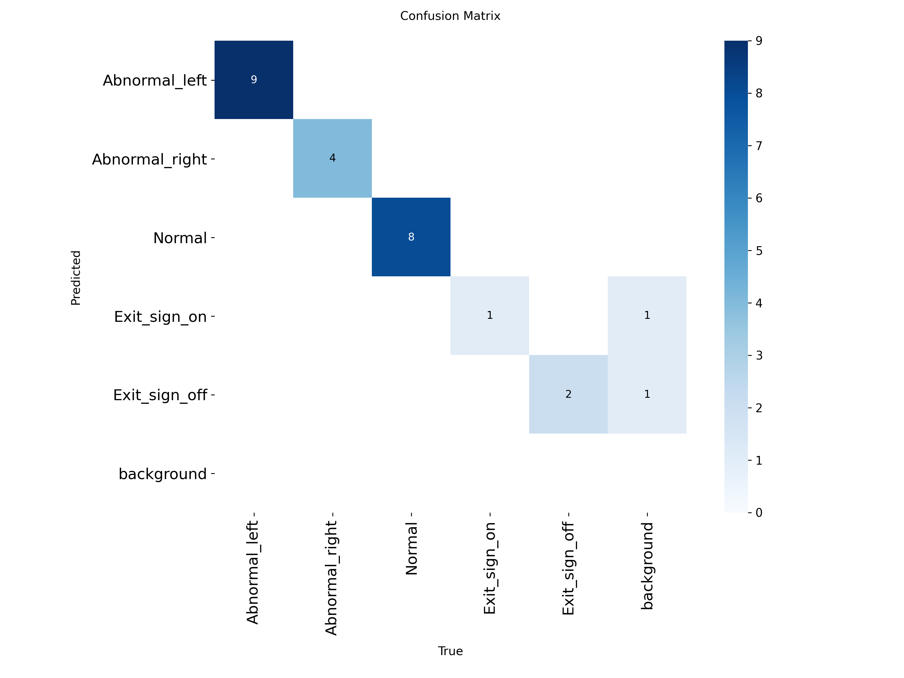

## 오늘 한 일
- 소화기 압력계 바늘이 정상 범위에서 왼쪽 또는 오른쪽으로 벗어난 상태를 각각 `Abnormal_left`, `Abnormal_right`로 구분하고, 정상 상태인 `Normal`과 함께 YOLOv8n 모델 학습 완료
- 학습된 모델로 소화기 압력계의 정상 및 좌·우 비정상 상태가 구분되어 인식되는지 확인
- 실제 소화기의 압력계 바늘 위치를 임의로 바꾸기 어려워 정상·비정상 압력계 이미지를 제작하고, 인쇄한 뒤 소화기에 직접 부착하여 촬영 데이터 수집
- 비상구 표지판의 점등 상태를 구분하기 위해 `Exit_sign_on`, `Exit_sign_off` 클래스를 추가하고 YOLOv8n 모델에 추가 학습
- 시간상 점등 및 소등 원본 사진을 각각 1장씩 준비한 뒤, 회전·전단·색조·채도·밝기·노출·블러 증강을 적용하여 총 30장의 데이터 생성
- 비상구 증강 데이터는 train:test:valid = 7:2:1 비율로 분배하고 이미지별 YOLO 라벨을 함께 생성
- `/home/mu-09/Downloads/fire-extinguisher.v1i.yolov8/train_yolo_models.py`를 사용하여 학습 및 검증 진행
- `/home/mu-09/Downloads/fire-extinguisher.v1i.yolov8/augment_exit_signs.py`를 사용하여 비상구 이미지 증강 및 라벨 생성

## 시행착오
- 실제 소화기의 압력계 바늘을 좌·우 비정상 위치로 직접 변경할 수 없어, 상태별 이미지를 인쇄해 부착하는 방식으로 대체
- 비상구 표지판도 실제 환경에서 충분한 수량을 촬영할 시간이 부족해 점등·소등 사진 각 1장을 증강하여 학습 데이터로 사용
- 원본 이미지 수와 촬영 환경의 다양성이 부족해 저적합 또는 일반화 성능 부족이 있는 것으로 판단
- 제한된 일정상 당시 모델로 진단 테스트를 진행했으나, 비상구 원본 각 1장으로는 운용 성능을 확정할 수 없어 PM 확인 필요

## 강조하고 싶은 것 / 달성
- YOLOv8n으로 소화기 압력계의 정상, 왼쪽 비정상, 오른쪽 비정상 상태를 구분하는 모델 학습 및 검출 확인
- 비상구 표지판의 점등·소등 클래스를 추가하고 증강 데이터 생성부터 라벨링, 학습, 검출 확인까지 완료
- 최종 모델 확인 결과 소화기 압력계는 비교적 잘 인식했으나, 비상구 점등 상태 인식은 데이터 부족으로 성능이 다소 아쉬웠음

## 10/12 반려 후 재검증·수정 기록

- 10/11 `best.pt`의 클래스는 `Abnormal_left`, `Abnormal_right`, `Normal`, `Exit_sign_on`, `Exit_sign_off` 5개임을 모델 메타데이터로 확인. 10/10의 good/pre_good 모델과 다름.
- 기존 코드의 `Guage.v2i`는 예전 기본 경로였으며, 10/11 학습 자료는 `fire-extinguisher.v1i.yolov8`임. 개인 홈 기본값과 자동 모델 탐색을 제거하고 `weights`를 필수 인자로 변경.
- 오래된 학습 캐시에는 점등 21장·소등 0장, 실제 라벨에는 점등 11장·소등 10장이 있었음. 검증 캐시도 점등 3장·소등 0장으로 남아 있어 기존 평가 수치를 신뢰할 수 없는 상태였음.
- 캐시를 새로 만든 기존 모델 평가: 전체 precision 0.6667, recall 0.8000, mAP50 0.6965. 소등 검증 이미지 2장을 모두 점등으로 오분류.
- 캐시를 백업하고 YOLOv8n을 새로 학습한 1차 모델은 검증셋 점수가 높았으나 실영상 검출이 약해 최종본에서 제외. 기존 모델의 특징을 보존하도록 기존 가중치에서 추가 학습(44 epoch 조기 종료, 최적 24 epoch, 초기 10층 고정). 좌우·상하 반전은 끔.
- 최종 `best.pt` 검증: 전체 precision 0.9353, recall 1.0000, mAP50 0.9950, mAP50–95 0.9568. `conf=0.25`, `iou=0.45`, `imgsz=640`, 검증 24장. 전체 precision 95% 기준 미통과.
- 최종 모델 SHA-256: `aff903afa7dbd8fea7ef36180141f9b0c6fd7c01513d4c1b8469d27d8956d35f`.
- `vision_pkg`를 제거하고 코드·모델을 `scv_detection/detection_alert`로 이관. `weights`를 필수로 받고 로봇 이름공간은 launch의 `robot_ns`/PushRosNamespace를 따름. `show` 기본값은 false. 정상·점등은 초록, 이상·소등은 빨강.
- 액션 요청 중에만 구독하는 IF-05·14 운영 기능은 다음 Step이며 현재 실행기는 상시 구독 진단용임.

### 데이터셋 집계 (증강 포함, 이미지 장수)

| 클래스 | train | valid | test | 총계 |
| --- | ---: | ---: | ---: | ---: |
| Abnormal_left | 60 | 9 | 3 | 72 |
| Abnormal_right | 69 | 4 | 4 | 77 |
| Normal | 87 | 8 | 3 | 98 |
| Exit_sign_on | 11 | 1 | 3 | 15 |
| Exit_sign_off | 10 | 2 | 3 | 15 |
| 합계 | 237 | 24 | 16 | 277 |

압력계 3클래스 총 247장. 비상구 원본은 점등·소등 각 1장, 증강 포함 각
15장으로 합계 30장이다. 거리·각도·조명·가림 조건별 장수와 압력계
원본/증강 구분은 확인 가능한 메타데이터가 없어 미확인으로 남긴다.
클래스별 수백 장 확보 기준은 미충족이고, 같은 원본의 증강본을 나눴으므로
이 검증 결과로 새로운 실환경에서의 정확도를 보장할 수 없다.

### 검증 precision 및 혼동행렬

최종 모델의 압력계 3클래스 precision은 각각 1.0000, 점등은 0.7332,
소등은 0.9435이며 recall은 모두 1.0000이다. 행=예측, 열=정답.
클래스 순서: 좌 비정상·우 비정상·정상·점등·소등·배경.

| 예측 / 정답 | 좌 비정상 | 우 비정상 | 정상 | 점등 | 소등 | 배경 |
| --- | ---: | ---: | ---: | ---: | ---: | ---: |
| 좌 비정상 | 9 | 0 | 0 | 0 | 0 | 0 |
| 우 비정상 | 0 | 4 | 0 | 0 | 0 | 0 |
| 정상 | 0 | 0 | 8 | 0 | 0 | 0 |
| 점등 | 0 | 0 | 0 | 1 | 0 | 1 |
| 소등 | 0 | 0 | 0 | 0 | 2 | 1 |
| 배경 | 0 | 0 | 0 | 0 | 0 | 0 |

근거: [기존 모델 재평가 JSON](../../detection_review/2026-10-12-before.json),
[새 모델 평가 JSON](../../detection_review/2026-10-12-after.json).
TEST_PLAN의 소화기 유무·위치 및 셔터 띠 위 물체는 현재 모델의 클래스에
없으므로, Detection 학습 모델 항목 전체를 통과로 표시하지 않는다.

### 로봇 PC 실영상 및 화면 없는 실행 확인

- 10/11 기존 모델을 MSI에서 OAK-D RGB 640×480 compressed 실영상 12프레임으로 평가. `Normal` 신뢰도 0.8639–0.9504(평균 0.9286), `Abnormal_left` 0.9370–0.9648(평균 0.9498).
- 10/10의 0.27–0.34보다 높았으나 촬영 장면과 모델이 달라, 같은 조건의 개선율이나 판정 정확도로 해석하지 않음. 실영상 정답 라벨은 따로 작성하지 않았음.
- 최종 추가학습본은 재시험 시 카메라 프레임이 오지 않아 실영상 신뢰도 미확인. 앞선 시도에서도 2프레임에서 검출이 없어 충분한 비교 자료가 아님.
- 로컬·MSI에서 설정값, 정상/이상 색상, 깨진 JPEG 처리, 추론 오류 후 복구, GUI 비활성화와 GUI 실패 대응을 시험. 각 14개 시험 통과.
- MSI에서 `show:=false`, DISPLAY 없는 환경으로 실제 `ros2 run scv_detection detection_alert`를 실행하고 가짜 카메라의 640×480 JPEG 입력에 대한 결과 이미지 수신 확인. 이는 기동 시험이며 실환경 정확도 시험은 아님.
- 액션 서버 연동 때 추론을 worker/콜백 그룹·MultiThreadedExecutor로 분리하고 요청·취소 응답 지연을 측정할 것.
- 파일명 `detection_alert.py`, 클래스명 `DetectionAlert`. 각 함수는 쉬운 한국어 주석으로 설명.

근거: [실영상 12프레임 비교](../../detection_review/2026-10-12-live-initial.json),
[최종 모델 실영상 미수신 기록](../../detection_review/2026-10-12-live-final.json),
[반려 항목별 확인표](../../detection_review/2026-10-12.md).

## 10/12 두 번째 피드백 보완 및 robot3 연결 확인

- 상대 토픽과 launch 이름공간 적용, 압력계 비정면·불확실 시 회색
  `UNCONFIRMED` 보류, `InspectionResult` 정상·이상 상수 매핑 추가.
- 로컬·MSI 자동시험 각 26개 통과. 화면 없는 launch 및 합성 JPEG 입출력 확인.
- MSI 도메인 4, 디스커버리 서버 `192.168.108.42:11811`에서 robot3 언도킹 후
  실제 원본 323장·검출 출력 113장 수신(약 25초), 해상도는 **1280×720**.
- 마지막 장면에 시험할 압력계/유도등 소품이 보이지 않아 검출 0건.
  카메라 연결만 검증했으며 정면/비정면 ≥90%·유도등 ≥95% 통과로 표시하지 않음.
- 로컬·MSI에 같은 코드·모델 적용. 시험 실행기는 종료함.
- 상세 기록: [두 번째 반려 확인표](../../detection_review/2026-10-12-second.md).

## 다음 작업
- 화물이 적재될 랙 영역을 OpenCV로 처리하고, 랙 밖으로 튀어나온 화물을 감지하는 기능 구현

## 막힌 것 (PM 도움 필요)
- 비상구 실촬영 원본 확보 또는 현재 모델의 진단용 사용 범위 결정 필요.
- 거리·각도·조명·가림별 수집 기록, 소화기 유무·위치/셔터 띠 위 물체 데이터와 소품 준비 여부 확인 필요.
- ChungBazi04의 10/11 일지가 빈 양식이고 스크린샷이 중복인 이유와 담당자 확인 필요. 해당 파일을 임의로 삭제하거나 대신 작성하지 않음.
