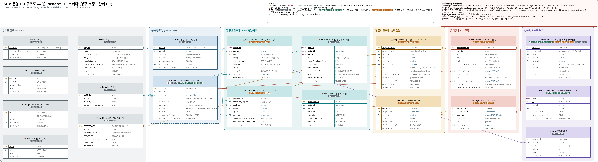
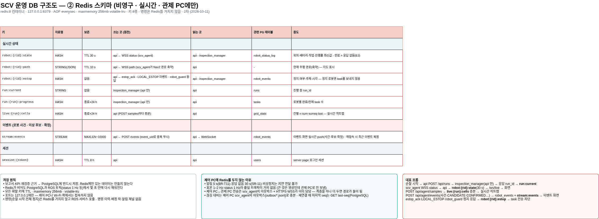

## 오늘 한 일
1. DB 스키마 2차 구현

## 시행착오
1-1. 통신 방식 구체화에 따른 사용 DB 구체화
     [A:모든 ROS 통신] 제어 PC와 관제 PC 간 ROS 통신, 이에 따른 인터페이스 방안 마련

     [C:WEB api 통신] PC 간에는 WEB UI 를 통한 통신, web api 통신 프로토콜 사용
 
     [결론] C 방식으로 우회 구현을 위해 DB 수정

## 강조하고 싶은 것 / 달성
<!-- 이 줄은 노션에 안 나가요. 그림:   이름에 빈칸이 있으면 
     영상: video: video/YYYY-MM-DD_이름.mp4 설명   YouTube: video: https://youtu.be/… 설명 -->

## 내일 할 일
1. 테스트 데이터 구현
2. WEB 기반 UI 구현
3. 가상 시스템 구현

## 막힌 것 (PM 도움 필요)
- 없음
