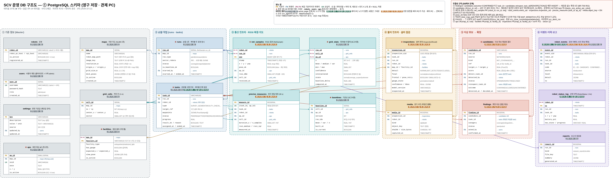
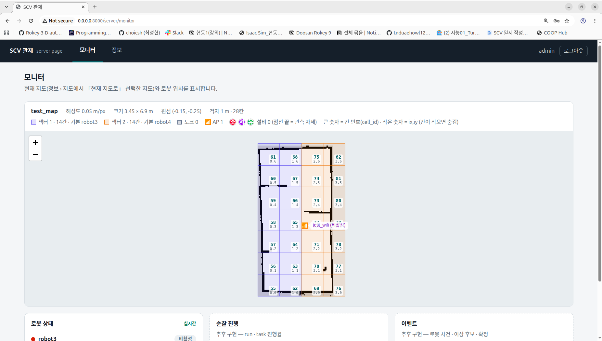
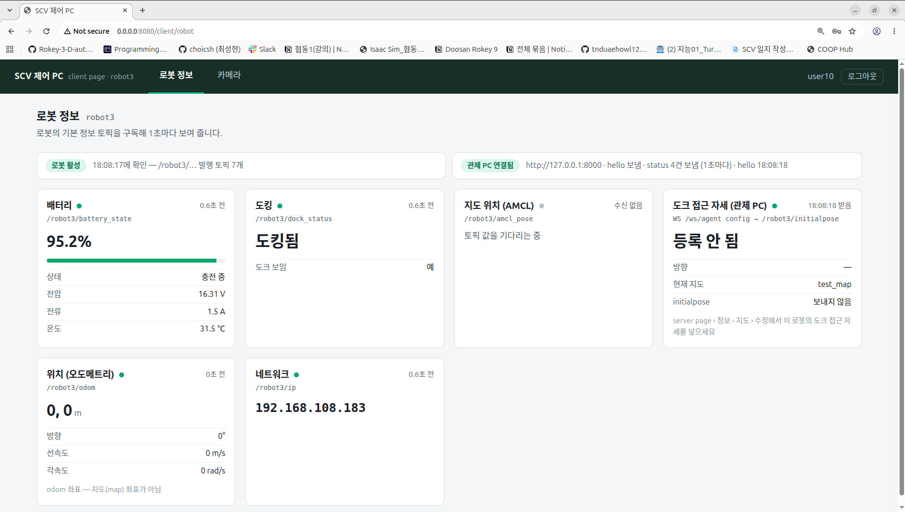

## 오늘 한 일
1. DB 스키마 3차 구현
2. 3차 DB 기반 테스트 데이터 구현
3. 3차 DB 기반 가상 시스템 구현 : 로봇 정보

## 시행착오
1-1. 통신 방식 변화에 따른 사용 DB 추가 수정

     [기존:Redis 사용] 제어 PC와 관제 PC 간 ROS 통신 시, 모든 통신 값을 직접 받아 처리하지 않기 위함.

     [수정:Redsi 미사용] 제어 PC와 과제 PC 간 WEB 통신 시, 제어 PC를 통해 1차 적으로 처리된 데이터.
 
     [결론] redis 를 관제 PC 앞 단에 둘 이유가 사라졌으므로, DB 수정

## 강조하고 싶은 것 / 달성
<!-- 이 줄은 노션에 안 나가요. 그림:   이름에 빈칸이 있으면 
     영상: video: video/YYYY-MM-DD_이름.mp4 설명   YouTube: video: https://youtu.be/… 설명 -->

## 내일 할 일
1. 3차 DB 기반 가상 시스템 구현 : 작업 제어

## 막힌 것 (PM 도움 필요)
- 없음
