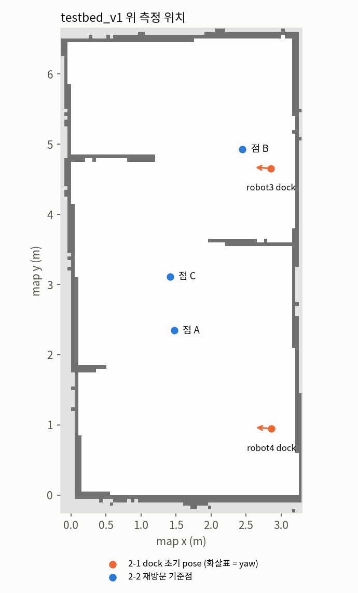
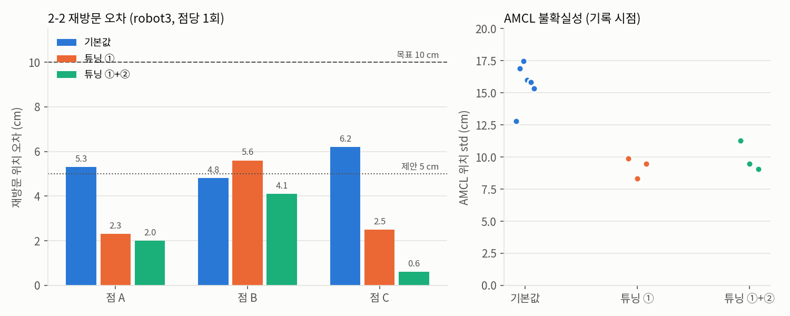
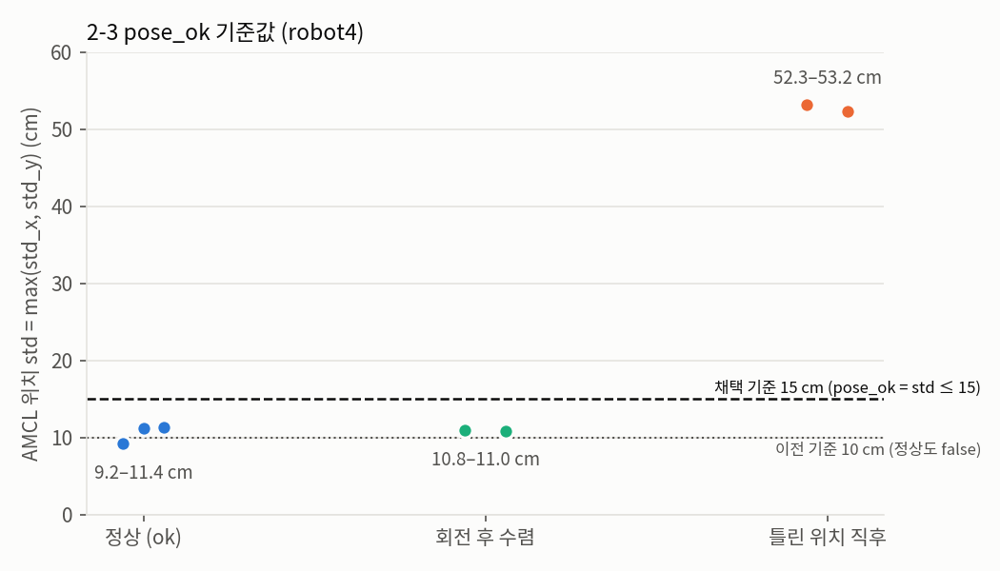

## 오늘 한 일
- 10/10 저녁 ~ 10/11 클라우드에서 코드 작성 (로봇 없이 문법·YAML 검사와 가짜 데이터 계산만 확인)
- `dock_init.py` 를 `mission_executor.py` 에 통합: 도킹 상태면 undock → 언도킹 직후 pose(`-p x y yaw`)로 setInitialPose → Nav2 활성화 대기. 이미 도킹이 풀린 상태면 초기 pose 는 건드리지 않음
- 측정 도구 작성
  - `pose_check.py`: amcl_pose 의 x, y, yaw, 위치 표준편차를 1초마다 출력, 기준점 이름 + Enter 로 CSV 기록 (2-1 ~ 2-3)
  - `track_check.py`: 첫 전역 경로 기준 cross-track 이탈 평균·최대(cm) 계산 (3-2·3-3)
  - `course_run.py`: 고정 웨이포인트 코스 반복 주행 (코스 좌표는 3-1 통로 실측 후 채움)
  - `fake_manager.py`: execute_task 액션 클라이언트 (`cancel_after`, `type:=facility|reinspection|dock`)
  - `fake_servers.py`: 가짜 inspect_facility·survey/precise, `-p mask:=true` 로 시험용 keepout 마스크 발행
- Nav2 설정 사본: `config/nav2.yaml`·`localization.yaml`(TurtleBot4 Jazzy 기본), `nav2_rpp.yaml`(FollowPath 만 RPP)
- 10/12 기능을 `mission_executor.py` 에 추가: FACILITY_CHECK·REINSPECTION(정밀 도착 후 파라미터 원복), 막힘 5초 BLOCKED·10초 건너뛰기, status 1 Hz, 배터리 30%/15% 규칙
- 도착 허용 오차를 0.10 m·0.17 rad 로 조이고, 전역·지역 costmap 에 `keepout_layer` 추가
- 2-1 Dock 초기 pose 결정 (robot3·robot4): undock 직후 위치를 RViz 로 맞춰 3회 기록(`pose_check.py`), 평균을 mission_executor 시작 위치로 사용. robot3 에서 mission_executor 로 undock → 초기 pose 설정까지 확인 (위치 정상)

| 로봇 | x (m) | y (m) | yaw (°) | 3회 차이 x / y / yaw |
| --- | --- | --- | --- | --- |
| robot3 | 2.855 | 4.656 | 176.74 | 2.1 cm / 1.8 cm / 0.35° |
| robot4 | 2.863 | 0.948 | 175.84 | 1.3 cm / 3.2 cm / 0.87° |

  - 기준(제안) 3 cm·2°. robot4 y 는 0.2 cm 넘었지만 RViz 클릭 오차 수준이고 실제 위치도 거의 맞아 평균 사용
  - std 40 cm·14° 대는 2D Pose Estimate 기본 공분산이 남은 값(정지 상태라 AMCL 미수렴) → 반복 일치도로 판단
  - 데이터: `docs/driving/data/2026-10-11_pose_check.csv`
- 2-2 AMCL 재방문 오차 (robot3, 점 A·B·C 각 1회 재방문). 지도가 벽과 약 1.5° 기울어 절대 좌표 대신 반복성으로 측정: 점 표시 → 다른 곳 갔다가 재방문 → 표시와 실제 어긋남(dx, dy, map 기준)을 줄자로 재고 AMCL 이동량과 비교. 기록 전 ±15° 제자리 회전으로 AMCL 갱신
  - 튜닝 ① 채택: `localization.yaml` `update_min_d` 0.25 → 0.10, `update_min_a` 0.2 → 0.1 (0.2 m/s 저속이라 갱신이 드물어 std 가 수렴 안 함)
  - 튜닝 ② 채택: `localization.yaml` `max_beams` 60 → 120 (scan 한 장에서 쓰는 빔 수를 늘려 벽 정합 단서 증가)

| | 오차 A / B / C (cm) | 평균 | std xy · yaw |
| --- | --- | --- | --- |
| 기본값 | 5.3 / 4.8 / 6.2 | 5.4 cm | 12–17 cm · 9–13° |
| 튜닝 ① | 2.3 / 5.6 / 2.5 | 3.5 cm | 8–10 cm · 6–7° |
| 튜닝 ①+② | 2.0 / 4.1 / 0.6 | 2.2 cm | 7–11 cm · 6–8° |

  - 목표(회차 간 ≤ 10 cm) 모두 통과, 튜닝 ①+② 에서 제안 기준 5 cm 도 3점 모두 통과
  - 한계: 시간 부족으로 점당 재방문 1회. 줄자·표시 오차 ±1 cm 수준이라 ①·② 차이(약 1 cm)는 측정 잡음 범위 → 추가 측정 시 점당 3회 권장
  - yaw: t2 에서 A·B 가 기준 대비 8–11° 차이. dyaw(실제 로봇 방향 어긋남)를 안 재서 AMCL 오차인지 정렬 차이인지 판단 보류 → 다음 측정부터 dyaw 기록
  - std 는 ① 이후 7–11 cm 로 pose_ok 기준(10 cm) 근처 → 2-3 에서 기준값 정할 때 반영
  - 데이터: `docs/driving/data/2026-10-11_robot3_amcl.csv`(기본값), `2026-10-11_robot3_amcl_t1.csv`(튜닝 ①, t1_B 는 A_3 기준으로 잰 값을 A_2 기준으로 환산), `2026-10-11_robot3_amcl_t2.csv`(튜닝 ①+②)
- 2-3 pose_ok 기준값 0.15 m 로 결정 (robot4). pose_ok = max(std_x, std_y) ≤ `pose_std_max`, mission_executor 가 `{ns}/status` 로 1 Hz 발행 → RSSI 가 false 샘플 제외
  - 측정: 정상 위치 3곳(ok) + RViz 2D Pose Estimate 로 일부러 틀린 위치(94 cm 어긋남, yaw 45° 틀어짐) 2회 → ±15° 회전 후 수렴(conv) 기록

| 상태 | 위치 std | yaw std |
| --- | --- | --- |
| 정상 (ok 3곳 + 수렴 후 2회) | 9.2–11.4 cm | 6.0–7.7° |
| 틀린 위치 직후 (t0) | 52–53 cm | 15–16° |

  - 기존 기본값 0.10 이면 정상 5개 중 4개가 false → `mission_executor.py` 기본값 0.10 → 0.15 (정상 최대보다 3.6 cm 여유, 틀림과는 크게 떨어짐)
  - 94 cm 틀린 위치에서도 회전만으로 원래 자리(0.8 cm 차이)로 수렴
  - 확인: `pose_std_max` 0.15 로 전환 확인 — 틀린 위치(chk_bad, std 51.8 cm) → `pose_ok: false`, 회전 후 복구(chk_back, 10.7 cm) → `true`
  - 한계: std 는 AMCL 의 확신 정도라 "틀렸는데 확신하는" 경우는 못 잡음. 2D Pose Estimate 직후엔 수렴 전까지 false 가 정상
  - 데이터: `docs/driving/data/2026-10-11_robot4_pose_ok.csv`, 전환 확인 `2026-10-11_robot4_pose_ok_chk.csv`
- 지도 `testbed_v1.pgm` 수정: robot4 dock 자리(x 2.88–2.98, y 0.93–1.08)에 SLAM 때 벽으로 찍힌 9칸을 빈칸으로 수정 (오늘 측정은 모두 이 지도로 진행)
- Nav2 설정 변경 (`nav2.yaml`·`nav2_rpp.yaml`)
  - progress_checker `required_movement_radius` 0.5 → 0.15: 0.2 m/s 저속·짧은 이동에서 "10초에 0.5 m" 를 못 맞춰 "Failed to make progress" → 도착 못 하고 재계획만 반복
  - MPPI `vx_min` -0.35 → 0.0 (후진 금지, `nav2.yaml` 만. RPP 는 원래 `allow_reversing: false`): Create3 는 후방 낭떠러지 센서가 없어 후진을 막음 → MPPI 가 후진을 고르면 명령은 나가도 로봇이 안 움직임(odom 속도 0) → 10초 실패 반복, 한 goal 에 2분 넘게 대기
  - 남은 것: BT 회복 동작 `backup`(후진)도 같은 이유로 실패함("backup failed: Exceeded time allowance"). 4-2 막힘 규칙 정할 때 같이 볼 것
  - 후진 금지 적용 후 확인(robot4, goal 5개): 후진하며 서 있는 현상은 없어짐, 3개는 10–17초에 도착. 2개는 x 1.9–2.0, y 2.1–2.8 구간에서 목표 약 20 cm 앞에서 "Failed to make progress" 3–4회 반복 후 다음 goal 로 덮어씀 → 원인 미확정 (내일 할 일)

## 시행착오
- 클라우드에서 ponytail 플러그인 설치가 권한 검사에서 막힘 → 저장소의 SKILL.md 규칙을 읽어 적용, hv-04 에는 설치
- 클라우드에는 ROS 가 없어 실제 토픽·액션 동작은 확인 못 함 → 로봇에서 처음 확인할 항목으로 남김
- loc 을 켠 채 dock → undock 하면 RViz 에 `rplidar_link → map` extrapolation 에러가 계속 남(분당 ~450회). Nav2 노드 로그에는 에러 없음 → RViz 를 껐다 켜면 해결. 이후 테스트는 dock/undock 뒤 RViz 재시작
- nav2 를 초기 pose 없이 먼저 띄우면 map TF 를 60초 기다리다 bringup 실패 → 순서는 loc → 초기 pose → nav2
- `mission_executor.py` 실행 시 `ModuleNotFoundError: scv_msgs` → `ros2_ws/install/setup.bash` source 누락
- localization 실행 시 `Failed to load map yaml file: MAP` → `map:=` 에 경로 대신 글자 MAP 이 들어감. 변수(`MAP=…/testbed_v1.yaml`) 정의 후 `map:=$MAP` 또는 절대경로 사용
- `ros2 topic pub --once /robot3/initialpose …` 로 초기 pose 가 안 들어감(amcl 로그에 "Setting pose" 없음): 발행 직후 종료돼 구독 연결 전에 메시지가 사라짐 → `-t 3 -r 1`(1초 간격 3회)로 해결
- `setInitialPose` 가 공분산 0 으로 보내 AMCL 공분산이 -1e-13 같은 음수 → `math.sqrt` 에서 ValueError 로 spin 스레드 종료. `mission_executor.py`·`pose_check.py` 에서 `max(..., 0.0)` 로 수정
- RViz Nav2 Goal 이 계속 실패: planner "Costmap timed out waiting for update". 원인은 costmap 에 넣은 `keepout_layer` 가 `keepout_mask` 를 기다리는데 발행자가 없음 → `nav2.yaml`·`nav2_rpp.yaml` 4곳 `enabled: false` 로 끔. **⚠ 4-1 에서 반드시 다시 켤 것** (PLAN 4단계에 경고 남김)
- 가까운 goal 에서 "Passing new path to controller" 만 반복되고 도착 안 함: controller "Failed to make progress" 반복. progress_checker 기본값(10초에 0.5 m)이 0.2 m/s 저속·짧은 이동에서 못 맞춤 → `required_movement_radius` 0.5 → 0.15 (`nav2.yaml`·`nav2_rpp.yaml`). 4-2 막힘 규칙(5초/10초) 정할 때 이 값도 같이 볼 것
- 로봇 뒤쪽 goal 에서 오래 서 있다가 출발: MPPI 가 후진(-0.09 m/s)을 고르는데 Create3 가 후진을 막아 odom 속도 0 → "Failed to make progress" 10회(약 2분) 뒤에야 전진 경로로 출발 → MPPI `vx_min` 0.0 으로 후진 금지

## 강조하고 싶은 것 / 달성
<!-- 이 줄은 노션에 안 나가요. 그림:   이름에 빈칸이 있으면 
     영상: video: video/YYYY-MM-DD_이름.mp4 설명   YouTube: video: https://youtu.be/… 설명 -->
- 주행 2단계(위치 추정) 2-1 ~ 2-3 실기 완료: dock 기준 초기 pose 자동 설정, AMCL 재방문 오차 평균 5.4 → 2.2 cm, pose_ok 기준 0.15 m

- 측정 속도 0.2 m/s 확정: MPPI `vx_max` 0.5 → 0.2, velocity_smoother `max_velocity` 0.26 → 0.2 로 맞춤. 컨트롤러가 0.5 로 계획하는데 smoother 가 0.26 으로 자르면 추종 오차가 커져, 두 컨트롤러를 같은 조건에서 비교하기 위함
- 3-2 비교 대상을 MPPI·RPP 로 확정 (이유는 `docs/driving/PLAN.md` 「3-2 비교 대상 선정」)
  - MPPI: TurtleBot4 Jazzy 기본값이라 기준선
  - RPP: 경로 추종 전용, 파라미터가 적어 통로 추종 목표에 맞음
  - DWB 제외(이전 세대 기본값, critic 튜닝 많음), Graceful 제외(정밀 도착용, 3-4 에서 따로 검토)
  - 컨트롤러 하나당 같은 코스 5회라 하나 늘면 시험 시간이 약 1.5배
- 정밀 도착은 BT 파일을 새로 만들지 않고 파라미터 방식: 정밀 지점 직전에 goal checker 의 `xy_goal_tolerance`·`yaw_goal_tolerance` 를 0.05 m·0.087 rad 로 줄였다가 도착 후 원복
- keepout 은 KeepoutFilter 대신 StaticLayer: costmap 에 `keepout_mask` 를 받는 StaticLayer 한 층을 inflation 앞에 추가(`use_maximum: true`). 노드가 늘지 않음. 마스크는 지도와 원점·해상도·크기가 같아야 하고 모르는 칸은 0 → RSSI 팀 확인 필요

## 내일 할 일
- **목표 근처 "Failed to make progress" 반복 원인 확인** (x 1.9–2.0, y 2.1–2.8 구간). 후보 두 가지
  - (가설 1, hhj) 바닥 골판지 언덕·마찰 차이로 회전 중 바퀴가 미끄러져 위치가 틀어지고 계속 다시 맞추려 함
  - (가설 2) `go` 의 도착 방향이 항상 yaw 0° 라 목표 근처에서 큰 제자리 회전이 필요한데, 진척 검사(SimpleProgressChecker)는 회전을 진척으로 안 침
  - 확인: 골판지 위·평평한 바닥에서 각각 제자리 회전(`spin 1.57` → `spin -1.57`) 전후를 pose_check 로 기록(cb_0/cb_1, flat_0/flat_1), 가능하면 odom·amcl_pose·cmd_vel rosbag 같이 기록 → 골판지 위에서만 x, y 가 몇 cm 틀어지면 가설 1
  - 대응: 가설 1 이면 골판지 고정·제거 또는 측정·정밀 지점에서 그 구간 피하기 / 가설 2 면 progress checker 를 `nav2_controller::PoseProgressChecker`(15 cm 또는 0.5 rad) 로 교체 — 회전만 하며 갇힌 경우 감지가 늦어지는 부작용은 mission_executor E1(5초·10초/5 cm) 이 잡음
- 시간 되면 2-2 점당 재방문 추가 측정(dyaw 포함)
- `mission_executor.py` 수정 제안: undock 상태로 시작하면 AMCL 위치가 없을 때 nav2_simple_commander 가 (0,0) 초기 pose 를 보냄 → undock 상태에서도 `-p x y yaw` 사용
- 3-2 MPPI·RPP 같은 코스 5회씩 비교 (track_check)
- 정밀 지점에서 goal checker 값이 0.05 로 바뀌는지 확인
- (4-1) keepout_layer 다시 켜고(`enabled: true`) 마스크가 RViz costmap 에 보이는지 확인

## 막힌 것 (PM 도움 필요)
- 없음
