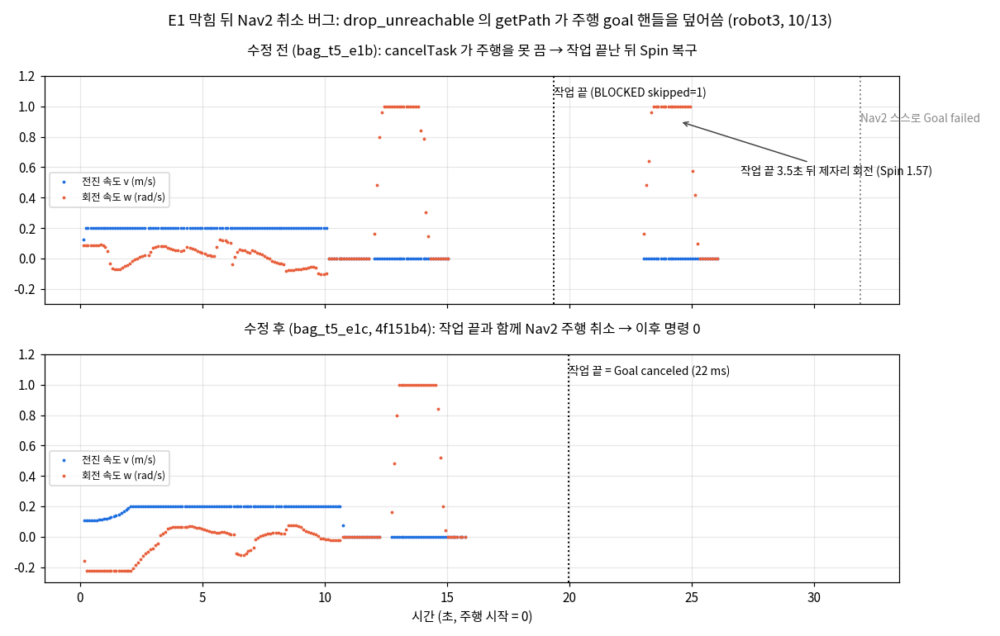
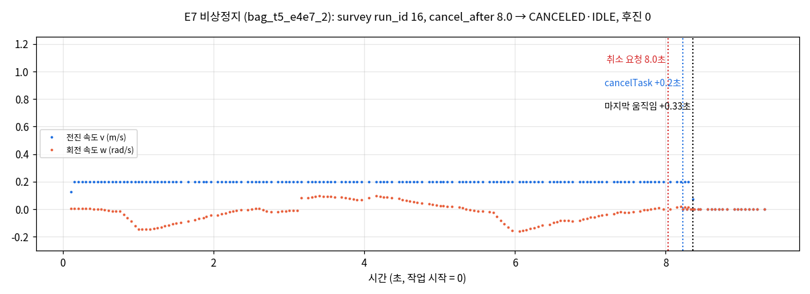

## 오늘 한 일
### 관제 (T6)
- `temp/bundle-test-1012`(faa34c4)와 `feature/driving`(630f07a)을 `feature/control` 에 병합 (충돌 없음, 200f4f3 · e1b27ee)
  - 임시 브랜치에서 온 것: 빈 마스크 발행, 벽 여유 경로, 칸 맵 확정, 재측정, 회피 마스크, 설비 점검, 회차 종료, `control_pc` · `robot_pc` launch
  - 주행은 임시 브랜치에 든 것 대신 최신으로 (BLOCKED 뒤 Nav2 취소 · go_home 취소 뒤 dock 수정, REINSPECTION 결과 필드 포함)
- 병합본 빌드(scv_msgs · scv_bringup · scv_survey · scv_manager · scv_nav) 성공, 단위 시험 87개 통과
- 로봇 없이 mock 한 회차 완주 (관제 PC 한 대, 칸 맵은 파일): 칸 확정 Z1 30칸 · Z2 30칸 → 재측정 3칸(CLEARED 1 · REMAINS 2) → 회피 칸 2개 → SHT-02 점검, SHT-01 은 KEEPOUT_BLOCKED → RUN_COMPLETED
- mock 작업 서버가 재측정 결과를 실제 mission_executor 처럼 결과 필드(rssi_median · rssi_iqr · n_samples)에도 채우게 수정
- 관제 A 인수 계획(`docs/control/PLAN.md`)을 쓰고 `docs/CONTROL_MANAGER_STATUS.md` 를 병합 뒤 상태로 정리
- 밤: robot3 한 대로 병합본 실기 (이 PC 한 대에서 `control_pc` + `robot_pc` launch, 핫스팟 turtle09, d8f7c26)
  - 빈 회피 마스크: 관제를 먼저 켜고 Nav2 를 띄움 → `/robot3/keepout_mask` 발행 1(inspection_manager) · 구독 2(global · local costmap), `Managed nodes are active` 확인
  - `robot_pc.launch.py` 가 MPPI 비교용 `nav2.yaml` 로 뜨던 것을 운영 설정 `nav2_rpp.yaml` 기본으로 바꿈. 실행 중 Nav2 가 읽은 값 232개가 저장소 파일과 같은 것 확인
  - 측정 경로를 지도의 실제 벽에서 0.30 m(로봇 반경 0.19 + 간격 0.10) 띄움 → 진행률 0 % 에 멈추던 것이 5번 점(42 %)까지 감
  - inflation_radius 0.45 → 0.30, cost_scaling_factor 4.0 → 10.0: 플래너 계산으로 줄에서 벗어나는 거리 y 4.5 줄 0.30 → 0.15 m, y 4.0 줄 0.13 → 0.00 m, y 6.0 줄 0.21 → 0.06 m (주행 시험은 아직)
  - 한 회차 완주는 아직 못 함 (측정 12점 중 5번 점에서 멈춤)

### 주행 (T5)
- PM step3 리뷰 반영 (b839d82, 기준 `docs/interfaces.md` v0.2.10 「자세 보정 "뒤로"」·RobotStatus.msg)
  - BackUp 복구 제거: `navigate_through_poses_scv.xml` 에서 삭제, go_home·dock 이동이 쓰는 navigate_to_pose 도 기본 BT 복사본 `config/navigate_to_pose_scv.xml`(BackUp 만 뺌)을 `default_nav_to_pose_bt_xml` 로 사용, behavior_server 의 `backup` 플러그인 삭제 (`nav2.yaml`·`nav2_rpp.yaml`)
  - velocity_smoother `min_velocity` x −0.2 → 0.0 (두 파일)
  - `mission_executor.py`: `RobotStatus.run_id` 를 작업이 끝나도 마지막 값으로 유지, v0.2.10 반영 (`InspectFacility.Goal.run_id`, REINSPECTION 결과 `rssi_median`·`rssi_iqr`·`n_samples`)
  - `fake_manager.py` 에 `-p run_id:=`, 결과 로그에 rssi 3개 / `fake_servers.py` inspect 로그에 run_id
  - `PLAN.md` keepout 경고문을 현재 설정(enabled: true)에 맞게 고침
- `settle()` 좌우 spin 사이 1초 대기 (6a9e8ba): 바로 반대로 돌면 한쪽으로 치우침 (spin 은 목표 각도에서 끝났다고 하지만 로봇은 아직 도는 중)
- 시험 ① fake_servers (robot3): REINSPECTION 결과 `median=-55.0 iqr=2.0 n=30` (30초 측정), FACILITY 에서 fake_servers 가 `run_id=8` 받음, status run_id 7 → 8 로 바뀐 뒤 작업 끝나도 8 유지
- 시험 ② E1 후진 확인 (robot3, fake_manager waypoint 3개 + 2번 점 지난 뒤 마스크 `rect [-0.2, 3.2, 3.4, 3.6]` 로 3번 점 앞 지도 폭 전체 막음)
  - 3번 모두 cmd_vel x 음수 0개
  - 수정 전 bag_t5_e1b: 작업은 24초에 `BLOCKED skipped=1` 로 끝났는데 3.5초 뒤 제자리 회전(1.0 rad/s, 약 3초). Nav2 로그상 bt_navigator 가 취소되지 않고 Spin·Wait 복구를 계속 돌다 12초 뒤 스스로 `Goal failed`
  - 원인: `drop_unreachable()` 의 `nav.getPath()` 가 navigator 의 `goal_handle`·`result_future` 를 경로 계산 goal 로 덮어써 `cancelTask()` 가 이미 끝난 경로 계산을 취소함. 같은 이유로 5초 BLOCKED 확인 뒤 `isTaskComplete()` 가 경로 계산 결과를 보고 주행 중인데 성공으로 끝낼 수 있었음. 10/12 작업 종료 후 후진 10초도 이 남은 주행의 BackUp 복구로 추정
  - 수정 (4f151b4): `drop_unreachable()` 에서 두 값을 저장했다가 되돌림 → bag_t5_e1c: BLOCKED 22 ms 뒤 bt_navigator `Goal canceled`, 작업 끝난 뒤 cmd_vel 전부 0
  - 데이터: `docs/driving/data/2026-10-13_backup_check.csv`
- 시험 ④ E2 자동 dock·DOCK_BACKOFF (robot3, 코드 수정 없이 `-r battery_state:=battery_fake` 로 remap 하고 `ros2 topic pub` 으로 배터리 값을 넣음, bag_t5_dock)
  - 쉬는 중: 15 % 로 내리자 dock 앞 0.3 m 자리 (2.51, 4.61) 로 47초 이동 → `Docking...` 25초 뒤 `Dock succeeded`, status DOCKED
  - 작업 중 (survey run_id 14): 15 % 에서 주행 취소 → 같은 자리로 20초 → dock 22초 성공, 작업 결과 `LOW_BATTERY`
  - undock 정상, 녹화 322초 동안 cmd_vel 음수 x 0개 → min_velocity 0.0 이 dock·undock 에 영향 없음
- 시험 ⑤ E4·E7 (robot3, 주행 쪽만. 관제 웹 쪽은 통합 시험)
  - E4 관제 끊김 (bag_t5_e4e7): survey run_id 15 를 보낸 뒤 fake_manager 를 Ctrl+C (취소 없이 사라짐) → mission_executor 가 42초 주행해 `ok=True` 완주, status 1 Hz 계속, 후진 0
  - E7 비상정지 (bag_t5_e4e7_2): survey run_id 16 `cancel_after:=8.0` → 취소 요청 0.2초 뒤 `cancelTask`, bt_navigator `Goal canceled`, 마지막 움직임 명령은 요청 0.33초 뒤, 결과 `CANCELED`·IDLE, 후진 0
- PM step5 반려 4건 반영 (86ceff8): ① REINSPECTION 결과 rssi 3개·② InspectFacility.Goal.run_id 는 b839d82 에서 이미 반영·시험 ① 확인 / ③ KIND 표에 `'RCK': KIND_RACK` 추가 → fake_manager `-p type:=facility -p target:=RCK-01 -p run_id:=17` 로 fake_servers 로그 `inspect_facility RCK-01 kind=4 run_id=17` 확인 / ④ `wait_nav(gh)`: 자세 보정(spin·전진) 대기 중 작업 취소면 바로 `cancelTask()`·정지, spin 뒤 취소면 전진 보정 안 함 (fake 보정이 0.1 rad 로 순식간이라 실기 확인은 못 하고 코드 확인만)
- PM step5 재리뷰 반영 (31d7d50, 문법 검사만): `go_home(gh)` 로 DOCK 작업·LOW_BATTERY 복귀 주행 중 취소를 Nav2 에 전달(취소되면 dock 안 함, 쉬는 중 자동 dock 은 gh=None 그대로) / KIND 표에 없는 종류면 `kind 0 으로 보냄` warn / `fake_servers.py` 에 `-p adjust_yaw:= -p adjust_forward:=` (보정 중 취소 시험용, 기본값 그대로)
- `go_home` 취소 버그 수정 (b52cc7a, 문법 검사만, 문서 정리 스레드에서 발견): `cancelTask()` 는 navigator `status` 를 안 바꿔(`robot_navigator.py:454-460`) `wait_nav(gh)` 가 취소로 빠져나온 뒤 `getResult()` 가 직전 동작 결과(settle spin·getPath 의 SUCCEEDED)를 줌 → DOCK 복귀 중 취소해도 그 자리에서 `dock()` 호출. `wait_nav(gh)` 뒤에 취소면 `CANCELED` 로 돌아가게 함
- voxel `origin_z` −0.1 확인: 오늘 controller_server 로그(nav2_rpp, 약 1시간 반)에 "Sensor origin out of map bounds" 0회

## 시행착오
- [관제] `/inspection/start` 를 불러도 출발 안 함: `mission_executor` 가 Nav2 준비를 묻는 `bt_navigator/get_state` 응답이 유실돼(`failed to send response … timeout`) 기동 중 멈춤 → `/robot3/status` 가 안 나옴. mission_executor 만 다시 띄워 해결. 한 launch 로 묶어 띄울 때의 타이밍 문제로 보임 (미수정)
- [관제] 진행률 0 % 에서 안 올라가고 경로가 휘어짐: 관제의 측정 경로가 바깥 사각형 벽만 보고 안쪽 벽 조각을 몰라 Z2 0번 점이 벽에서 0.08 m, 6번 점이 0.18 m (로봇 반경 0.19 m 안) → 점의 0.35 m 안에 못 들어가 waypoint 가 안 지워짐. 설정 문제가 아니라 경로 점 문제. Z1 6번 점도 0.18 m 라 10/12 밤 robot4 의 「진행률 50 % 에서 끝남」과 같은 원인으로 추정
- [관제] 5번 점 (0.53, 4.5) 앞 0.41 m 에서 52초 동안 못 나아감: 벽 조각 아래 막다른 자리라 경로가 갔다가 같은 길로 되돌아옴 → RPP(lookahead 0.4)가 끝에 닿기 전에 돌아나오는 쪽을 따라감. inflation 은 막지 않았고(비용 159) 경로를 줄에서 0.3 m 밀어 끝을 더 뾰족하게 만듦 (미수정)
- [관제] 비상정지 뒤 `/inspection/start` 는 「이미 진행 중」으로 거절됨: 이어 하려면 `/inspection/resume`(그 작업을 처음부터), 새로 하려면 관제를 다시 띄움
- [관제] `ros2 topic list` 에 로봇이 안 보임: Wi-Fi 를 turtle08 로 바꾸기 전에 뜬 ros2 daemon 이 Discovery Server 에 못 붙은 채 남아 있었음 (`--no-daemon` 으로는 72개 보임) → `ros2 daemon stop`
- 막힘 마스크 rect `[0.0, 3.2, 2.0, 3.6]` 로는 안 막힘: 그 높이에서 지도가 x −0.15~3.3 m 전체 빈 공간이라 오른쪽으로 돌아감 → 지도 폭 전체 `[-0.2, 3.2, 3.4, 3.6]`
- `fake_servers -p clear_after:=1.0` 는 1초 뒤 빈 마스크를 내고 다시 안 냄. 마스크는 latched 라 fake_servers 를 꺼도 남음 → 지울 때는 `rect:="[0.0, 0.0, 0.0, 0.0]"` 로 빈 마스크 발행
- **약점 (미수정, hhj 결정으로 기록만)**: ④ 작업 중 첫 시도가 13초 만에 `BLOCKED skipped=3` 로 끝남. RViz 가 잠깐 끊긴 순간(11:52:29) map→odom TF 가 갱신되지 않아 controller 가 `Unable to transform robot pose` 로 실패 → mission_executor 가 Nav2 실패를 막힘처럼 처리해 0.35초 사이에 3개 점을 모두 건너뜀. 짧은 TF·Wi-Fi 끊김 한 번에 작업 전체가 사라짐. 수정안: Nav2 실패인데 길 없는 점이 없으면 건너뛰지 말고 잠시 뒤 같은 점들로 다시 보냄
- **약점 (미수정)**: 로봇이 구간의 마지막 점 근처에 서 있을 때 같은 survey 를 받으면 40 ms 만에 `ok=True` (Nav2 `Reached the goal!` 바로 찍힘). navigate_through_poses 가 마지막 목표 도착만 보고 끝내는 것으로 추정 → 중간 점을 안 지나고 "완료". E7 첫 시도 4번이 이것 때문에 취소할 틈 없이 끝남
- keepout 마스크 발행자(fake_servers)를 Nav2 와 같이 끄면 Nav2 를 다시 켰을 때 costmap 이 "no map received" → 모든 점 "길 없음"으로 `BLOCKED skipped=3`. inflation 문제 아님. 빈 마스크를 다시 켜면 해결
- 첫 E1 bag(bag_t5_e1)은 작업 끝나고 2초 만에 녹화를 꺼서 종료 후 구간 확인 못 함 → BLOCKED 뒤 20초 더 녹화

## 강조하고 싶은 것 / 달성
<!-- 이 줄은 노션에 안 나가요. 그림:   이름에 빈칸이 있으면 
     영상: video: video/YYYY-MM-DD_이름.mp4 설명   YouTube: video: https://youtu.be/… 설명 -->
- E1 막힘 뒤 Nav2 취소 버그 수정 전후: 수정 전에는 작업이 끝난 뒤에도 Nav2 가 Spin 복구를 돌았고(10/12 후진도 같은 원인 추정), 수정 뒤에는 작업 끝과 함께 22 ms 만에 취소

- E7 비상정지: 취소 요청 0.2초 뒤 cancelTask, 0.33초 뒤 마지막 움직임, CANCELED·IDLE

## 내일 할 일
- [관제] 5번 점: 측정 작업을 막다른 끝에서 두 구간으로 나누는 방법으로 고치고 robot3 로 측정 12점 → Dock 완주 확인
- [관제] inflation 0.30 · scaling 10 으로 주행했을 때 벽 · Dock 접근 거리 확인 (기존 주행 시험은 0.45 · 4.0 기준)
- [관제] 로봇 한 대로 빈 마스크를 Nav2 가 받는지 → 작업 1건 왕복 → 상태 끊김 · 비상정지 · 재개 (10:30 코드리뷰 전)
- [관제] 핫스팟을 켠 채 한 대 완주(칸 확정 · 재측정 · 마스크 · 설비), 그다음 두 대 동시
- ③ robot4 keepout 마스크 변경 재계획·빈 마스크 주행 1회
- 끝점에서 같은 구간을 받으면 바로 완료되는 약점 처리 여부 결정
- (필요할 때) 보정 중 취소 시험: 로봇을 마지막 점 (1.0, 4.2) 에 세우고 fake_servers `-p adjust_yaw:=3.0`, facility RCK-01 `cancel_after:=3.0` → 회전 중 정지·CANCELED / dock 복귀 중 취소 시험: `-p type:=dock -p cancel_after:=5.0` → 정지·dock 안 함
- Nav2 실패(TF 끊김)를 막힘으로 보고 점을 건너뛰는 약점 수정 여부 결정

## 막힌 것 (PM 도움 필요)
- 없음
