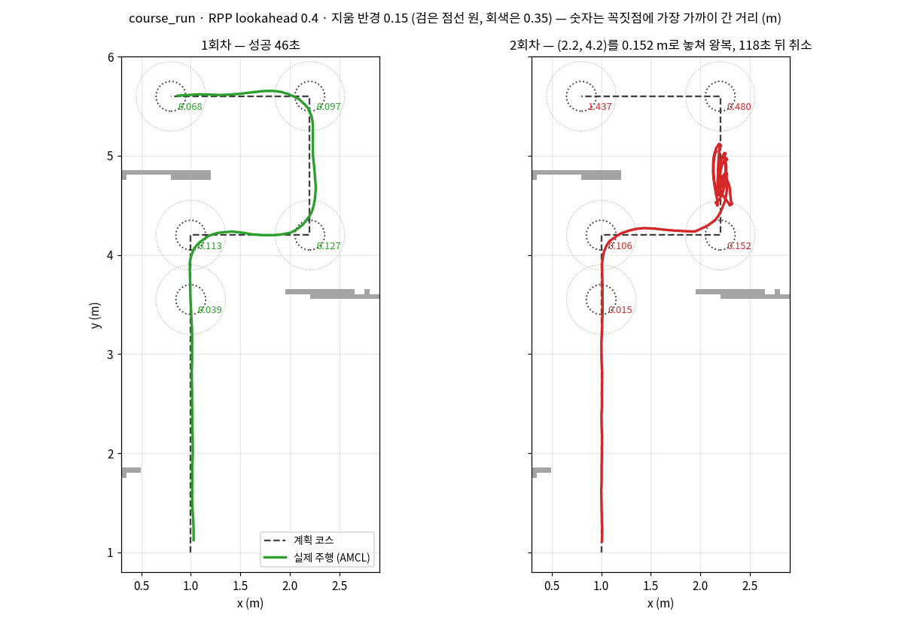
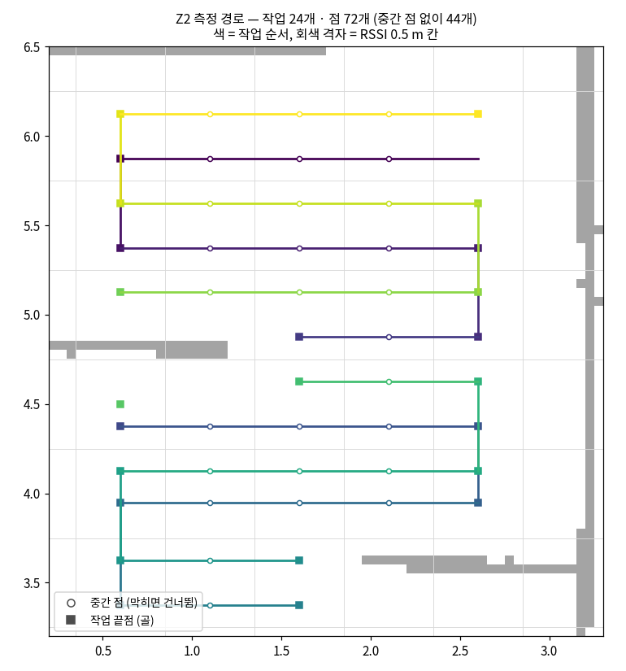
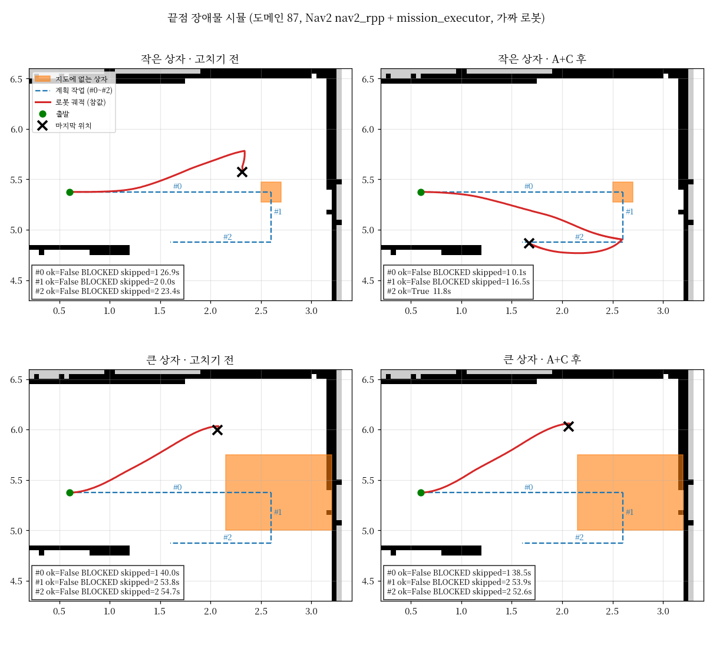
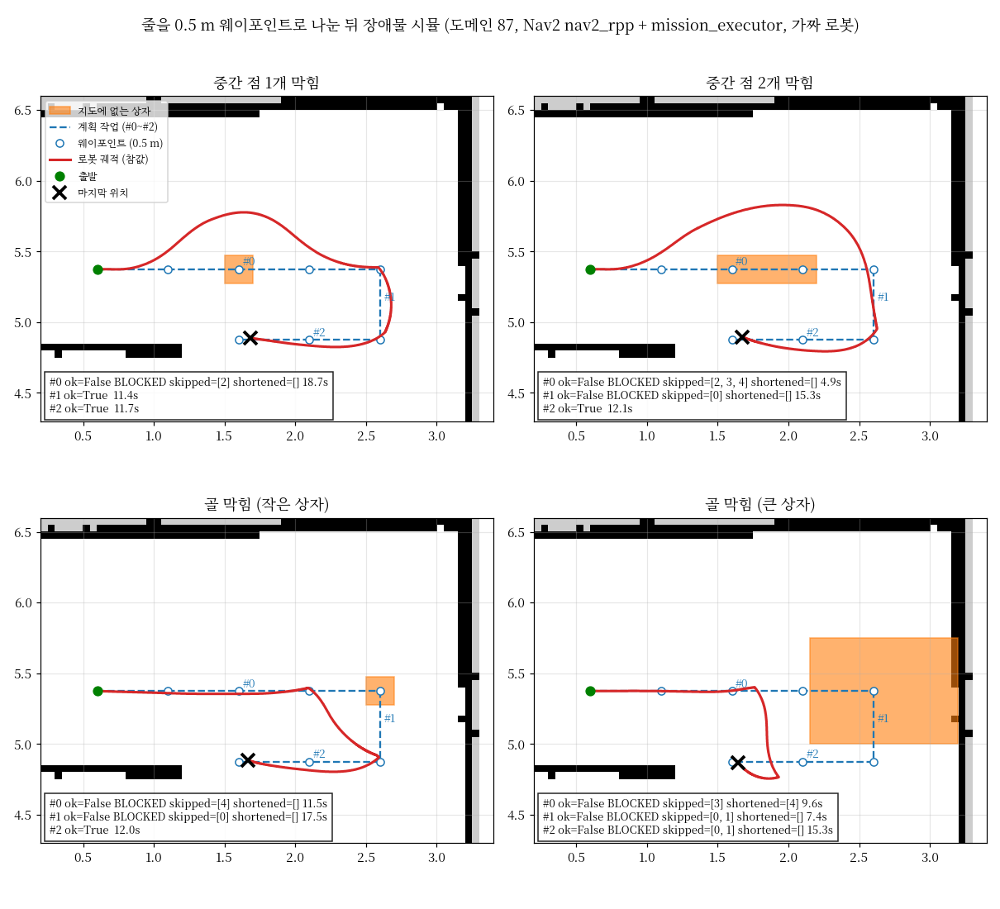
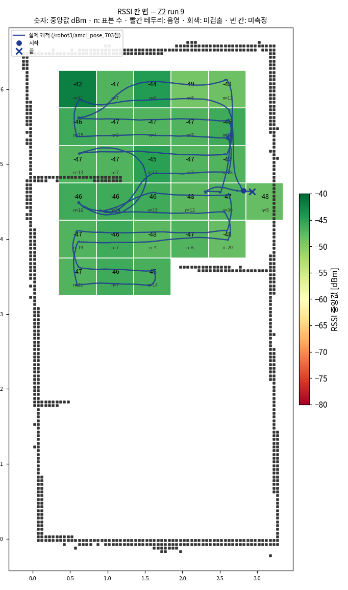
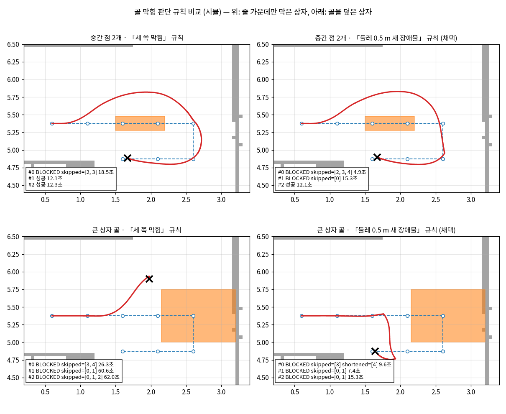

## 오늘 한 일
### 주행 (T5)
- `RemovePassedGoals radius` 를 오전에 0.35 → 0.15 로 바꿨다가 **0.35 로 되돌림** (`navigate_through_poses_scv.xml` 은 feature/driving 원본과 같음, `docs/driving/NAV2_PARAMS.md`)
  - `course_run` (90도 모서리 4개를 한 번에) 반경 0.15: 1회차 성공 46초(10/12 기준 44.2초), 2회차는 (2.2, 4.2) 를 0.152 m 로 놓친 뒤 y 4.5 ↔ 5.1 을 90초 왕복 → 취소
  - 원인: 반경(0.15)이 lookahead(0.4)보다 짧으면 한 번 놓친 점은 경로가 되접혀도 RPP 가 0.4 m 앞(되돌아 나가는 쪽)을 쫓아 0.3 m 까지만 다가가 영영 못 지움
  - 관제 B 회차는 모서리마다 작업이 끝나 작업마다 직선 하나라 지울 중간 점이 없었음 → B 의 개선은 반경이 아니라 줄마다 멈췄다 정렬한 덕
- `mission_executor.py`
  - 초기 pose 를 1초에 한 번만 보냄: `spin_once` 가 메시지가 오면 바로 돌아와 초기 pose 를 25만 번 보냈고, AMCL 이 계속 초기화돼 Nav2 기동이 멈췄음
  - 막힘 처리(E1): 장애물 칸이 된 점은 다가가기 전에 빼고 다음 점으로, 측정 골은 줄 위 장애물 앞으로 줄임, 취소가 끝난 뒤 다음 goal (관제 PLAN N-11)

### 관제 (T6)
- 측정 경로를 칸 기준으로 다시 짬 (0e6bb3e): RSSI 칸마다 방문 점 → 직선으로 갈 수 있는 이웃만 연결 → Dock 에서 이어진 칸만 → 가로로 이어진 칸을 줄로 묶음 → 직선이 벽에 걸리거나 되돌아가는 점에서 작업을 나눔
  - 10/13 밤 5번 점(벽 조각 아래 막다른 자리)에서 멈추던 것이 풀림. 지도가 바뀌어도(줄을 가로지르는 벽, 닫힌 방) 같은 규칙으로 경로가 나오는 것을 시험으로 고정
- robot3 한 대로 처음 완주 (run 3, 11:20): 측정 12점 → Dock → 칸 확정 Z2 28칸 → Dock → 종료, 4분 29초, 건너뛴 점 0
- 재측정 대상에서 미측정 칸을 뺌 (`include_unmeasured` 기본 false): 문서의 재측정은 음영 · 미검출 후보의 30초 정밀 측정. run 3 은 전 칸 정상인데 미측정 칸 하나에 30초 측정 + Dock 왕복이 돌았음
- 칸 맵 히트맵 스크립트 `scv_manager/scripts/cellmap_heatmap.py` (8e138a5)
- 측정 줄 간격 0.25 m · 한 줄 건너 돌기 (4b7a284): 칸 한 줄을 1/4 · 3/4 높이로 두 번 지나고, U턴 폭은 0.5 m 그대로
  - run 4 (12:02): 측정 4분 26초(0.5 m 때 2분 13초), 칸 29 전부 정상, 칸당 표본 수 중앙값 4 → 8, 표본 0개이던 칸 (4,10) 0 → 7
- 모서리 처리 비교 시험 (a923226, `docs/control/PLAN.md` N-10) — robot3 · Z2 · 0.25 m 간격, 궤적은 bag(`/robot3/amcl_pose`) · RSSI 샘플 위치로 비교

| 회차 | 방식 | 모서리에 가장 가까이 간 거리 최대 | 줄 가운데 계획 줄과의 거리 중앙값 | 측정 시간 |
| --- | --- | --- | --- | --- |
| A (run 5) | 기준, 지움 0.35 | 0.32 m | 0.135 m | 4분 47초 |
| B (run 6) | 못 지울 모서리를 작업 끝점으로, 지움 0.15 | **0.10 m** | **0.048 m** | 6분 13초 |
| C (run 7) | 모서리 뒤 0.2 m 보조 점, 지움 0.35 | 0.25 m | 0.092 m | 4분 39초 |

  - B 채택: 모서리 · 직선 모두 정확도가 뚜렷이 좋음. 늘어난 86.5초 = 작업 사이 대기 +13초(작업 8 → 24개) + 모서리 정지 · 정렬 +73초. C 는 효과가 없어 코드에서 지움
  - 바로잡음: B 는 90도 넘게 꺾는 점마다 작업을 끊는 것이 핵심 → 지움 반경과 떼어 `corner_break_deg`(90) 로 끊음. BT 반경은 0.35 그대로, Z2 경로는 B 와 같음
- 지도에 없는 장애물 처리 (`docs/control/PLAN.md` N-11) — 시뮬(도메인 87: 실제 Nav2 + mission_executor + 가짜 로봇 · 라이다)
  - 처음: 끝점을 상자로 막으면 로봇이 상자에 2–5 cm 까지 붙어 회전도 못 하고 갇힘 → 다음 작업도 출발 못 함
  - 측정 줄을 0.5 m 중간 점으로 나눔 (`survey_split_m`, Z2 44 → 72점, 작업 24개 그대로)
  - 중간 점이 막히면 그 점만 건너뛰고, 골이 막히면 줄 위 장애물 앞까지만 재고 다음 작업으로
  - 관제가 결과(`BLOCKED skipped=[…] shortened=[…]`)로 못 간 칸을 기록해, 미측정이면 채우기(재측정 후보)에서 뺌
  - 시뮬 4가지 모두 갇히지 않음 (작업 3개 32–42초). 중간 점 2개를 막은 경우는 골도 막힘으로 보고 버림 (앞에서는 골을 덮은 상자와 구분이 안 돼 보수적으로 둠)
- robot3 실기 run 9 (19:00, 0.5 m 중간 점 · 지움 0.35, 상자 없음): 측정 6분 1초(B 6분 13초), 작업 24개 중 20개 성공 · 4개 BLOCKED → Dock → Z2 29칸 모두 값 있음(음영 0 · 미검출 0), 재측정 0칸
  - BLOCKED 4개는 구석의 소화기 · 랙(지도에 없음): (0.6, 4.375) 골을 (0.90, 4.39) 로 줄이고 다음 작업 시작점을 뺌, (0.6, 6.125) 골을 빼고 다음 작업 시작점을 뺌. 관제가 칸 (1, 9) · (1, 12) 를 못 간 칸으로 기록 (두 칸 모두 다른 줄에서 값이 채워져 채우기에는 영향 없음)

## 시행착오
<!-- 줄 앞에 어느 업무인지 적어요: [주행] … / [관제] … -->
- [관제] run 3 에서 줄이 지나간 칸 (4,10) 에 표본이 0개: 벽 조각을 피해 올린 줄(y 5.15)이 칸 경계에서 0.10 m 이고 바로 앞이 회전 구간이라, RPP 회전 오프셋으로 윗줄 칸에 찍힌 것으로 봄 → 칸마다 두 줄(0.25 m)
- [관제] 0.25 m 간격으로 바로 옆줄로 꺾으면 U턴 폭이 점 지움 반경(0.35)보다 좁아 두 점이 함께 지워짐 → 한 줄 건너 돌기 + 다음 점이 지움 반경 안이면 그 점을 혼자 한 작업으로
- [관제] 줄 이탈을 처음에 「줄에서 0.125 m 안의 점」만으로 재서 A 를 0.08 m 로 작게 봄. 궤적을 그려 보니 두 줄 사이를 달리는 곳이 있었음 → 궤적 점을 경로 구간 순서대로 짝지어 다시 잼 (A 0.135 m)
- [관제] B 회차 bag 이 0 바이트: 기록 탭을 Ctrl+C 없이 바로 닫음 → RSSI 샘플 CSV(1 Hz)의 위치로 대신 비교. C 부터는 Ctrl+C → 「Recording stopped」 확인 뒤 닫음
- [주행] B 회차 마지막 Dock 이 `DOCK_FAILED`: Dock 앞 지점까지는 갔고 Create3 도킹 단계에서 8초 만에 실패. 원인 미확인, 한 번만 남. 손으로 dock 해서 이어 감
- [관제] RViz 의 global costmap 이 하얗게 보임: 투명도 0.3 으로 지도 위에 덮는 설정 때문 (자료는 정상, 0.7 Hz). Downsampled Costmap 경고는 NavFn 이 그 토픽을 내지 않아서
- [관제] RViz 실시간 히트맵(`/survey/heatmap`)은 회차를 시작해도 비워지지 않음 → `ros2 service call /network_map_engine/reset_survey std_srvs/srv/Trigger`
- [주행] robot3 Nav2 기동이 bond 시간 초과로 중단 → 원인은 초기 pose 반복(위). 그 자리에서는 노드마다 `ros2 lifecycle set /robot3/<노드> activate` 로 살림
- [주행] mission_executor 가 Nav2 활성 확인(`bt_navigator/get_state`)에서 응답을 못 받고 멈춤 (실기 · 시뮬 모두, 가끔) → Nav2 가 뜬 뒤 mission_executor 만 다시 띄우면 됨. 근본 원인 미해결
- [주행] course_run 시험에서 track_check 를 시작점 도착 전에 켜 시작점까지 가는 길이 섞임(1회차 기록 무효) → 시작점 도착 뒤 Enter 전에 켬
- [관제] 지움 반경 0.15 의 효과를 B 회차로 판단했는데, B 는 작업마다 직선 하나라 반경이 쓰이지 않았음 → 경로를 다시 뽑아 구간 안 꺾임 수를 세어 확인
- [관제] 골 막힘 판단: 「골 둘레 세 쪽이 막혀야 막힘」으로 하면 줄 가운데만 막은 상자는 잘 돌아가지만, 골을 덮은 큰 상자에서 돌아가다 모서리에 4 cm 까지 붙어 이후 작업을 모두 잃음 → 「줄이 막혔고 골 둘레 0.5 m 안에 새 장애물」(보수적)으로 둠
- [관제] run 8 은 RSSI 칸이 하나만 채워짐: 로봇(RPi · Create3) 시계가 노트북보다 0.8초 앞서 `manual_tagger` 가 표본 251개 중 250개를 위치 불량(`pose_ok` false, 기준 0.5초)으로 버림 → 로봇 시계를 맞춘 뒤(차 0.03초 이하) robot_pc 를 다시 띄워 run 9. 기준만 늘리면 0.8초 전 위치(약 15 cm)가 붙으므로 시계를 맞춰야 함
- [주행] 취소 직후 다음 goal 을 보내면 bt_navigator 가 늦게 받은 취소를 새 goal 에 적용해 다음 작업의 점을 0초에 모두 건너뜀 → 취소가 끝날 때까지 기다림

## 강조하고 싶은 것 / 달성
<!-- 이 줄은 노션에 안 나가요. 그림:   이름에 빈칸이 있으면 
     영상: video: video/YYYY-MM-DD_이름.mp4 설명   YouTube: video: https://youtu.be/… 설명 -->
- 새 측정 경로로 robot3 완주 4회 (run 3 · 4 · 5 · 7, run 6 은 Dock 만 실패). 칸 맵 29칸 모두 정상, 표본 0개인 칸 없음
- 모서리 처리 비교: 계획 경로(회색 점선)와 실제 궤적(주황). B 는 모든 모서리를 0.10 m 안으로 찍음

- 줄 간격 0.25 m 회차(run 4)의 RSSI 칸 맵

- 지움 반경 0.15 course_run: 1회차는 성공, 2회차는 (2.2, 4.2) 를 0.152 m 로 놓친 뒤 위아래로 왕복 → 0.35 로 되돌린 근거

- 지금 Z2 측정 경로: 작업 24개, 줄마다 0.5 m 중간 점 (막히면 그 점만 건너뜀)

- 지도에 없는 장애물: 처음에는 끝점을 막은 상자에 붙어 갇힘 (왼쪽: 고치기 전)

- 줄을 0.5 m 웨이포인트로 나누고 막힌 점 · 골을 처리한 뒤 4가지 모두 갇히지 않음

- 실기 run 9: RSSI 칸 맵 위에 실제 궤적(`/robot3/amcl_pose`). 왼쪽 위 구석과 왼쪽 벽 조각 아래(소화기 · 랙)에서 골을 줄이거나 빼고 넘어감

- 골 막힘 판단 규칙: 「세 쪽이 막혀야 막힘」은 큰 상자에서 돌아가다 모서리에 붙어 갇힘 → 「줄이 막혔고 골 둘레 0.5 m 안에 새 장애물」 채택 (줄 가운데만 막은 상자에서는 골 앞 한 칸을 덜 잼)

## 내일 할 일
### 주행 (T5)
- 우회 경로가 장애물 모서리를 스칠 때 RPP 가 질러가며 붙는 문제: `max_allowed_time_to_collision_up_to_carrot` 1.0 → 2.0 등 시뮬로 시험 (주행 쪽과 상의)
- mission_executor 의 Nav2 활성 확인 멈춤 원인 찾기
- B 회차 Dock 실패 재현 확인 (같은 조건으로 몇 회)

### 관제 (T6)
- 새 기본값(`corner_mode` angle · `survey_split_m` 0.5 · 지움 0.35)으로 관제 · 로봇 PC 를 다시 띄워 한 회차, 이어서 상자를 놓고 장애물 회차 (못 간 칸이 채우기에서 빠지는지)
- 핫스팟을 끈 채 음영 · 미검출 → 재측정(30초 정밀) → 회피 마스크 → 마스크 주행 (2-6 · 2-7)
- robot4(Z1, 설비 포함)로 완주, 이어서 두 대 동시
- 작업 사이 대기 줄이기 (작업이 끝나면 배정 타이머 0.5초를 기다리지 않고 바로 다음 작업)

## 막힌 것 (PM 도움 필요)
- 없음
