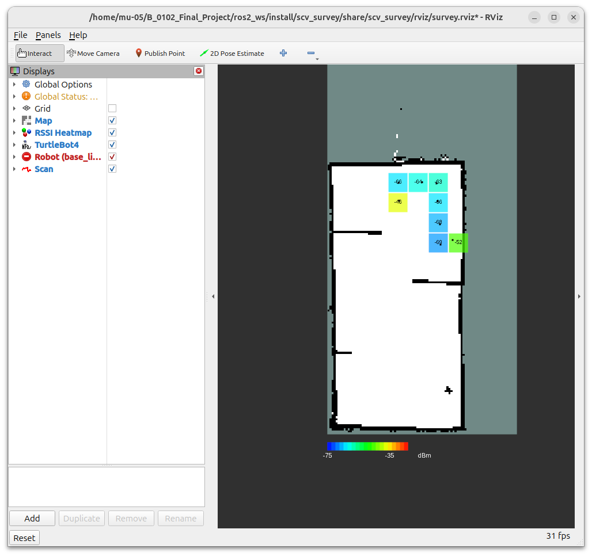
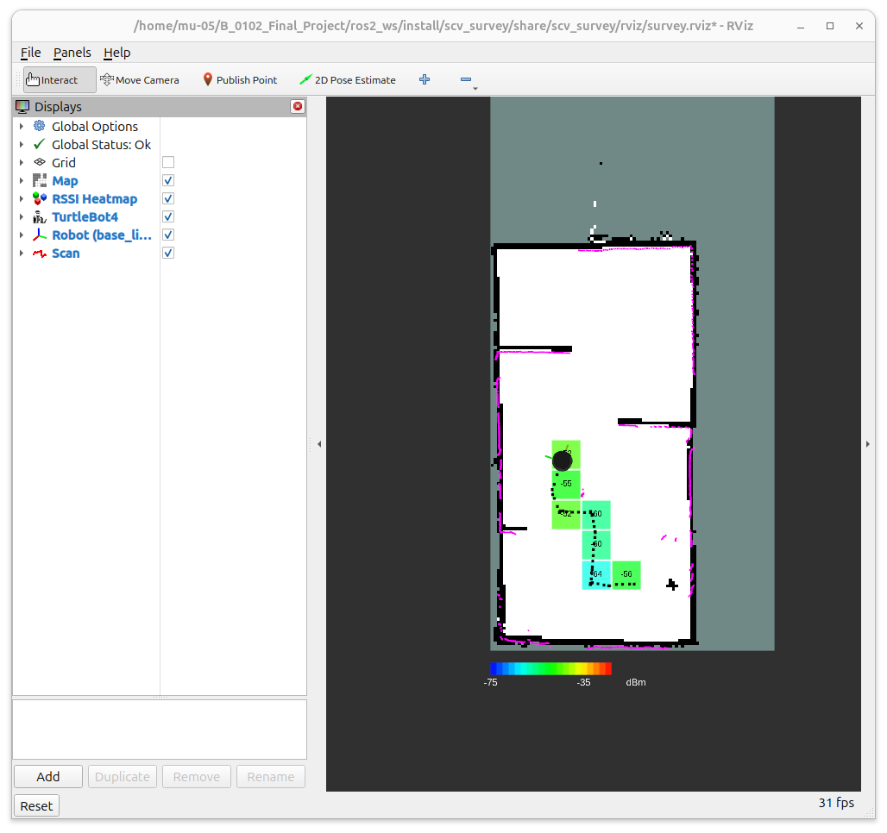
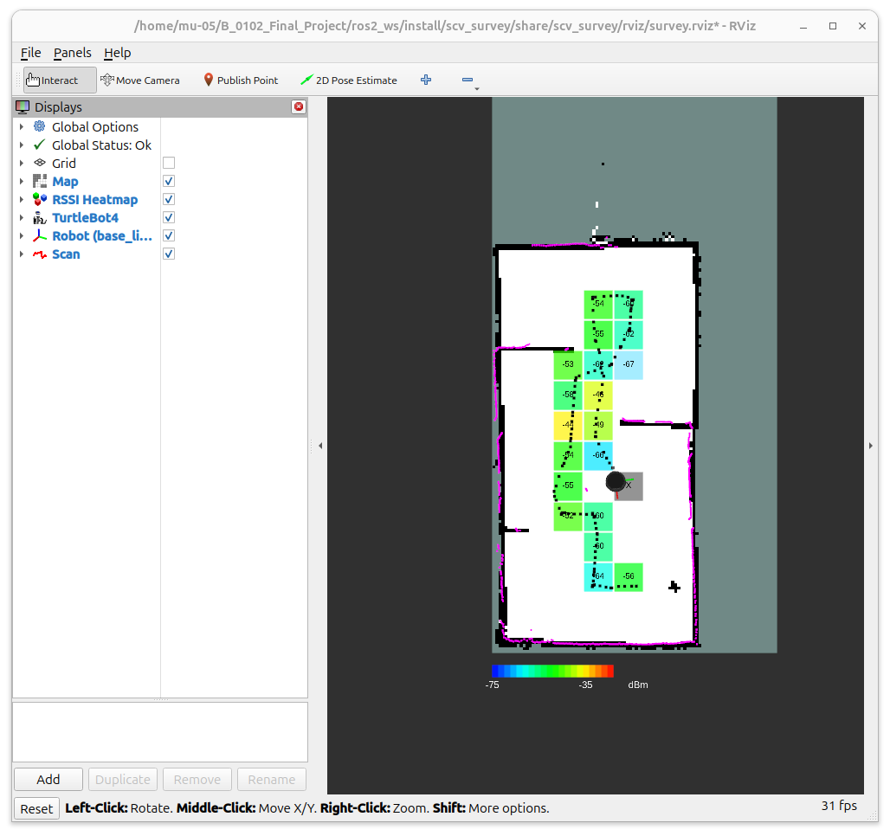
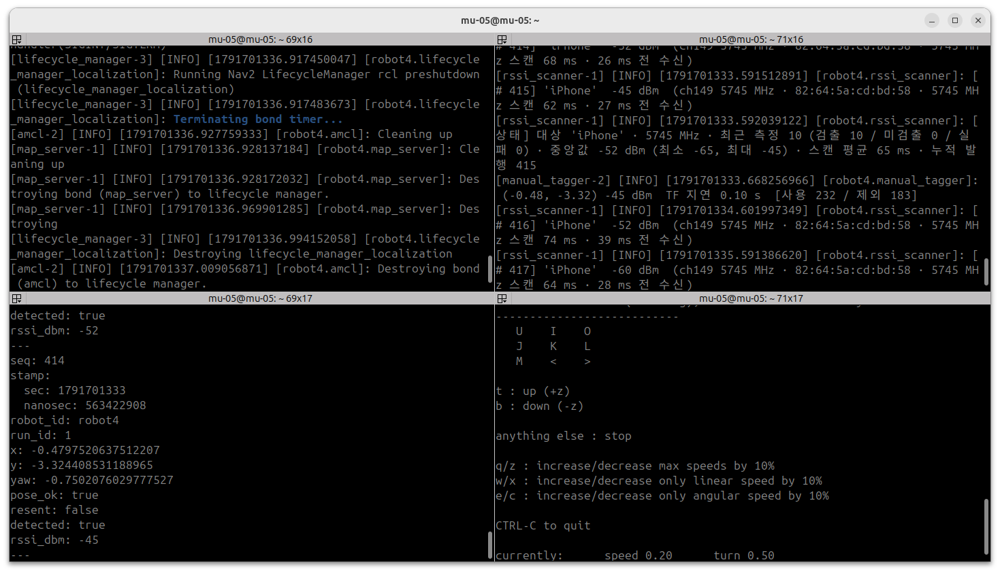

## 오늘 한 일
- rssi_scanner 측정 방식 변경: `iw link`(노트북이 붙은 AP) → `iw scan`(주변 AP 듣기). 노트북은 turtle08에 붙은 채로 아이폰 핫스팟만 들어서 잼 (NetRaw 형식은 그대로, IF-02 변경 없음)
- 측정할 SSID 직접 입력: launch `ssid:=…`, 실행 중에는 `ros2 param set … target_ssid`. 비우면 SSID에 `iPhone`이 들어간 AP 중 처음 가장 센 것으로 고정
- 채널 고정: 처음 한 번 전체 대역 스캔(약 5 s)으로 핫스팟 채널을 찾고, 이후엔 그 채널만 스캔(약 0.06 s). 3회 연속 미검출이면 바로 한 번, 그 뒤 10 s마다 전체 스캔으로 채널 재탐색
- 로그 추가: launch 시작 때 대상 SSID, 측정마다 SSID·dBm·채널·스캔 시간, 10초마다 상태 요약(검출/미검출/실패·중앙값), 상태가 바뀔 때(채널 고정·재탐색·다시 검출)
- 측정 시각을 iw가 끝난 시각이 아니라 실제로 신호를 받은 시각(끝난 시각 − last seen)으로 기록 → 전체 스캔(수 초)에도 로봇 위치가 어긋나지 않게
- 노트북 단독 아이폰 핫스팟 측정 → 로봇 4번 위 노트북 TF 모드 teleop 측정 → 핫스팟 멀리갔다오기, 껐다 켰다하기
- 음영 칸을 Nav2 keepout 마스크(IF-10 OccupancyGrid)로 주행팀에 넘기는 계획 정리 (형식·판정 규칙·작업 순서)

## 시행착오
- 일반 사용자는 `iw scan`을 실행할 수 없음(Operation not permitted) → `sudo setcap cap_net_admin+ep /usr/sbin/iw` 로 iw에만 권한
- iw scan 출력에 이번에 못 들은 AP도 커널 캐시(약 30 s)에서 섞여 나옴 → 이대로면 핫스팟을 꺼도 30초 동안 "검출" → BSS마다 `last seen` 시각이 스캔 시작 이후인 것만 사용
- 한 채널 스캔은 AP가 있어도 50–85 %만 들림(probe 응답 누락). directed probe(`ssid`)·`duration`은 효과 없음 → 못 들으면 같은 채널을 2번 더 스캔 → 40/40 검출
- SSID의 한글·특수문자가 `\xNN`으로 출력됨 → UTF-8로 되돌린 뒤 비교
- 처음 미검출이 나오는 순간 노드가 죽음 → rclpy는 호출 위치마다 로그 수준이 고정이라 한 줄에서 info/warn을 고르면 ValueError → 줄을 나눔
- 3회 미검출 뒤 첫 전체 스캔이 10초 늦게 나가는 버그를 단위테스트(껐다 켜기 시나리오)로 발견 → 바로 한 번 스캔하도록 수정
- 로봇 4번에서 히트맵이 한동안 안 뜸 → AMCL 공분산 0.292 > 기준 0.25라서 처음 샘플 183개가 "위치 제외"됨. 로봇을 움직여 AMCL이 수렴한 뒤부터 표시 (어제와 같은 원인 → 초기위치를 작은 공분산으로 주는 기능 필요)
- 핫스팟을 다시 켤 때마다 BSSID가 바뀜(이번 주행에서 3번 모두 다름) → 대상은 BSSID가 아니라 SSID로 판단해야 함. 대신 `iPhone` 같은 흔한 이름은 다른 아이폰과 겹칠 수 있음

## 강조하고 싶은 것 / 달성
<!-- 이 줄은 노션에 안 나가요. 그림:   이름에 빈칸이 있으면 
     영상: video: video/YYYY-MM-DD_이름.mp4 설명   YouTube: video: https://youtu.be/… 설명 -->
- ✅ 단위테스트 통과: scv_survey pytest (iw scan 해석·캐시 거르기·SSID 복원·채널 고정/재탐색·껐다 켜기 시나리오 포함)
  - 단계: 1 단위 · IF-02·08 · mock
  - 기준: 전부 통과
  - 결과: 48 / 48 통과 (어제 35개 + iw scan 13개)
- ✅ 단위테스트 통과: rssi_scanner iw scan 아이폰 핫스팟 1 Hz 측정
  - 단계: 1 단위 · IF-02 · 노트북 (아이폰 핫스팟 실측)
  - 기준: 1 Hz, 핫스팟이 켜져 있는 동안 미검출 0, 한 채널 스캔 1 s 이내, 로봇 통신(turtle08) 패킷 손실 0
  - 결과: 88회 연속 검출 · 미검출 0 · 한 채널 스캔 평균 60–93 ms · RSSI −77 ~ −41 dBm · 한 채널 1 Hz 스캔 중 Discovery Server ping 손실 0 (최대 지연 11–23 ms)

- ✅ 단위테스트 통과: 로봇 4번 TF 결합 아이폰 핫스팟 히트맵
  - 단계: 2 두 기능 (RSSI + AMCL 위치) · IF-02·08 · 로봇 4번
  - 기준: 위치가 확실한 샘플만 지도에 표시, TF 지연 0.5 s 이하
  - 결과: 지도에 쓴 샘플 234개(검출 214 / 미검출 20) · 칸 24개 · RSSI −74 ~ −43 dBm (칸 중앙값 −67 ~ −44.5) · TF 지연 약 0.1 s · AMCL 수렴 전 샘플 183개 제외

- ✅ 단위테스트 통과: 핫스팟 껐다 켜기 감지
  - 단계: 1 단위 · IF-02 · 로봇 4번 위 노트북
  - 기준: 끄면 다음 측정(1 s)에서 미검출, 다시 켜면 재검출, 꺼진 동안 캐시 값이 검출로 나오지 않음
  - 결과: 2회 모두 끈 뒤 첫 측정에서 미검출 · 미검출 4회, 16회 뒤 같은 채널(5745 MHz)에서 재검출 · 켤 때마다 BSSID가 바뀌어도 SSID로 이어서 측정 · 꺼진 동안 지나간 칸은 지도에 회색 X(검출 0)로 표시 (위 두 번째 TF 그림)

## 내일 할 일
- 같은 SSID가 둘 들리면 경고 로그 추가
- T3-3 회피 마스크: 음영 기준값 확정(−65 / 요구사항 −72) → 음영 칸을 IF-10 `keepout_mask`로 발행, 주행팀과 마스크 형식 합의

## 막힌 것 (PM 도움 필요)
- 없음
