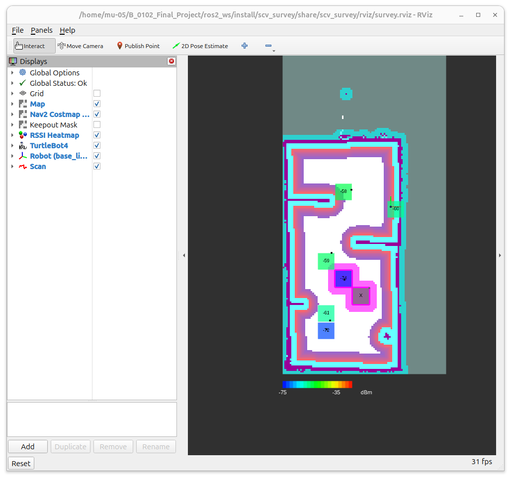
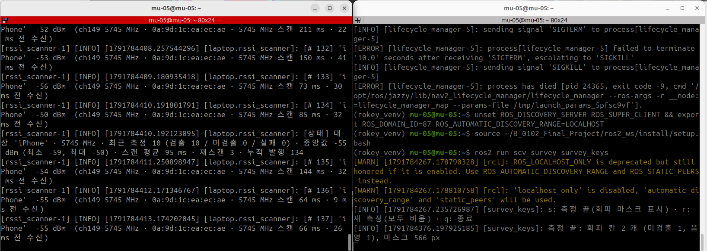
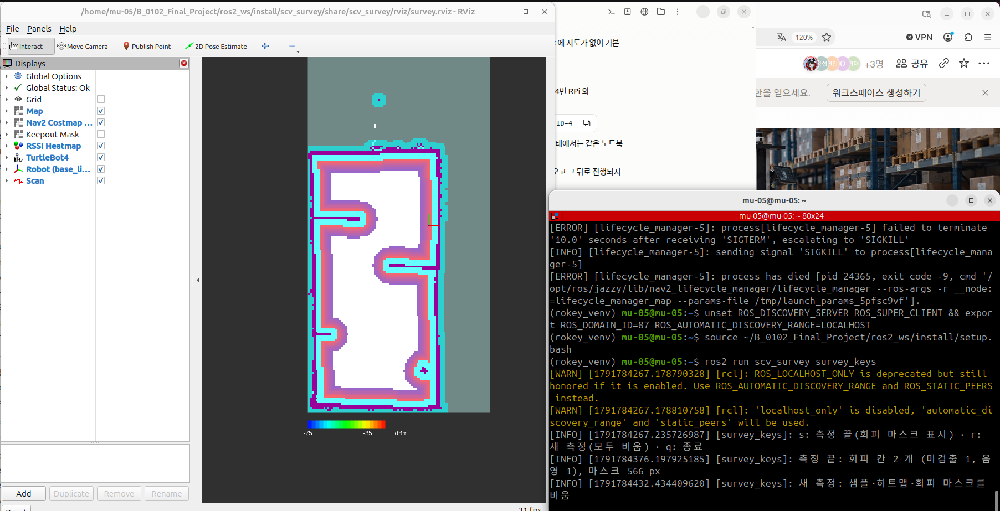

## 오늘 한 일
- 재측정 계획 정리: 1차 측정 뒤 미검출·음영 칸만 다시 재고 다른 칸은 바뀌지 않게
  - 엔진이 1차 측정 끝에 대상 칸 목록을 고정
  - 재측정 회차 샘플은 대상 칸 안(경계에서 0.1 m 안쪽)의 것만 반영
  - 대상 칸은 재측정 값으로 교체
  - 중복 판단 키는 `(robot_id, run_id, seq)` 로
- 지금 지도에 값을 넣는 방식 정리
  - 저장하는 것은 샘플(점)뿐이고, 칸 번호·중앙값·색은 1초마다 다시 계산
  - 회차를 구분하지 않고, 엔진을 재시작하면 지도가 사라짐
- DB 저장 방식 검토(칸 중심 cx·cy + dBm 을 저장했다가 재측정 때 그 칸만 받아 감)
  - 칸 중심으로 칸을 찾는 방식은 가능
  - 미검출을 dBm 0 으로 저장하면 0 은 가장 센 신호라서 정상 칸으로 판정됨 → 재측정·회피 대상에서 빠짐
  - 그래서 dBm 은 NULL, 상태(`status`) 열을 따로 두는 쪽으로 제안
- T3-3 회피 마스크 구현 (`scv_survey`)
  - `heatmap.py`: 칸 상태(미검출 / 음영 = 중앙값 < −72 dBm(BR-T04) / 정상), 회피 칸 선정(샘플 2개 이상), 마스크 생성(회피 칸 100, 정상·측정 안 한 칸 0, 지도와 같은 원점·해상도·크기)
  - `network_map_engine`: `/keepout_mask` (IF-10) 발행
    - 측정 중에는 전부 0
    - `~/finish_survey`(측정 끝) 때 회피 칸을 정해 고정
    - `~/reset_survey`(새 측정) 때 샘플·히트맵·마스크를 모두 비움
    - 노드가 시작하면 빈 마스크부터 보냄
  - `survey_keys` (시험용 키 입력 노드): `s` = 측정 끝, `r` = 새 측정, `q` = 종료
  - launch (manual 모드): 노트북에 Nav2 전역 코스트맵(static + inflation + KeepoutFilter)을 띄워 `/costmap` 으로 표시. RViz 에 코스트맵·마스크 표시와 회피 칸 자홍 테두리 추가
- 노트북을 들고 아이폰 핫스팟 측정 → `s` → 미검출·음영 칸이 코스트맵 장애물로 표시 → `r` → 백지로 돌아오는 것 확인
- 회피 칸 여유 폭을 0.2 m → 0(칸 그대로)으로 결정 (0.2를 늘리니 너무 넓어짐.)

## 시행착오
- 노트북만으로 launch 했더니 RViz 에 지도가 안 뜨고 회색 바탕만 나옴
  - 원인: 셸이 로봇 4번 RPi 의 Discovery Server(ROS 노드끼리 서로 찾게 해 주는 서버)를 쓰도록 설정되어 있는데, RPi 가 꺼져 있어 같은 노트북 안의 노드끼리도 서로 못 찾음 → `map_server` 가 켜지지 않아 `/map` 이 없음
  - 해결: 노트북만 쓸 때는 `unset ROS_DISCOVERY_SERVER ROS_SUPER_CLIENT && export ROS_DOMAIN_ID=87 ROS_AUTOMATIC_DISCOVERY_RANGE=LOCALHOST` 를 launch 터미널과 키 터미널 양쪽에서 실행
- Nav2 KeepoutFilter 는 마지막으로 받은 마스크를 계속 씀. 엔진만 꺼 두면 지난 측정의 회피 칸이 코스트맵에 남아 있음(100)
  - 엔진이 시작할 때 빈 마스크를 보내 덮어쓰도록 함 → 새로 띄우면 0 확인
- KeepoutFilter 는 inflation 뒤에 적용돼 회피 칸 주변은 팽창되지 않음
  - 처음엔 로봇 반경(0.19 m)을 고려해 0.2 m 넓혔더니 칸 2개가 566 px 로 커지고 옆 정상 칸까지 막힘 → 너무 멀리 돌아갈 것 같아 0(칸 그대로)으로 바꿈
  - 아래 첫 그림은 0.2 m 로 넓혔을 때 찍은 것
- 마스크 값 50 을 넣으면 코스트 49(중간 비용)가 됨 → 100 과 0 만 쓰기로
- 단독 코스트맵 노드는 lifecycle bond(노드 상태 감시 연결)를 만들지 않아 lifecycle manager 가 4초 뒤 켜기를 중단함 → `bond_timeout: 0.0`
- 키 노드에서 `self.clients` 라는 이름을 썼더니 rclpy `Node.clients` 와 겹침 → `key_clients` 로 바꿈
- launch 를 Ctrl+C 로 끌 때 단독 코스트맵 노드가 `exit code -11` 로 종료됨. 측정·마스크 결과에는 영향 없음 (원인은 확인 안 함)

## 강조하고 싶은 것 / 달성
<!-- 이 줄은 노션에 안 나가요. 그림:   이름에 빈칸이 있으면 
     영상: video: video/YYYY-MM-DD_이름.mp4 설명   YouTube: video: https://youtu.be/… 설명 -->
- ✅ 단위테스트 통과: scv_survey pytest (칸 상태·회피 칸 선정·마스크 넓힘·모서리·지도 끝 잘림·새 측정 비우기 포함)
  - 단계: 1 단위 · IF-10 · mock
  - 기준: 전부 통과
  - 결과: 56 / 56 통과 (어제 48개 + 회피 마스크 8개)
- ✅ 단위테스트 통과: Nav2 KeepoutFilter 동작
  - 단계: 1 단위 · IF-10 · 노트북 (Nav2 Jazzy 단독 코스트맵, domain 87)
  - 기준: 마스크 100 → 코스트맵 장애물, 빈 마스크를 다시 보내면 해제
  - 결과: 마스크 100 → 코스트맵 100 · 0 으로 다시 보내면 원래 값 · 엔진만 끄면 회피 칸 남음 → 새로 띄우면 0
- ✅ 단위테스트 통과: 노트북 핫스팟 측정 → 측정 끝(s) → 코스트맵 장애물
  - 단계: 2 두 기능 (RSSI 측정 + Nav2 코스트맵) · IF-02·08·10 · 노트북 (아이폰 핫스팟 실측, manual)
  - 기준: 측정 중에는 장애물 없음, `s` 뒤 미검출·음영 칸만 장애물, 정상 칸과 측정 안 한 칸은 0
  - 결과: 칸 7개 중 회피 칸 2개(미검출 X 1, 음영 −74 dBm 1), 마스크 566 px(0.2 m 넓힘). 정상 칸(−58 ~ −61, −72)은 장애물 아님 — −72 는 기준이 "−72 미만"이라 정상

- ✅ 단위테스트 통과: 새 측정(r) 때 백지
  - 단계: 1 단위 · IF-10 · 노트북
  - 기준: `r` 뒤 히트맵·회피 칸·코스트맵 장애물이 모두 사라짐 (재측정이 아니라 처음부터 새로 재는 경우)
  - 결과: "새 측정: 샘플·히트맵·회피 마스크를 비움", 코스트맵은 지도 벽·팽창만 남음

## 내일 할 일
- 점검 로봇 Nav2 에 KeepoutFilter 넣기: 전역·지역 코스트맵 `filters`, `costmap_filter_info_server` 를 그 로봇 PC 에만 (주행팀·PM 과 `scv_bringup` 에서 협의)
- 문서상 측정 로봇(robot4)·점검 로봇(robot3)과 실제 시나리오의 로봇 번호를 PM 과 확인 → `mask_topic` 을 점검 로봇의 `/{ns}/keepout_mask` 로
- 재측정: 대상 칸 고정 · 대상 칸만 반영(이동 중 샘플은 버림) · 재측정 값으로 교체(덮어쓰기), 중복 판단 키에 `run_id` 추가
- T3-4 로봇 이식 (RPi `rssi_scanner`, `survey_buffer`)
- DB 칸 저장 형식(cx·cy·dBm·status·run_id)을 관제 B 와 맞추기

## 막힌 것 (PM 도움 필요)
- 없음
