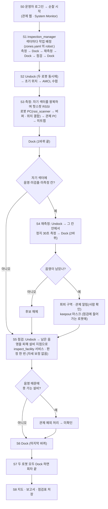
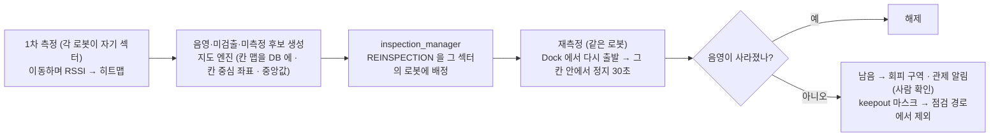
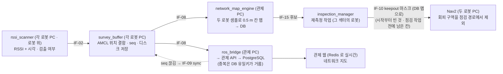
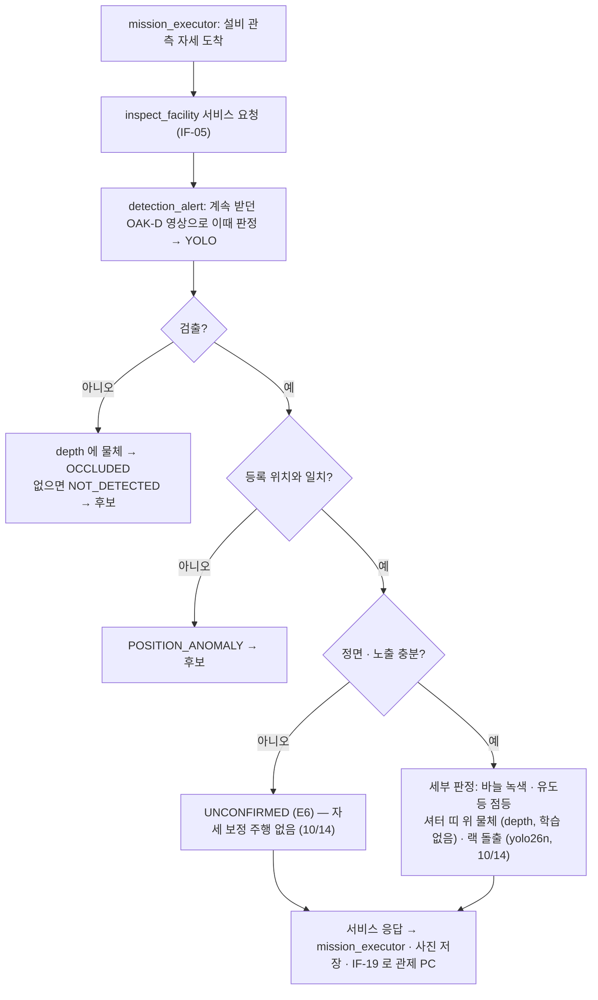

# SCV Process Flow (제출용 초안 v0.1)

> 이 저장소 문서가 원본이다 (10/11 PM 결정). 노션 「SCV 설계」는 10/10 까지의 예전 판이다. 시나리오는 10/12 PM 결정(두 대 동시 주행 · 섹터 2개 · 측정 → 재측정 → 점검)이다.

2026-10-10 · 작성 도윤 (PM) · 출처: 팀 노션 「SCV 설계」 3·10장, 시스템 다이어그램 v2.1. GitHub 에서 열면 그림으로 보입니다. 한 장짜리 전체 그림(기기 스택·인터페이스·노드별 흐름)은 같은 폴더의 `scv-system-diagram.drawio`(그림은 `.png`)가 원본입니다.

## 1. As-Is → To-Be

| As-Is | To-Be |
| --- | --- |
| Wi-Fi 는 문제가 생겨야 외주 측정 → 사람이 현장 전체를 걷고 → 일회성 보고서 | 두 로봇이 섹터를 나눠 동시에 순찰하며 자동 측정 → 통계 지도(히트맵) → 음영 후보 |
| 배치가 바뀌어도 지도는 그대로, 로봇·단말이 멈춘 뒤에야 음영을 안다 | 음영 후보는 그 섹터의 로봇이 칸 안에서 재측정 → 남은 것만 담당자에게, 점검 때는 피해 감 |
| 한 번 낮게 나온 값이 노이즈인지 실제 문제인지 구분할 방법이 없다 | 담당자는 보고서로 AP 조정·투자 판단, 다음 순찰에서 개선 확인 |
| 소방 설비는 법정 점검 연 1–2회, 평소엔 작업자 눈에 의존 | 같은 순찰에서 소방 설비·랙 적재물 판정 → 알림 → 조치 → 해소 확인 |

## 2. 순찰 한 번 (S0–S8)

10/12 PM 결정: 두 로봇이 동시에 주행한다. 구역을 섹터 2개로 나눠 로봇 A(`/robot4`)·로봇 B(`/robot3`)가 하나씩 맡고 **같은 일**을 한다. 아래 S2–S7 은 로봇마다 자기 섹터에서 동시에 일어난다.

- 로봇마다 최대 3바퀴(측정 · 재측정 · 점검), 자기 섹터에 재측정할 칸이 없으면 2바퀴다. 두 로봇은 서로 기다리지 않는다.
- 두 Dock 은 각자 섹터 안에 떨어져 있어(약 3.6 m) 두 로봇이 동시에 출발하고 각자 Dock 으로 돌아온다.
- 측정·재측정 때는 회피 구역을 쓰지 않는다(마스크는 빈 것 — 시작부터 발행해 둔다). 로봇마다 점검 작업을 보내기 전에 inspection_manager 가 DB 맵의 남은 칸으로 마스크를 만들어 그 로봇에 보낸다 (요청을 주고받지 않는다). 한 로봇만 재측정이 필요하면 다른 로봇은 기다리지 않고 점검으로 넘어간다.
- 측정·판정 노드는 두 로봇 쪽에 모두 올린다.

## 3. 음영 후보 재측정 (BR-T06)

- 재측정은 그 섹터를 맡은 로봇(후보를 만든 로봇)이 한다. 음영 칸을 피하지 않고 그 안으로 들어가 정지 측정한다 (처음 설계의 "다른 로봇이 경계 칸에서 재검증"에서 바뀜).
- 재측정 대상은 음영·미검출·미측정 칸이다 (미측정은 갈 수 있는 칸(섹터 안, 벽·장애물에서 0.45 m 밖) 중 샘플이 없는 칸, 시연에는 없음). 재측정 뒤에도 음영이 남을 수 있다. 남은 칸은 점검 때 피해 가고 관제에 알림을 띄워 사람이 확인한다. 그 때문에 갈 수 없는 설비는 관제가 예외로 처리한다(미확인). 시연은 한 섹터에만 음영을 두고 재측정에서 사라지는 흐름이다 (10/12 오후).
- 설비 후보(미검출·가림)는 다른 로봇이 다시 찍지 않는다. 점검한 로봇이 자세를 바꿔 스스로 다시 보고(최대 3회), 안 되면 미확인으로 남긴다.

## 4. 측정 데이터가 지도가 되기까지

## 5. 설비 점검 한 건

## 6. 예외 처리 (E1–E8)

| 번호 | 상황 | 감지 | 대응 |
| --- | --- | --- | --- |
| E1 | 통로 막힘 | LiDAR 장애물, 진행 정체 | 5초 대기·재계획 → 10초 안에 안 되면 건너뛰고 재방문 목록 |
| E2 | 배터리 30 % / 15 % | 배터리 상태 | 즉시 Dock (15 %) · 30 % 인계는 추가 기능 — 풀사이클이 돈 뒤에 넣는다 (10/11 PM 결정) |
| E3 | 로봇 응답 없음 | status 30초 끊김 | 감지하고 화면에 경보 · 남은 작업 재배정은 추가 기능 — 풀사이클이 돈 뒤에 넣는다 (10/11 PM 결정) |
| E4 | 관제 PC 연결 끊김 | 로봇 PC 에서 응답 없음 | 받은 작업은 끝까지(설비 판정 포함) · 샘플은 로봇 PC 에 보관 → 재연결 때 전송 |
| E5 | 위치 불확실 | AMCL 공분산 큼 | 그 샘플을 지도 계산에서 제외 · 오래가면 경보 |
| E6 | 정면 아님·가림·어두움 | 정면 판별 실패 | 미확인 (UNCONFIRMED) — 자세 보정 재관측 없음 (10/14) |
| E7 | 비상정지 | 관제 웹 버튼 | 두 로봇 goal 취소·정지, 재개 명령 대기 |
| E8 | DB 쓰기 실패 | 저장 예외 | 메모리 큐·재시도·경보, 복구 뒤 순서대로 저장 |

- 재측정 뒤에도 남은 음영 때문에 설비에 갈 수 없으면 관제가 그 설비를 미확인으로 두고 다음 작업으로 넘어간다 (10/12, E1 의 건너뛰기와 같은 처리).
