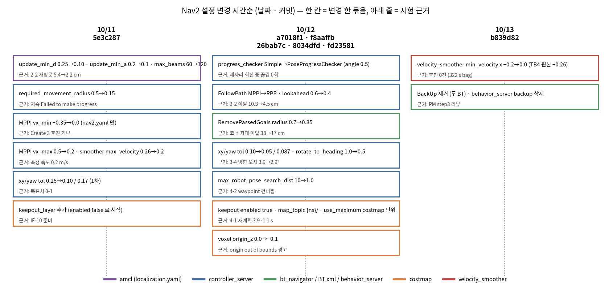
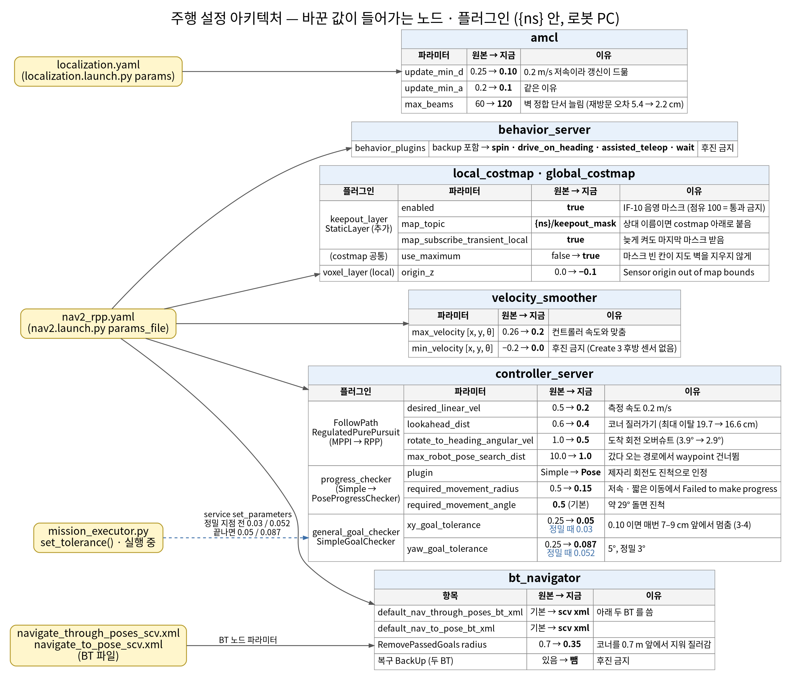
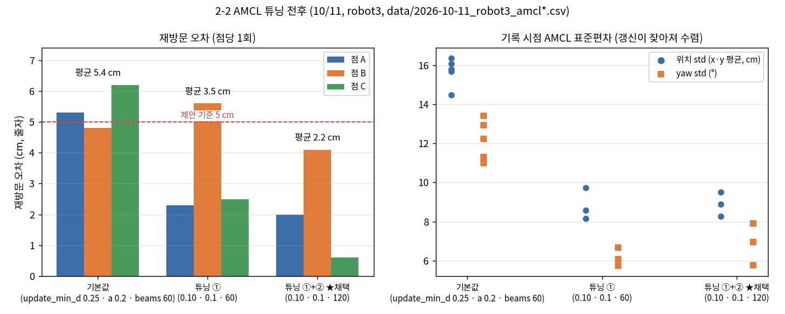
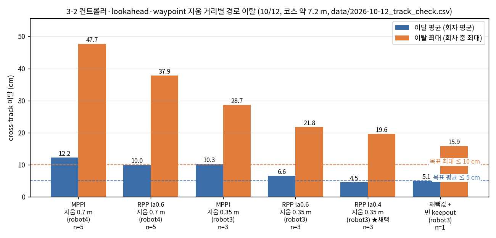
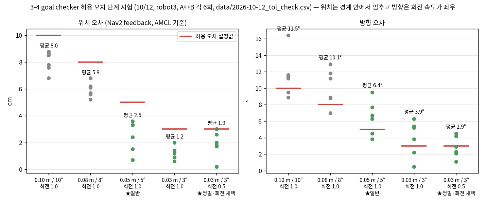

# Nav2 설정값 정리 — 바꾼 값과 시험 근거

2026-10-13 · 담당 hhj · 기준 `feature/driving` 114ff2a
설정 파일: `ros2_ws/src/scv_nav/config/nav2_rpp.yaml`(운영), `localization.yaml`(AMCL), `navigate_through_poses_scv.xml` · `navigate_to_pose_scv.xml`(BT), `nav2.yaml`(MPPI 비교용)

TurtleBot4 Jazzy 기본 설정에서 **무엇을 왜 바꿨고, 그 값을 어떤 시험으로 확인했는지** 한 곳에 모았다. 시험이 없는 변경은 「근거 없음」으로 표시했다.
원본 기록: `MEASUREMENTS.md`(1단계), `PLAN.md`(단계·목표치), `../daily/barlide/2026-10-1x.md`(일지), `data/`(CSV), `../daily/barlide/img/`(일지 그림). 이 문서의 그림 4장은 `img/nav2_params_charts.py` 로 CSV 에서 다시 만든다.

> 「원본」 값은 저장소 사본 `config/nav2.yaml`(MPPI, 10/11 에 TurtleBot4 Jazzy 기본으로 복사) · `localization.yaml` 원본 사본 · Nav2 Jazzy 기본 BT 기준이다. 이 PC 의 `~/turtlebot4_ws`(turtlebot4 2.1.1, 2025-09) 에 있는 `nav2.yaml` 은 컨트롤러가 DWB 라 저장소 사본과 다르다. 비교 기준선(MPPI)이 어느 배포판 기본값인지는 문서에 남아 있지 않다.

---

## 1. 한눈에: 바뀐 값 전부

★ = 시험 데이터(CSV·rosbag)로 확인 · ○ = 로그·관찰로 확인 · — = 합의값 또는 근거 없음

| # | 노드 · 플러그인 | 파라미터 | 원본 → 지금 | 날짜 · 커밋 | 바꾼 이유 | 시험 근거 | 데이터 |
| --- | --- | --- | --- | --- | --- | --- | --- |
| 1 | amcl | `update_min_d` | 0.25 → **0.10** | 10/11 5e3c287 | 0.2 m/s 저속이라 갱신이 드물어 std 수렴 안 함 | ★ 2-2 재방문 오차 평균 5.4 → 3.5 cm, 위치 std 12–17 → 8–10 cm | `data/2026-10-11_robot3_amcl.csv`, `_t1.csv` |
| 2 | amcl | `update_min_a` | 0.2 → **0.1** | 10/11 5e3c287 | 같은 이유 (①과 한 묶음) | ★ 위와 같음 | 위와 같음 |
| 3 | amcl | `max_beams` | 60 → **120** | 10/11 5e3c287 | 벽 정합 단서 늘림 | ★ ① → ①+②: 3.5 → 2.2 cm. 단 차이 1 cm 는 줄자 잡음(±1 cm) 범위 | `_t2.csv` |
| 4 | controller_server · progress_checker | `plugin` | SimpleProgressChecker → **PoseProgressChecker** | 10/12 a7018f1 | 도착 후 제자리 약 125° 회전을 Simple 이 진척으로 안 봐 "Failed to make progress" 4회 반복 | ○ robot4 MPPI 확인 주행: (2.05, 1.93) 17.2 s, (1.88, 2.75) 10.6 s 도착, 실패 0회 (전날 같은 goal 4회 실패) | 10/11 Nav2 로그, 10/12 rosbag (CSV 없음) |
| 5 | controller_server · progress_checker | `required_movement_radius` | 0.5 → **0.15** | 10/11 5e3c287 | 저속·짧은 이동에서 "10 s 에 0.5 m" 를 못 맞춰 도착 못 함 | ○ 적용 후 robot4 goal 5개 중 3개 10–17 s 도착. 나머지 2개는 #4 원인 | 10/11 로그 |
| 6 | controller_server · progress_checker | `required_movement_angle` | (기본 0.5) → **0.5** 명시 | 10/12 a7018f1 | 약 29° 돌면 진척으로 인정 | — 별도 시험 없음 (기본값) | |
| 7 | controller_server · general_goal_checker | `xy_goal_tolerance` | 0.25 → 0.10 (10/11) → **0.05** | 10/12 26bab7c | 로봇이 허용 오차 경계에 들어오는 순간 멈춰 0.10 이면 매번 7–9 cm 앞에서 섬 | ★ 3-4 단계 시험 4단계 × 6회: 0.05 에서 위치 0.7–3.6 cm, 수정 0회 5/6, 시간 +1 s 정도 | `data/2026-10-12_tol_check.csv` |
| 8 | controller_server · general_goal_checker | `yaw_goal_tolerance` | 0.25 → 0.17 (10/11) → **0.087** (5°) | 10/12 26bab7c | 목표치 0-1 (일반 yaw ≤ 10°, 설비 ≤ 5°) | ★ 위 시험. 5° 설정에서 방향 3.8–9.5° (회전 1.0 rad/s) → #11 과 같이 봄 | 위와 같음 |
| 9 | controller_server · FollowPath | `plugin` | MPPI → **RegulatedPurePursuit** | 10/12 f8aaffb | 3-2 비교: 통로 추종 전용, 파라미터 적음 | ★ robot3 · 지움 0.35 m · 3회: RPP 이탈 평균 6.6 · 최대 19.7 cm vs MPPI 10.3 · 27.2 cm | `data/2026-10-12_track_check.csv` |
| 10 | FollowPath (RPP) / MPPI | `desired_linear_vel` / `vx_max` | 0.5 → **0.2** | 10/11 5e3c287 | PLAN 0-3 측정 속도 0.2 m/s. 컨트롤러와 smoother 상한을 맞춰야 추종 오차가 안 커짐 | — 합의값. 주행 중 cmd_vel x 가 0.2 로 유지되는 것은 keepout rosbag 에서 확인 | `data/2026-10-12_keepout.csv` |
| 11 | FollowPath (RPP) | `lookahead_dist` | 0.6 → **0.4** | 10/12 f8aaffb | 코너 안쪽 질러가기 | ★ 3회: 6.6 / 19.7 cm → 4.5 / 16.6 cm | `track_check.csv` |
| 12 | FollowPath (RPP) | `rotate_to_heading_angular_vel` | 1.0 → **0.5** | 10/12 26bab7c | 도착 회전 오버슈트로 방향 오차가 허용값보다 큼 | ★ 0.03 m/3° 에서 방향 오차 평균 3.9 → 2.9° (1.1–4.5°), 위치 변화 없음, 시간 약 +2 s | `tol_check.csv` |
| 13 | FollowPath (RPP) | `max_robot_pose_search_dist` | 10.0 → **1.0** | 10/12 8034dfd | 내려갔다 올라오는 경로에서 뒤 구간을 "지금 위치"로 잡아 1번 점을 건너뛰고 14 s 제자리 회전 | ○ 4-2 E1 시험에서 재현 안 됨. 정량 데이터 없음 | 10/12 일지 |
| 14 | FollowPath (RPP) | `allow_reversing` | **false** (RPP 기본) | — | 후진 금지 | — RPP 기본값 그대로 | |
| 15 | bt_navigator | `default_nav_through_poses_bt_xml` → scv xml, `RemovePassedGoals radius` | 0.7 → **0.35** (10/14 0.15 로 바꿨다 되돌림) | 10/12 f8aaffb | 기본 BT 가 waypoint 0.7 m 안에서 지우고 3 s 마다 재계획 → 코너를 0.7 m 앞에서 버림 | ★ robot4 0.7 m: 최대 이탈 38–48 cm → robot3 0.35 m: 20–22 cm. 0.2 m 는 RPP 가 코너에 0.21 m 까지만 접근해 못 지움 (왕복 반복) | `track_check.csv` |
| 16 | bt_navigator · behavior_server | `default_nav_to_pose_bt_xml` → scv xml, 두 BT 의 `BackUp` 제거, `behavior_plugins` 에서 `backup` 삭제 | 있음 → **없음** | 10/13 b839d82 | Create 3 가 후진을 거부해 BackUp 복구가 "backup failed" (10/11 로그 2회). interfaces 「자세 보정 "뒤로"」 | ★ 10/13 bag 5개(E1·dock·E4·E7) cmd_vel x < 0 **0건**. 10/12 작업 종료 후 후진 10 s 는 BackUp 이 아니라 취소 버그(#17 아래 4-7)로 밝혀짐 | `data/2026-10-13_backup_check.csv` |
| 17 | velocity_smoother | `max_velocity` x | 0.26 → **0.2** | 10/11 5e3c287 | #10 과 같음 (`min_velocity` x 도 이때 −0.26 → −0.2 로 대칭 조정) | — 합의값 | |
| 18 | velocity_smoother | `min_velocity` x | −0.2 (TB4 원본 −0.26) → **0.0** | 10/13 b839d82 | 후진 금지 (PM step3 리뷰) | ★ dock · undock 322 s bag: cmd_vel x < 0 0건, Dock succeeded 2회 → dock 에 영향 없음 | `backup_check.csv` (bag_t5_dock) |
| 19 | local · global costmap | `keepout_layer` (StaticLayer) 추가, `enabled` | 없음 → **true** | 10/11 추가(false) → 10/12 8034dfd true | IF-10 RSSI 음영 마스크. KeepoutFilter 대신 StaticLayer 한 층 (노드 안 늘어남) | ★ 4-1: 주행 중 0.5 m 칸 발행 → 피하는 경로까지 3.87 s · 1.09 s (기준 5 s), 칸 옆 0.49–0.53 m 우회. 빈 마스크 주행 46.6 s · 이탈 5.1 cm (영향 없음) | `data/2026-10-12_keepout.csv`, `track_check.csv` keepout_empty_1 |
| 20 | keepout_layer | `map_topic` | keepout_mask → **$(var namespace)/keepout_mask** | 10/12 8034dfd | 상대 이름이면 `{ns}/global_costmap/keepout_mask` 로 붙어 "no map received", 경로 전부 실패 | ○ 수정 후 마스크 수신·우회 확인 (#19) | |
| 21 | local · global costmap | `use_maximum` | (플러그인 안) → **costmap 단위 true** | 10/12 8034dfd | 플러그인 안에 두면 무시됨 → 빈 마스크(0)가 지도 벽을 덮어 벽 0칸, 경로가 벽을 뚫음 | ○ global costmap 벽 0 → 3282칸 | 10/12 일지 |
| 22 | local costmap · voxel_layer | `origin_z` | 0.0 → **−0.1** | 10/12 fd23581 | 라이다 높이가 odom 에서 −0.00… 으로 잡혀 "Sensor origin out of map bounds", raytrace 안 됨 | ○ 10/13 controller_server 로그 약 1.5 h 경고 0회 | 10/13 일지 |
| 23 | nav2.yaml (MPPI 비교용만) | `vx_min` | −0.35 → **0.0** | 10/11 5e3c287 | Create 3 후진 거부 → 후진 명령 내고 2분 대기 | ○ robot4: 후진하며 서 있는 현상 사라짐 | 10/11 로그 |

### mission_executor 가 실행 중 바꾸는 값

| 파라미터 | 평소 (`NORMAL_TOL`) | 정밀 지점 직전 (`PRECISE_TOL`) | 근거 |
| --- | --- | --- | --- |
| `general_goal_checker.xy_goal_tolerance` | 0.05 | **0.03** | ★ 3-4: 0.03 m 에서 위치 0.2–3.0 cm (#7 시험) |
| `general_goal_checker.yaw_goal_tolerance` | 0.087 (5°) | **0.052** (3°) | ★ 3-4: 회전 0.5 rad/s 와 함께 방향 1.1–4.5° |

`set_parameters` 서비스로 바꾸고 `finally` 에서 원복. 5-2 가짜 서버 시험(10/12 robot4)에서 0.03/0.052 로 바뀌고 도착 후 0.05/0.087 로 돌아오는 것 확인 (`data/2026-10-12_step5_status.csv`).

### 바꾸지 않았지만 시험으로 확인한 값

| 파라미터 | 값 | 확인 |
| --- | --- | --- |
| costmap `footprint` 반경 0.189 m · `inflation_radius` 0.45 | 기본 그대로 | 3-1 통로 폭 실측 최소 1.98 m → 로봇 0.38 m 빼도 양쪽 약 0.8 m |
| bt_navigator `RemovePassedGoals radius` 0.35 → 0.15 → **0.35 로 되돌림** (`navigate_through_poses_scv.xml`) | 10/14 변경 후 같은 날 되돌림 | **되돌린 이유**: 아래 B 회차는 모서리마다 작업이 끝나 작업마다 직선 하나라 지울 중간 점이 없었다 → 개선은 반경이 아니라 줄마다 멈췄다 정렬한 덕. 0.15 는 lookahead 0.4 보다 짧아, 한 번 반경 밖으로 지나친 점은 경로가 되접혀도 RPP 가 0.4 m 앞(되돌아 나가는 쪽)을 쫓아 0.3 m 까지만 다가가므로 영영 못 지운다. `course_run` 반경 0.15(지움을 3 초 주기 밖 매 틱으로 옮김): 1회차 성공 46 초(모서리 최근접 0.08–0.11 m), 2회차 (2.2, 4.2) 를 0.152 m 로 놓쳐 90 초 왕복 후 취소 (bag `~/scv_logs/bags/2026-10-14_course_tick_1` · `_tick_2`). 관제는 이제 지움 반경과 상관없이 90도 이상 꺾는 점을 작업 끝점으로 보낸다(`corner_break_deg`). 이하 당시 기록: 관제 측정 경로의 모서리를 0.35 m 앞에서 지워 질러가던 것(파먹기). 0.15 로 줄이면 RPP(lookahead 0.4)가 90도 모서리에 0.17 m 까지만 다가가 못 지우므로, 관제가 그런 모서리를 작업 끝점으로 보낸다(`corner_mode=angle`, `passed_goal_radius_m` 0.15 — 둘은 같이 바꾼다). robot3 비교(0.25 m 간격, Z2, 관제 PLAN N-10): 모서리에 가장 가까이 간 거리 최대 0.32 → 0.10 m, 줄 가운데 계획 줄과의 거리 중앙값 0.135 → 0.048 m, 측정 4분 47초 → 6분 13초(+30 %). 지움 반경 0.35 + 모서리 뒤 보조 점(3번)은 효과 없음 |
| (Nav2 값 아님) `mission_executor.py` 막힘 처리(E1) | 10/14 변경 | 지도에 없는 장애물이 waypoint 위에 있으면 Nav2 는 그 점을 건너뛰지 않고(RemovePassedGoals 는 지나간 점만 지움), 플래너 tolerance 0.5 로 근처까지 계획 → RPP 가 장애물에 2–5 cm 까지 붙어 회전도 못 하고 갇힘(BackUp 복구 없음, 시뮬). 장애물 칸이 된 점은 다가가기 전에 빼고(측정 골은 줄 위 장애물 0.25 m 앞으로 줄임), 취소가 끝날 때까지 기다린 뒤 다음 goal 을 보냄. 근거 관제 PLAN N-11. 남은 것: 우회 경로가 장애물 모서리를 스칠 때 RPP 가 질러가며 붙음 → `max_allowed_time_to_collision_up_to_carrot` 등 시험 필요 |
| costmap `inflation_radius` 0.45 → **0.30** · `cost_scaling_factor` 4.0 → **10.0** (global · local, `nav2_rpp.yaml` 만) | 10/13 밤 변경 | 관제 측정 경로(줄 간격 0.5 m, 벽 여유 0.30 m)가 벽 조각 옆에서 inflation 에 걸려 계획 경로가 줄에서 휘어 나감. 플래너 계산으로 비교(robot3, 주행 없이): y 4.5 줄 0.30 → 0.15 m, y 6.0 줄 0.21 → 0.06 m, y 4.0 줄 0.13 → 0.00 m. **주행 시험은 아직 안 함** — 벽에 0.30 m(로봇 가장자리 0.11 m)까지 붙을 수 있음 |
| planner `tolerance` 0.5 | 기본 그대로 | 4-2: waypoint 하나만 막으면 0.5 m 안 근처를 지나가 막힘이 안 생김 → E1 시험은 통로 전체를 막아야 함 |
| `controller_frequency` 20 Hz · `transform_tolerance` 0.1 | 기본 그대로 | 1-2 cmd_vel→odom 반응 지연 p95 218 ms (약 4주기). 기준 ≤ 250 ms 안이라 미반영 |
| 지움 거리 0.35 m 와 waypoint 통과 | — | 4-2: 지나가는 점은 0.35 m 안이면 지난 것으로 봄 (1번 점 0.30 m 까지만 감) → 꼭 찍어야 하는 점은 마지막 점으로 |

---

## 2. 변경 시간순

10/11 은 "일단 돌아가게"(저속 진척 판정·후진 금지·속도), 10/12 는 "정확도"(컨트롤러·lookahead·지움 거리·허용 오차·keepout), 10/13 은 PM 리뷰 반영(후진 완전 제거)이다.

## 3. 바뀐 값이 들어가는 노드 · 플러그인

---

## 4. 시험 기록 상세

### 4-1. AMCL (`localization.yaml`) — #1 #2 #3

robot3, 10/11, 점 A·B·C 재방문 각 1회. 점 표시 → 다른 곳 갔다가 재방문 → 표시와 실제 어긋남을 줄자로 재고 AMCL 이동량과 비교. 기록 전 ±15° 제자리 회전으로 AMCL 갱신.

| | 오차 A / B / C (cm) | 평균 | 위치 std · yaw std |
| --- | --- | --- | --- |
| 기본값 (0.25 · 0.2 · 60) | 5.3 / 4.8 / 6.2 | 5.4 | 12–17 cm · 9–13° |
| 튜닝 ① (0.10 · 0.1 · 60) | 2.3 / 5.6 / 2.5 | 3.5 | 8–10 cm · 6–7° |
| 튜닝 ①+② (0.10 · 0.1 · 120) ★채택 | 2.0 / 4.1 / 0.6 | **2.2** | 7–11 cm · 6–8° |

- 목표(회차 간 ≤ 10 cm) 모두 통과. ①+② 에서 제안 기준 5 cm 도 3점 통과.
- 한계: 점당 1회. ①과 ①+② 차이(약 1 cm)는 줄자·표시 오차 범위 → `max_beams` 효과는 추가 측정(점당 3회) 필요.
- odom 계통 오차(직진 −1.9 %, `MEASUREMENTS.md` 1-4)는 alpha 로 보정하지 않았다. 재방문 2.2 cm 로 목표 안이라 두었음.
- 부산물: std 가 7–11 cm 로 내려와 pose_ok 기준(`pose_std_max`)을 0.10 → 0.15 m 로 정함 (2-3, `data/2026-10-11_robot4_pose_ok.csv`). Nav2 값은 아니지만 이 튜닝의 결과다.
- 일지 그림: `../daily/barlide/img/2026-10-11_amcl_tuning.png`, `2026-10-11_test_points_map.png`

### 4-2. progress checker — #4 #5 #6

CSV 없음. 10/11 Nav2 로그(`~/.ros/log`)와 10/12 확인 주행 rosbag 이 근거.

| 날짜 | 설정 | 관찰 |
| --- | --- | --- |
| 10/11 | Simple · radius 0.5 (원본) | 가까운 goal 에서 "Passing new path to controller" 만 반복, "Failed to make progress" 반복. 0.2 m/s 로 10 s 에 0.5 m 를 못 채움 |
| 10/11 | Simple · radius **0.15** | 후진 대기는 사라짐. robot4 goal 5개 중 3개 10–17 s 도착. (2.08, 1.93) → (1.88, 2.75) 는 "Failed to make progress" 약 10 s 간격 4회, Spin 복구 1회 뒤 목표 20 cm 앞 정지 |
| 10/12 | **PoseProgressChecker** · 0.15 m / 0.5 rad | 같은 goal 17.2 s · 10.6 s 도착, 실패 0회. 두 goal 모두 "전진 → 도착 후 제자리 약 125° 회전"(goal yaw 0°) 이었고, 어제는 이 회전을 Simple 이 진척으로 안 봐 끊은 것 |

- 가설 1(골판지 미끄러짐)은 제자리 약 100° 회전 중 위치 변화 1.8 cm(정지 흔들림 수준)로 1회 기준 배제.
- 부작용: 회전만 하며 갇힌 경우 감지가 늦어짐 → mission_executor E1(5 s/10 s · 5 cm · 0.3 rad)이 잡음.

### 4-3. 컨트롤러 · lookahead · waypoint 지움 거리 — #9 #11 #15

`course_run.py` 코스 약 7.2 m(코너 90° 3개) + `track_check.py`(첫 전역 경로 기준 cross-track) + rosbag. 10/12.

| 설정 | 로봇 | 회차 | 시간 | 이탈 평균 | 이탈 최대 |
| --- | --- | --- | --- | --- | --- |
| MPPI · 지움 0.7 m (Nav2 기본 BT) | robot4 | 5 | 43.9 s | 12.2 cm | 38.1 cm (회차 최대 47.7) |
| RPP la0.6 · 지움 0.7 m | robot4 | 5 | 39.2 s | 10.0 cm | 35.2 cm (회차 최대 37.9) |
| MPPI · 지움 0.35 m | robot3 | 3 | 47.5 s | 10.3 cm | 27.2 cm (회차 최대 28.7) |
| RPP la0.6 · 지움 0.35 m | robot3 | 3 | 41.7 s | 6.6 cm | 19.7 cm (회차 최대 21.8) |
| **RPP la0.4 · 지움 0.35 m ★채택** | robot3 | 3 | 44.2 s | **4.5 cm** | **16.6 cm** (회차 최대 19.6) |
| 채택값 + 빈 keepout 마스크 | robot3 | 1 | 46.6 s | 5.1 cm | 15.9 cm |

(표의 "이탈 최대"는 일지 값 = 회차 평균, 괄호는 CSV 회차 중 최대. 14:24 `rpp_bt_1` 행은 지움 0.2 m 실패 회차라 제외)

- 최대 이탈은 모두 코너 안쪽 질러가기 (첫 직선은 6–9 cm 이하). 지움 거리 0.7 → 0.35 가 가장 큰 효과, lookahead 0.6 → 0.4 가 그 다음.
- 목표 평균 ≤ 5 cm 통과, 최대 ≤ 10 cm 는 **미달**(16.6 cm, 코너). 코너 안쪽은 통로 폭 1.98 m 기준 여유가 있어 보류 중.
- 지움 0.2 m 시도: RPP(la0.6)가 첫 코너에 0.21 m 까지만 접근해 waypoint 가 안 지워짐 → 경로가 코너로 되돌아가 왕복 반복 → 0.35.
- MPPI 약점: 목표가 0.5 m 안 등 뒤에 있고 도착 yaw 가 반대면 후진 금지 때문에 못 돌아서고 머뭇거림 (시작점 복귀 때 3번). RPP 는 제자리 회전 후 진입.
- 일지 그림: `../daily/barlide/img/2026-10-12_course_trajectory.png`(궤적), `2026-10-12_deviation_compare.png`

### 4-4. goal checker 허용 오차 · 도착 회전 속도 — #7 #8 #12, PRECISE_TOL

`tol_check.py`, robot3 · RPP la0.4, A (1.0, 1.5) ↔ B (1.0, 3.0), 도착 yaw = 진행 방향 + 90°, 단계마다 6회. 10/12. 오차는 Nav2 feedback(AMCL) 기준, 바닥 실측 안 함.

| 허용 오차 | 회전 속도 | 위치 오차 | 방향 오차 | 수정 0회 | 도착 시간 |
| --- | --- | --- | --- | --- | --- |
| 0.10 m / 10° | 1.0 | 6.8–8.8 cm | 8.9–16.4° | 6/6 | 12.8–18.2 s |
| 0.08 m / 8° | 1.0 | 5.2–6.8 cm | 7.0–12.9° | 6/6 | 13.4–13.9 s |
| **0.05 m / 5° ★일반** | 1.0 | 0.7–3.6 cm | 3.8–9.5° | 5/6 | 14.2–16.5 s |
| 0.03 m / 3° | 1.0 | 0.6–2.0 cm | 0.5–6.3° | 6/6 | 14.7–15.2 s |
| **0.03 m / 3° ★정밀** | **0.5 ★채택** | 0.2–3.0 cm | 1.1–4.5° (평균 2.9°) | 5/6 | 16.5–27.5 s |

- 위치: 경계에 들어오는 순간 멈추므로 설정값 바로 아래에 모임. 줄여도 수정 횟수가 안 늘고 1 s 정도만 더 걸림 → 0.05 채택.
- 방향: 회전 1.0 rad/s 에서는 허용값을 넘김(오버슈트). 0.5 로 평균 3.9 → 2.9°. 0.5 rad/s 첫 회차 27.5 s 는 1회 이상값(이후 16.5–17.4 s).
- 정지 흔들림(10/12 robot4 AMCL 강제 갱신 30회: x 0.97 cm · y 1.83 cm · yaw 0.50°)보다 허용 오차가 충분히 큼.
- 일지 그림: `../daily/barlide/img/2026-10-12_tolerance_test.png`

### 4-5. keepout 마스크 — #19 #20 #21

robot3, 10/12, `course_run.py` + 임시 스크립트로 0.5 m 칸 마스크 발행. 데이터 `data/2026-10-12_keepout.csv`(rosbag 추출: amcl_pose · plan · cmd_vel · keepout_mask).

| 항목 | 결과 | 기준 |
| --- | --- | --- |
| 마스크 발행 → 칸 피하는 경로 | 3.87 s, 1.09 s (2회) | ≤ 5 s (PLAN 4-1) ✓ |
| 우회 거리 | 칸 옆 0.49–0.53 m | — |
| 완주 시간 | 54.8–61.7 s (빈 마스크 46.6 s) | — |
| 빈 마스크가 주행에 주는 영향 | 이탈 평균 5.1 cm (채택값 단독 4.5 cm) | 없음 |

- 버그 1 (`map_topic`): 상대 이름이 costmap 노드 밑으로 붙어 마스크 미수신 → `$(var namespace)/keepout_mask`.
- 버그 2 (`use_maximum`): 플러그인 안에 두면 무시 → 빈 마스크가 지도 벽을 덮어 global costmap 벽 0칸 → costmap 단위로 옮겨 3282칸.
- 운영 조건: 발행자가 없으면 costmap 이 준비되지 않아 모든 경로 계획 실패. 관제가 시작부터 빈 마스크를 냄 (interfaces v0.2.8). 마스크는 latched 라 발행자를 꺼도 남고, 발행자와 Nav2 를 같이 끄면 "no map received" (10/13).
- 우회 경로가 x 1.78 까지 가서 로봇 가장자리가 골판지 레일(x 1.9–2.0) 끝에 걸칠 수 있음.
- 일지 그림: `../daily/barlide/img/2026-10-12_keepout_detour.png`

### 4-6. `max_robot_pose_search_dist` — #13

4-2 E1 시험 중 발견. `fake_manager.py` waypoint (1.0, 1.5) · (1.0, 2.5) · (1.0, 4.2) 에서 내려갔다 올라오는 경로가 생기자 RPP 가 뒤 구간을 현재 위치로 잡아 1번 점을 건너뛰고 14 s 제자리 회전. 10 → 1.0 m 로 줄인 뒤 같은 시험(`data/2026-10-12_blocked.csv`, 10/13 bag_t5_e1b·e1c)에서 재현되지 않음. 전후 정량 비교는 없음.

### 4-7. 후진 금지 — #16 #18 #23

| 날짜 | 관찰 | 조치 |
| --- | --- | --- |
| 10/11 | MPPI 가 후진(−0.09 m/s)을 고르면 Create 3 가 거부(후방 낭떠러지 센서 없음) → odom 속도 0 → "Failed to make progress" 10회(약 2분) | MPPI `vx_min` 0.0 (#23) |
| 10/11 | BT BackUp 복구 "backup failed: Exceeded time allowance" 2회 | 10/13 까지 보류 |
| 10/12 | 4-2 E1 작업 종료 뒤 cmd_vel 후진 −0.15 m/s 약 10 s | 당시 BackUp 추정 |
| 10/13 | PM step3 리뷰: 두 BT 에서 BackUp 제거, behavior_server `backup` 삭제, smoother `min_velocity` x 0.0 | #16 #18 |
| 10/13 | 10/12 후진의 실제 원인은 `drop_unreachable()` 의 `getPath()` 가 goal 핸들을 덮어써 `cancelTask()` 가 주행을 못 끈 것(4f151b4). 남은 주행의 BackUp 복구였음 | 코드 수정 |

10/13 rosbag 5개(`data/2026-10-13_backup_check.csv`): cmd_vel 3,400여 건 중 x < 0 **0건**. dock · undock 322 s 에서도 0건 → `min_velocity` 0.0 이 dock 에 영향 없음.
일지 그림: `../daily/barlide/img/2026-10-13_cancel_fix.png`

### 4-8. voxel `origin_z` — #22

10/12 10:36 부터 local costmap "Sensor origin out of map bounds" 경고(라이다 높이가 odom 기준 −0.00…). 충전 뒤 TF 변화로 추정. −0.1 적용 뒤 10/13 controller_server 로그(nav2_rpp, 약 1.5 h) 0회. 경고 전후 costmap 차이(raytrace 되는지)는 그림으로 남기지 않음.

---

## 5. 근거가 약하거나 없는 변경 — 보강하려면

| # | 항목 | 지금 상태 | 보강 방법 |
| --- | --- | --- | --- |
| 3 | `max_beams` 120 | ① 대비 1 cm 차이, 잡음 범위 | 2-2 점당 3회 재방문, dyaw 기록 |
| 4 5 | progress checker | 로그·1회 확인 주행뿐, CSV 없음 | 같은 goal 5회 반복해 실패 횟수·도착 시간 기록 |
| 6 | `required_movement_angle` 0.5 | 기본값 | 제자리 회전만 하며 갇힌 상황을 만들어 E1 이 먼저 잡는지 확인 |
| 10 17 | 속도 0.2 m/s | RSSI 와 합의값 | 3-5 최종 확정 기록 (아직 "잠정") |
| 13 | `max_robot_pose_search_dist` 1.0 | 재현 안 됨 수준 | 갔다 오는 경로로 10 vs 1.0 각 3회 |
| 22 | `origin_z` −0.1 | 경고 0회 | 경고 상태에서 raytrace 가 안 됐다는 증거(costmap 그림) 없음 |
| — | 코너 최대 이탈 16.6 cm | 목표 10 cm 미달 | `min_lookahead_dist` · `regulated_linear_scaling_min_radius` 조정 시험 또는 목표치 조정 결정 |
| — | robot4 | 3-2 이후 측정은 robot3 위주 | 6-3 회귀 시험에서 robot4 로 3-2 · 3-4 재측정 |

---

## 6. 파일 · 재생성

| 파일 | 내용 |
| --- | --- |
| `img/nav2_params_timeline.png` | 2장 시간순 (스크립트 안에 표로 기록) |
| `img/nav2_params_track_check.png` | 4-3, `data/2026-10-12_track_check.csv` |
| `img/nav2_params_tol_check.png` | 4-4, `data/2026-10-12_tol_check.csv` |
| `img/nav2_params_amcl.png` | 4-1, `data/2026-10-11_robot3_amcl*.csv` |
| `img/nav2_params_charts.py` | 위 4장 생성: `python3 docs/driving/img/nav2_params_charts.py` |
| `img/param_architecture.dot` → `.png` | 3장, `dot -Tpng -Gdpi=100` |
