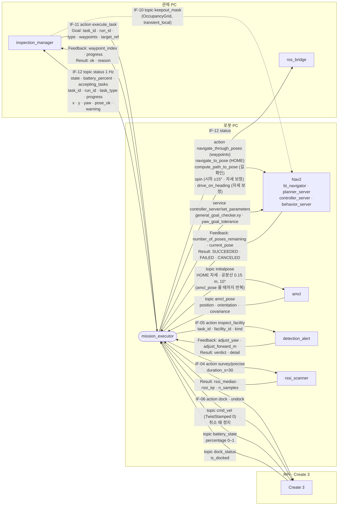
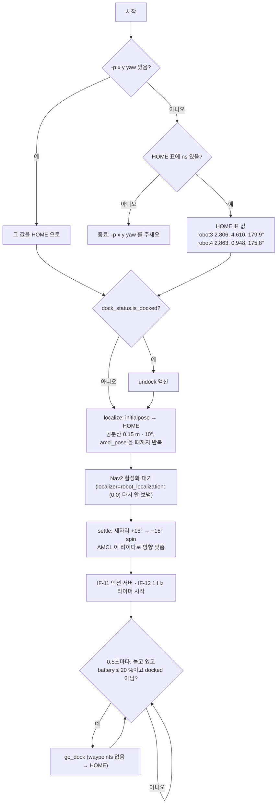
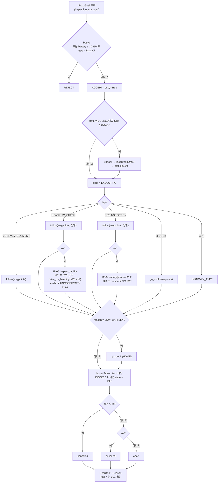
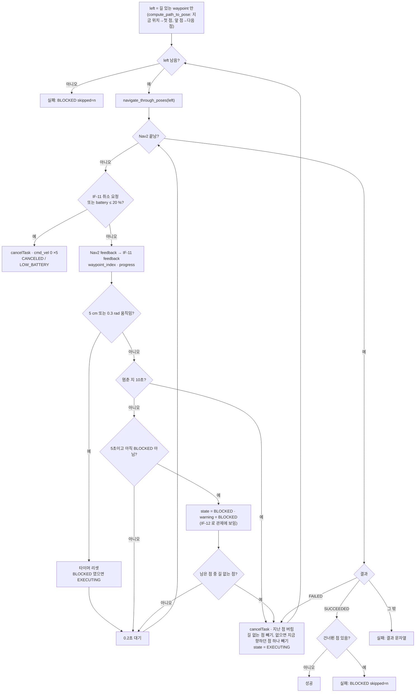
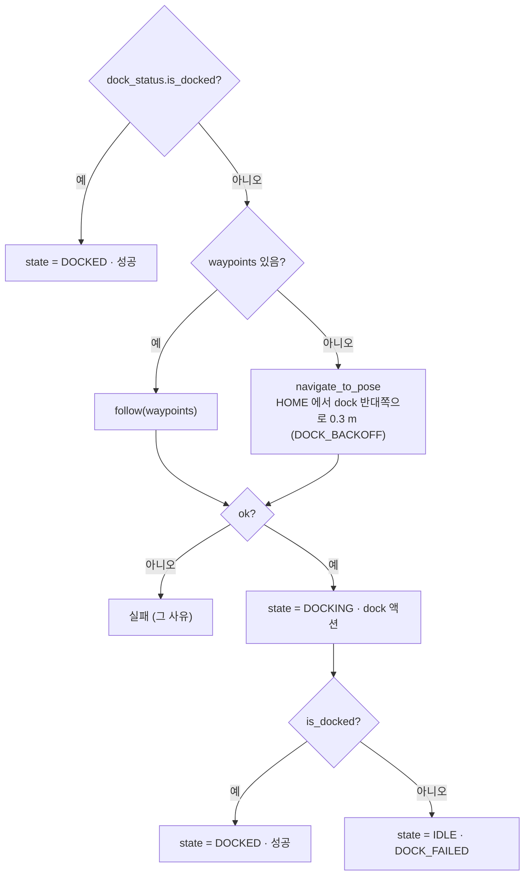

# mission_executor 주행 흐름

2026-10-12 · 기준 코드 `feature/driving` fd23581 `ros2_ws/src/scv_nav/scripts/mission_executor.py` · 인터페이스 `docs/interfaces.md` v0.2.11

주행에 관한 부분만 그렸습니다. 설비 점검(IF-05)·재측정(IF-04)은 "도착 뒤 다른 노드 액션 호출"까지만 나옵니다. `{ns}` 는 `/robot4`·`/robot3` 입니다.

## 1. 외부 노드 ↔ mission_executor

- keepout_mask 는 mission_executor 를 거치지 않고 Nav2 costmap 의 keepout_layer 로 바로 들어갑니다 (점선).
- `dock`·`undock`·`dock_status`·`initialpose` 와 Nav2 액션은 `TurtleBot4Navigator`(`nav`)가 대신 주고받습니다. initialpose 는 `localize()` 가 `nav` 의 publisher 로 직접 보냅니다 (setInitialPose 는 공분산 0 이라 AMCL 이 몇 도 틀린 것을 못 고침).

## 2. 시작 (main)

## 3. 작업 수락·실행 (on_goal · execute)

- 정밀 도착 `follow(..., 정밀)`: 출발 전 set_parameters 로 허용 오차를 0.03 m · 0.052 rad 로 바꾸고, 끝나면 0.05 m · 0.087 rad 로 되돌립니다. 바꾸지 못하면 출발하지 않고 `TOLERANCE_FAILED`.
- waypoints 가 비면 `NO_WAYPOINTS` (DOCK 은 예외: HOME 으로 감).

## 4. 주행·막힘 (follow_loop, E1·E2)

## 5. 복귀 (go_dock)

## 6. artifact 「1 AMR · mission_executor」 와 비교

artifact 는 807b7e9 기준이라 그 뒤(8034dfd·fd23581) 바뀐 곳이 틀립니다.

| 항목 | artifact | 지금 코드 (fd23581) |
| --- | --- | --- |
| 스스로 dock 하는 배터리 | 15 % | **20 %** (`DOCK_PCT`) |
| 허용 오차 | 정밀 0.05 m/0.087 rad, 평소 0.10/0.17 | **정밀 0.03/0.052, 평소 0.05/0.087**. 못 바꾸면 `TOLERANCE_FAILED` |
| 막힘 E1 | 5초에 그 점 건너뜀, 10초에 남은 점 모두 | 5초 BLOCKED(회전 0.3 rad 도 움직임으로 셈). 길 없는 점은 바로 뺌. 10초·Nav2 실패면 길 없는 점, 없으면 지금 향하던 점 **하나만** 뺌. 출발 전에도 길 없는 점을 뺌 |
| DOCK | HOME 으로 가서 dock | waypoints 있으면 그 경로, 없으면 HOME 에서 0.3 m 더 나간 자리. dock 뒤 안 붙었으면 `DOCK_FAILED` |
| 초기 위치 | initialpose 설정 | `localize()`: 공분산 0.15 m·10° 넣어 보냄 → `settle()`: 제자리 ±15° 회전. 시작 때와 Dock 에서 작업 받아 undock 할 때 모두 |
| robot3 HOME | 2.855, 4.656, 176.7° | 2.806, 4.610, 179.9° (10/12 재측정) |
| 입출력 | — | `cmd_vel` 정지, `dock_status`, `compute_path_to_pose`, `navigate_to_pose`, `spin`, `drive_on_heading` 빠짐. initialpose 는 액션이 아니라 토픽 |
| 결과 `rssi_*` · `InspectFacility.run_id` · RCK 종류 | 아직 안 채움 (⚠) | 맞음, 아직 안 채움 |
