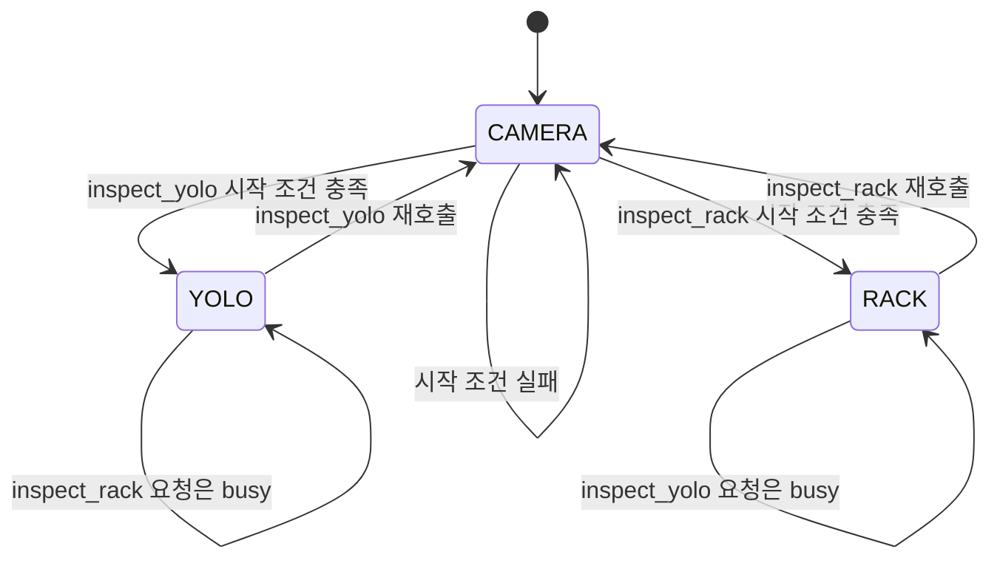
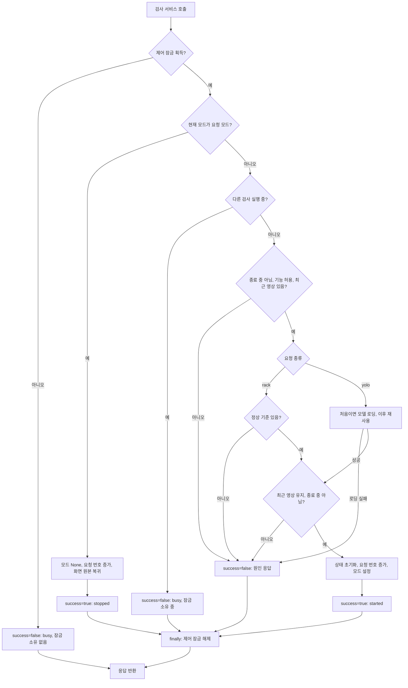
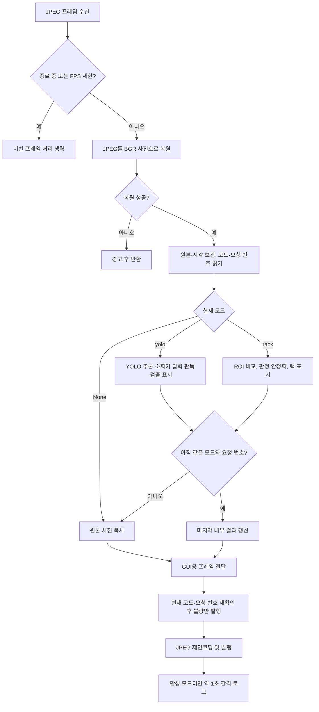
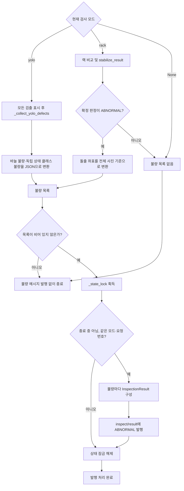
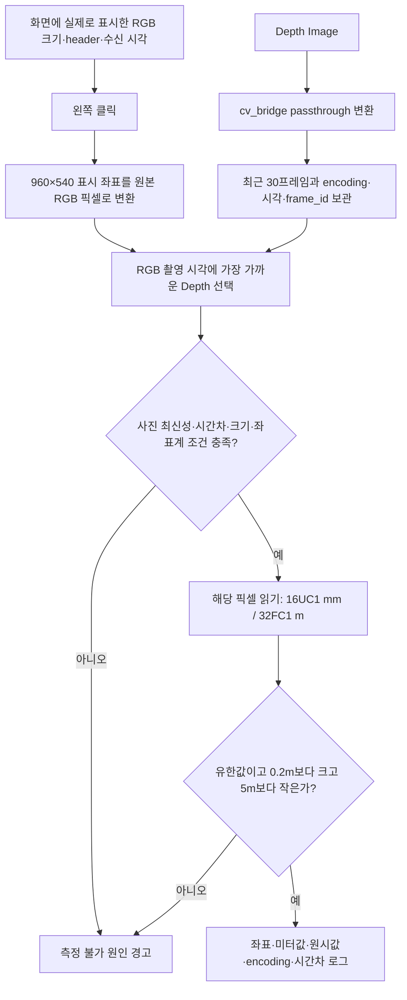
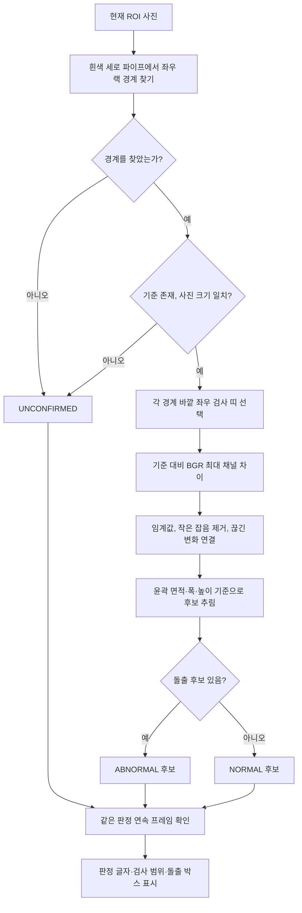
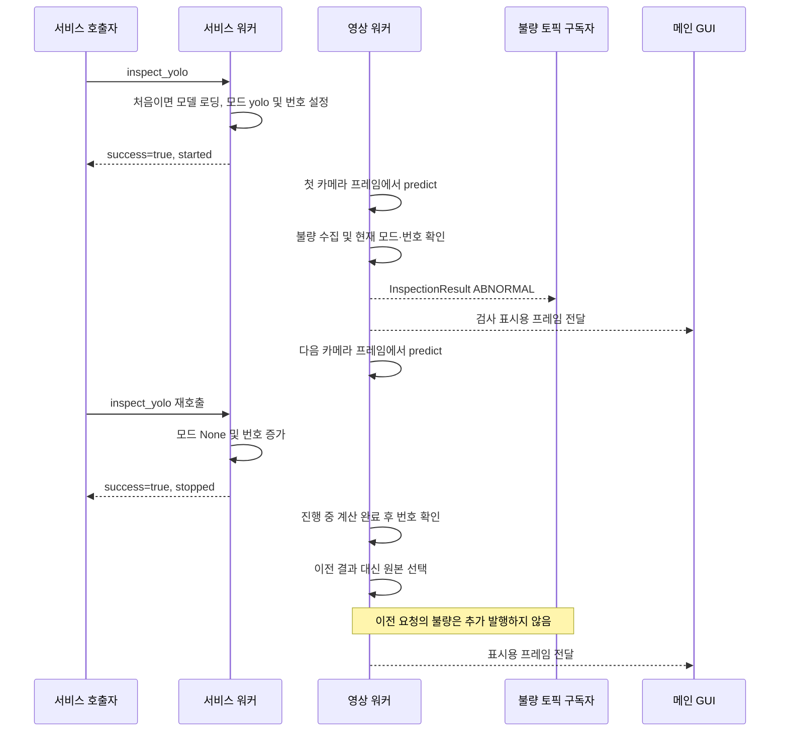

# scv_detection 설계·아키텍처·코드 리뷰 설명서

기준일: 2026-10-14. 현재 소스의 동작을 설명하는 문서이며 운영 기능 제안과 구현 완료 항목을 구분한다.

> 카메라를 항상 구독하는 매니저 하나가 서비스로 선택한 검사 한 가지만 수행합니다. 결과는 영상에 표시하고 불량은 토픽으로 전달합니다. 소화기 노란 바늘 판독과 랙 분석은 별도 함수 모듈에서 처리합니다.

## 1. 요구사항과 설계 결정

| 요구사항 | 현재 구현 | 선택 이유 |
|---|---|---|
| 인자 없이 카메라부터 보고 싶다 | 기본 /robot4, show=true, 모드는 None | 카메라 연결 확인과 검사 실행을 분리한다 |
| YOLO와 랙 중 하나만 실행한다 | None/yolo/rack 중 하나만 보관 | 불가능한 “두 검사 동시 활성” 상태를 표현하지 않는다 |
| 호출하면 계속, 다시 호출하면 중지한다 | 같은 Trigger 서비스로 토글, 자동 종료 없음 | 시작·중지를 같은 명령으로 수동 제어한다 |
| 모델 경로를 매번 입력하지 않는다 | 패키지 share의 models/best.pt 자동 선택 | 사용자 홈 경로와 현재 실행 폴더에 의존하지 않는다 |
| 카메라만 볼 때는 모델을 로딩하지 않는다 | 첫 YOLO 시작 요청에서 지연 로딩 | 시작 비용과 모델 오류를 카메라 실행에서 분리한다 |
| 설비 계산을 따로 시험하고 확장한다 | rack_loading·rack_conditioner·extinguisher_pressure 함수 모듈 | ROS 실행·카메라·모델을 설비마다 복사하지 않는다 |
| 랙·박스 검출 경계로 적재 상태를 표시한다 | 같은 YOLO 결과의 박스 소속·네 경계 비교·연속 확인 | 좌우 방향과 기준 사진에 의존하지 않는 영상 판정 |
| 소화기 안의 압력판 바늘로 압력을 확인한다 | 기존 색 판정·연속 정상 확인 | 물체 이름이나 순간적인 정상 후보로 정상 복귀하지 않는다 |
| 검출된 불량을 외부에서 읽는다 | inspect/result에 InspectionResult 발행 | 기존 메시지 형식으로 불량 종류와 검출 근거를 전달한다 |
| 검출 화면의 한 지점에서 깊이를 확인한다 | 왼쪽 클릭 → 대응 Depth 픽셀을 미터로 로그 출력 | 화면·원본 좌표와 촬영 시각을 확인한 수동 측정 기능 |
| 화면이 멈추지 않고 중지를 받는다 | 메인 GUI + 멀티스레드 executor | 영상 처리와 제어 요청을 별도 콜백 그룹으로 처리한다 |

작업 범위는 `scv_detection` 단독 실행이다. `scv_bringup`은 수정하지 않았다.
카메라 드라이버를 이 패키지가 직접 켜는 것은 아니다. 다른 노드가 발행한 JPEG를 받아 미리보기 창을 표시한다.

## 2. 현재 파일 구조와 책임

아래 경로의 기준 폴더는 `/home/mu-09/final_ws/ros2_ws/src/scv_detection`이다.

```text
scv_detection/
├── scv_detection/
│   ├── __init__.py                 # Python 패키지 표시, 별도 실행 로직 없음
│   ├── scv_detection_manager.py    # ROS 실행·카메라·모드 제어·YOLO·불량 발행
│   ├── rack_conditioner.py         # 랙 검출·기준 비교·안정화·그리기 함수 모음
│   ├── rack_loading.py             # YOLO 랙·박스 연결·경계 초과·연속 확인 함수 모음
│   ├── extinguisher_pressure.py     # 정상 영역 안의 바늘색 존재 판독 함수 모음
│   └── depth_checker.py            # 표시 좌표 변환·깊이 픽셀 단위/유효성 확인
├── models/
│   └── best.pt                    # 현재 5개 객체 클래스 YOLO 가중치
├── config/
│   └── rack_reference.npz         # 정상 랙 기준 영상과 경계 좌표
├── launch/
│   └── detection_alert.launch.py  # 이 패키지만 실행하는 launch
├── resource/
│   └── scv_detection              # ament 패키지 인덱스 등록용 파일
├── test/
│   ├── test_detection_alert.py    # 매니저·서비스·YOLO 표시·불량 발행 회귀 시험
│   ├── test_rack_conditioner.py   # 랙 함수·기준 저장/로드 시험
│   ├── test_extinguisher_pressure.py  # 합성 계기판 각도·정상 범위·미확인 시험
│   └── test_depth_checker.py      # 깊이 좌표·단위·시간 대응·클릭 로그 시험
├── docs/
│   ├── architecture.md           # 이 설명서
│   └── inspection_scenarios_plan.md  # 후속 설비 점검·학습 계획, 현재 실행과 별도
├── README.md
├── package.xml                   # ROS 의존성과 빌드 종류
├── setup.py                      # Python 패키지·자료·console_scripts 설치
├── setup.cfg                     # ROS 실행 스크립트 설치 위치
└── rosdep.yaml                   # Ultralytics 의존성 설치 키
```

실행은 다음 세 이름을 구분해야 한다.

| 종류 | 이름 | 의미 |
|---|---|---|
| ros2 run 실행 이름 | scv_detection_manager | setup.py의 console_scripts 키 |
| Python 클래스 | ScvDetectionManager | rclpy.node.Node를 상속한 대표 클래스 |
| ROS 노드 이름 | detection_alert | 토픽·private 서비스 이름을 구성하는 노드명 |

[setup.py](/home/mu-09/final_ws/ros2_ws/src/scv_detection/setup.py)의 실제 진입점:

```python
# ROS가 이 실행 이름을 찾으면 매니저의 main 함수를 호출한다.
'scv_detection_manager = scv_detection.scv_detection_manager:main'
```

`rack_conditioner.py`는 별도 노드·프로세스가 아니다. 매니저가 import하여 필요한 함수를 호출한다.
`detection_render.py`는 제거했다. 이전 `pressure_gauge.py`, `exit_sign.py`도 현재 파일 구조에 없다.
테스트 파일명 `test_detection_alert.py`는 유지했지만 시험 대상은 현재 매니저다.

### 왜 매니저와 모듈로 나눴는가?

매니저는 “언제, 무엇을 검사하고 어디로 보내는가”를 담당한다. 랙 모듈은 “사진에서 어떻게 돌출 후보를 찾는가”를 담당한다.
설비별로 ROS 노드를 추가하면 카메라 구독, 모드 전환, 화면 처리, 오류 대응을 중복 구현하기 쉽다.
현재 구조에서는 사진과 기준을 입력한 랙 함수를 ROS 서비스 없이 시험할 수 있다.

YOLO 표시는 모든 클래스에 동일한 박스·이름·신뢰도 처리를 적용한다.
박스·이름·신뢰도 표시는 매니저에 두고 소화기 바늘 판독과 판독 결과 그리기는
`extinguisher_pressure.py`로 분리했다. 영상 수신·전체 및 crop 모델 추론·ROS 실행은 매니저에 유지한다.

## 3. 전체 아키텍처: 제어·영상·불량 발행 경로

```mermaid
flowchart LR
    CAMERA["외부 카메라 노드"] --> INPUT["CompressedImage 입력"]
    INPUT --> IMAGE["매니저 image_callback"]
    CLIENT["서비스 호출자"] --> CONTROL["매니저 토글 서비스"]
    CONTROL --> STATE["공유 상태: None / yolo / rack"]
    STATE --> IMAGE
    IMAGE --> IDLE["None: 원본 영상"]
    IMAGE --> YOLO["yolo: model.predict"]
    YOLO --> PRESSURE["소화기 내부 압력판 연결·필요시 crop 추론"]
    YOLO --> LOADING["rack_loading: 랙·박스 소속과 네 경계 비교·연속 확인"]
    LOADING --> LABEL
    PRESSURE --> NEEDLE["extinguisher_pressure: 정상 영역 안의 바늘색 존재"]
    NEEDLE --> CONFIRM["같은 압력계의 연속 정상 확인"]
    CONFIRM --> LABEL["annotate_yolo_result"]
    IMAGE --> RACK["rack: rack_conditioner 함수"]
    REF["정상 기준 NPZ 또는 메모리"] --> RACK
    IDLE --> OUTPUT["JPEG 재인코딩 및 발행"]
    LABEL --> OUTPUT
    RACK --> OUTPUT
    LABEL --> LOG["검출 로그"]
    RACK --> LOG
    LABEL --> EVENTS["현재 모드·요청 번호 확인 후 불량 발행"]
    RACK --> EVENTS
    EVENTS --> TOPIC["inspect/result: InspectionResult"]
    IDLE --> DISPLAY["표시용 프레임"]
    LABEL --> DISPLAY
    RACK --> DISPLAY
    DISPLAY --> GUI["메인 스레드 GUI"]
    DEPTH["RGB에 정렬된 Depth Image"] --> CACHE["depth_callback: 최근 30프레임"]
    GUI --> CLICK["왼쪽 클릭: 표시 RGB의 좌표·시각"]
    CACHE --> CLICK
    CLICK --> DEPTHLOG["Depth 픽셀을 미터로 로그 출력"]
    GUI --> KEYS["N 저장 / R 초기화"]
    KEYS --> REF
```



서비스 콜백은 검사 결과를 기다리는 작업 루프가 아니다.
검사 모드만 바꾸고 응답한다. 이후 수신되는 프레임을 `image_callback`이 현재 모드에 따라 처리한다.
단, 첫 YOLO 시작 서비스에는 모델 로딩 시간이 포함된다.

세 경로는 역할이 다릅니다. 서비스는 검사 모드를 바꾸고, 영상 토픽은 카메라 또는 검사 화면을 전달하며,
불량 토픽은 검출된 불량의 종류와 근거를 전달합니다. 서비스 응답이나 영상 표시 색상을 외부 시스템이 해석하는 대신,
`InspectionResult`의 `kind`, `verdict`, `detail`을 읽어 불량을 구분할 수 있습니다.

## 4. 상태 전이와 서비스 계약

`enable_yolo`와 `rack_enabled`는 서비스를 제공할지 정하는 설정이다.
둘 다 true여도 두 검사가 켜진 것은 아니다. 실제 실행 상태는 `_inspection_mode` 하나다.



| 현재 상태 | inspect_yolo 호출 | inspect_rack 호출 |
|---|---|---|
| None: 카메라 대기 | YOLO 시작 | 랙 시작 |
| yolo | YOLO 중지 → 대기 | busy, 기존 YOLO 유지 |
| rack | busy, 기존 랙 유지 | 랙 중지 → 대기 |

- 두 서비스 타입은 `std_srvs/srv/Trigger`이며 요청 내용은 `{}`이다.
- `success=true`는 시작 또는 중지에 성공했다는 뜻이다. 물체가 NORMAL이라는 뜻이 아니다.
- `message`에 `started`, `stopped`, `busy` 또는 실패 원인이 들어간다.
- 검사 판정은 영상과 로그에 표시하고, 불량은 `inspect/result` 토픽에도 발행한다. `_inspection_result`는 마지막 프레임의 내부 기록이며 발행 메시지와는 별도다.
- 다른 모드로 바로 전환하지 않는다. 현재 검사 중지 → 다른 검사 시작의 두 호출이 필요하다.
- 토글은 멱등적이지 않다. 즉 같은 요청을 두 번 보내면 상태가 원래대로 돌아온다. 재시도 정책은 운영 연동 전에 정해야 한다.

### 서비스 처리 플로우차트



잠금을 얻은 뒤 다른 모드 때문에 busy를 반환해도 `finally`에서 해제한다.
첫 잠금 획득 자체가 실패한 요청은 잠금을 소유하지 않으므로 해제하지 않는다.
중지 분기가 시작 조건보다 앞에 있어 카메라 단절이나 기준 누락 상태에서도 중지를 받는다.

## 5. 한 프레임의 처리 순서와 코드

[매니저 소스](/home/mu-09/final_ws/ros2_ws/src/scv_detection/scv_detection/scv_detection_manager.py)의 `image_callback`:



다음은 실제 분기 구조의 핵심 발췌다. 오류 처리·요청 번호 확인·발행 코드는 설명을 위해 생략했다.

```python
# 한 프레임에는 선택된 검사 하나만 실행한다. None이면 원본 복사본을 그대로 사용한다.
if mode == 'yolo':
    result = self.model.predict(
        source=frame, conf=self.conf, iou=self.iou, imgsz=self.imgsz,
        device=self.device, verbose=False,
    )[0]
    pressure_reports = self._inspect_extinguisher_pressures(result)
    loading_result = self._inspect_rack_loading(result)
    pressure_reports = self._stabilize_extinguisher_pressures(
        pressure_reports, now, message.header.stamp, request_id)
    loading_result = self._stabilize_rack_loading(
        loading_result, now, message.header.stamp, request_id, message.header.frame_id)
    annotated, detections = self.annotate_yolo_result(result, pressure_reports, loading_result)
    defects = self._collect_yolo_defects(result, pressure_reports, loading_result)
elif mode == 'rack':
    roi_frame, roi_box = self.crop_rack_roi(frame)
    rack_report = rack_conditioner.stabilize_result(
        rack_conditioner.inspect_rack(
            roi_frame, reference=self.reference_for_roi(roi_box),
            **self.rack_inspect_options),
        rack_state, self.rack_confirm_frames)
```

이 `if/elif`가 한 프레임에서 두 검사를 동시에 실행하지 않는 직접적인 근거다.
YOLO는 전체 사진에서 설비를 찾고 랙·박스 적재 관계도 판독한다. 압력판 후보가 없으면
소화기 crop을 재분석한다. 별도 rack 모드는 기존 사진 비교를 위해 지정한 ROI만 분석한다.

처리가 오래 걸리는 동안 중지 요청이 오면 `_inspection_id`가 바뀐다.
처리 후 읽었던 번호와 현재 번호를 비교하여 이전 검사의 결과를 내부 상태·표시용 프레임에 채택하지 않는다.

```python
# 검사 시작·중지마다 번호를 바꾸고, 프레임 완료 때 같은 검사인지 확인한다.
if mode is not None and mode == self._inspection_mode and request_id == self._inspection_id:
    self._inspection_result = outcome
elif mode is not None:
    annotated = frame.copy()
    detections = []
    defects = []
    rack_report = None
    mode = None
```

중지는 이미 시작된 모델 계산 자체를 강제로 취소하지 않는다. 모드를 중지하고 완료된 옛 결과를 걸러낸다.
JPEG 발행 직전까지 원자적인 취소를 보장하는 설계는 아니므로 중지 직후의 화면·출력 지연은 별도 측정해야 한다.
불량 메시지는 발행 직전에 모드·요청 번호·종료 상태를 다시 확인하고 상태 잠금 안에서 발행한다.
따라서 중지 응답 뒤에 이전 검사 결과로 새 불량을 발행하지 않는다. 중지 전에 발행한 메시지의 네트워크 수신은 늦을 수 있다.
대기 영상도 디코딩·재인코딩하므로 “검사 없는 원본 내용”이지 원본 JPEG 바이트의 그대로 전달은 아니다.

### 5.1 불량 발행 처리 흐름

YOLO는 `_collect_yolo_defects`에서 발행 대상을 만들고, 랙은 연속 확인된 ABNORMAL 판정의 돌출 목록을 만듭니다.
두 경로 모두 `(설비 종류, JSON 설명)` 목록을 공통 발행 함수에 전달합니다.
이 함수는 그림을 그리거나 불량을 새로 판정하지 않고, 현재 검사에서 나온 결과만 ROS 메시지로 전송합니다.



소화기에 연결된 압력계는 바늘 판독 결과로 기존 상태 클래스 판정을 대체합니다.
연결되지 않은 압력계 상태 클래스와 유도등 소등은 기존 불량 처리를 유지합니다.
랙은 확인 중인 프레임을 발행하지 않고 기본 3프레임 연속 확인 직후부터 발행합니다.
발행은 약 1초 간격의 로그 출력과 별개이며, 서비스 종료를 기다리지 않습니다.

### 5.2 공통 발행 함수와 중지 시 결과 차단

다음은 매니저 `_publish_defects`의 실행 로직입니다. 설명용 docstring과 주석을 제외한 동작은 현재 소스와 같습니다.

```python
def _publish_defects(self, defects, stamp, mode, request_id) -> None:
    """현재 검사에 속한 불량만 골라 설비 종류·시각·JSON 근거를 토픽으로 보낸다."""
    if not defects:
        return
    with self._state_lock:
        if (self._stop_event.is_set() or mode != self._inspection_mode
                or request_id != self._inspection_id or mode not in ('yolo', 'rack')):
            return
        event_stamp = stamp if stamp.sec or stamp.nanosec else self.get_clock().now().to_msg()
        for kind, detail in defects:
            event = InspectionResult()
            event.stamp = event_stamp
            event.robot_id = self.get_namespace().strip('/')
            event.kind = kind
            event.verdict = InspectionResult.ABNORMAL
            event.detail = detail
            event.attempts = 1
            # 상태 확인부터 발행까지 잠금을 유지해 중지 요청과 전송 순서가 엇갈리지 않게 한다.
            self.result_publisher.publish(event)
```

검사 시작·중지마다 `_inspection_id`가 바뀌므로 같은 YOLO 모드로 돌아와도 이전 요청의 계산 결과는 채택하지 않습니다.
상태 확인과 발행을 같은 잠금 안에서 처리하므로 중지 응답 이후 이전 요청의 불량을 새로 발행하지 않습니다.
단, 중지 전에 이미 발행한 메시지가 네트워크를 통해 늦게 도착하는 것까지 취소하는 것은 아닙니다.

## 6. 매니저 함수별 역할과 입출력

| 함수 | 받는 것 → 돌려주는 것 | 하는 일과 이유 |
|---|---|---|
| _find_default_weights | 없음 → 모델 경로 문자열 | ament share에서 best.pt를 찾아 사용자별 경로를 없앤다 |
| _find_default_reference | 없음 → 기준 경로 또는 빈 문자열 | 설치 위치에서 개발 워크스페이스의 소스 config를 추정한다 |
| depth_callback | sensor_msgs/Image → 반환값 없음 | cv_bridge로 깊이를 복원하고 최근 사진·촬영/수신 시각·좌표계를 보관한다 |
| show_preview_frame | 표시 사진·header·수신 시각 → 반환값 없음 | 메인 스레드에서 화면을 표시하며 클릭에 쓸 RGB 메타데이터를 보관한다 |
| mouse_callback | 마우스 이벤트·표시 좌표 → 반환값 없음 | 왼쪽 클릭에서 원본 픽셀을 구하고 대응 Depth의 값 또는 경고를 로그로 출력한다 |
| time_difference | Depth 기록 → RGB와의 시간차(초) | mouse_callback 내부 보조 함수로, 촬영 시각이 0이면 수신 시각을 사용한다 |
| __init__ | ROS 노드 생성 옵션 → 노드 초기화 | 파라미터·잠금·서비스·영상·불량 통신·GUI를 준비하고 모델은 아직 로딩하지 않는다 |
| crop_rack_roi | BGR 사진 → ROI 사진, 전체 사진 기준 좌표 | 0~1 비율 설정을 실제 픽셀로 바꿔 자른다 |
| reference_for_roi | ROI 좌표 → 기준 자료 또는 None | 현재 ROI 기준은 그대로, 과거 전체 사진 기준은 잘라 좌표를 옮긴다 |
| capture_rack_reference | 없음 → bool | 제어 잠금을 얻고 검사 대기 중에만 저장 작업을 허용한다 |
| _capture_rack_reference | 없음 → bool | 최신 ROI에서 파이프를 찾고 기준을 메모리·선택 NPZ에 저장한다 |
| reset_rack_reference | 없음 → bool | 대기 중 메모리 기준·연속 판정을 초기화한다. 파일은 지우지 않는다 |
| _load_yolo_model | 없음 → 반환값 없음 | 첫 요청 때 경로 확인·Torch/YOLO 로딩·장치 선택 후 모델을 재사용한다 |
| _handle_inspect_yolo | Trigger 요청·응답 → 응답 | 공통 제어 함수에 yolo를 전달한다 |
| _handle_inspect_rack | Trigger 요청·응답 → 응답 | 공통 제어 함수에 rack을 전달한다 |
| _handle_inspection | 모드·응답 → 응답 | 시작·중지 토글, 충돌 거절, 시작 조건 확인을 한곳에서 처리한다 |
| _inspect_extinguisher_pressures | YOLO Results → 소화기별 판독 목록 | 내부 압력판 연결·필요시 crop 추론 후 함수 모듈로 판독한다 |
| _stabilize_extinguisher_pressures | 사진 판독·수신/촬영 시각·요청 번호 → 확정 목록 | 현재 검사·유효 시각을 확인하고 모듈에 연속 정상 확인을 맡긴다 |
| _inspect_rack_loading | YOLO Results → racks/boxes 후보 | 같은 추론의 랙·박스를 이름으로 추출해 경계 판독을 맡긴다 |
| _stabilize_rack_loading | 후보·수신/촬영 시각·요청 번호·카메라 ID → 확정 결과 | 현재 검사·영상 유효성을 확인하고 대상별 연속 확인을 맡긴다 |
| _check_pressure_camera_timeout | 없음 → 반환값 없음 | 별도 타이머에서 영상 단절 시 압력·적재 이력과 오래된 GUI 판정을 지운다 |
| annotate_yolo_result | YOLO Results·확정 압력/적재 판독 → 표시 사진, 로그 | 설비별 확정 상태로 색상과 로그를 만든다 |
| _collect_yolo_defects | YOLO Results·확정 압력/적재 판독 → 설비 종류·JSON 목록 | 압력·적재·독립 상태 클래스 불량을 추린다 |
| _publish_defects | 불량 목록·영상 시각·모드·요청 번호 → 반환값 없음 | 현재 검사 결과만 ABNORMAL 메시지로 발행한다 |
| image_callback | CompressedImage → 반환값 없음 | 사진 복원·선택 검사·표시·불량·JPEG 발행·로그를 수행한다 |
| destroy_node | 없음 → ROS 정리 결과 bool | 종료 표시와 GUI·ROS 자원 정리를 수행한다 |
| main | 없음 → 반환값 없음 | ROS 시작, 노드·executor 생성, 메인 GUI·깊이 클릭·키 입력과 종료 정리를 담당한다 |

함수명 앞의 `_`는 모듈·클래스 내부에서 사용할 보조 기능이라는 의미다.
대표 클래스는 파일명에 맞춘 `ScvDetectionManager`이며 클래스명에는 밑줄이 없다.

### 6.1 화면 클릭 깊이 측정

참고 파일은 `/home/mu-09/to_students/day3/3_3_a_depth_checker.py`입니다.
이 파일에서 깊이 구독·픽셀 읽기·mm→m 변환을 참고했고, 도킹·언도킹·이동 기능은 가져오지 않았습니다.
현재 매니저의 메인 스레드 GUI를 유지하며 창에 `cv2.setMouseCallback`을 등록합니다.



`depth_checker.py`는 ROS 구독 없이 시험할 수 있는 함수 모듈입니다.

| 함수 | 입력 → 반환 | 역할 |
|---|---|---|
| display_to_image_point | 클릭 좌표·원본 크기·표시 크기 → 원본 (x,y) 또는 None | 표시를 위해 축소·확대한 사진의 좌표를 원본 픽셀로 환산한다 |
| sample_depth_meters | 깊이 배열·픽셀·encoding·유효 범위 → 미터값 또는 None | 단위를 변환하고 0·비유한값·범위 밖 값을 제외한다 |

표시 RGB와 Depth의 해상도가 다르면 임의로 비례 확대하여 같은 지점이라고 가정하지 않습니다.
두 frame_id가 모두 있는 경우 서로 다르면 거절합니다. frame_id가 없는 입력의 정렬 여부는 운영자가 확인해야 합니다.
촬영 시각이 있는 경우 최근 캐시에서 시간차가 가장 작은 프레임을 사용합니다. 시각이 0이면 수신 시각 차이로 대체합니다.
기본 Depth 최대 수신 경과 시간은 1초, 허용 촬영 시각 차이는 0.2초이며 설정으로 변경할 수 있습니다.

로그 예시: `Depth RGB=(320, 240): 1.420 m raw=1420 encoding=16UC1 dt=0.012 s`.
클릭 위치를 노란 십자로 표시하며 로그는 클릭할 때 한 번 출력합니다. Depth 조회는 카메라·YOLO·랙 모드 모두 가능하고 불량 판정에는 사용하지 않습니다.
이 값은 카메라 Z축 깊이이며 3D 직선 거리·지도 좌표·설비 전체의 거리 또는 돌출 길이가 아닙니다. [ROS REP 118](https://github.com/ros-infrastructure/rep/blob/master/rep-0118.rst)

## 7. 모델 이름별 역할과 소화기 바늘 판독

2026-10-13 실제 가중치 로딩에서 `box`, `exit_sign`, `fire_extinguisher`, `pressure_gauge`,
`rack` 순서의 5개 객체 클래스를 확인했다. 소화기·압력계 역할을 이름으로 선택하므로
이전 상태 모델의 ID와 섞지 않는다. 소화기 내부 압력판은 바늘로 판독하고 다른 객체 이름은
존재·위치만 표시하며 회색 미확인으로 둔다. `exit_sign` 자체로 점등 상태를 추정하지 않는다.

아래 표는 이전 6개 상태 클래스 모델의 호환 색상표다. 실제 ID를 그대로 쓰지 않고
클래스 이름을 `YOLO_LABEL_STYLE_IDS`로 연결한다. 소화기 내부 바늘 판독은 이 표보다 우선한다.

| 이전 ID | 상태 클래스 이름 | OpenCV BGR | 기본 표시·로그 의미 |
|---:|---|---|---|
| 0 | Abnormal_left | (0, 0, 255) | 빨강, ABNORMAL |
| 1 | Abnormal_right | (0, 0, 255) | 빨강, ABNORMAL |
| 2 | Fire Extinguisher | (192, 192, 192) | 회색, UNCONFIRMED |
| 3 | Normal | (0, 255, 0) | 초록, NORMAL |
| 4 | Exit_sign_on | (0, 255, 0) | 초록, NORMAL |
| 5 | Exit_sign_off | (0, 0, 255) | 빨강, ABNORMAL |

색상은 RGB가 아니라 OpenCV의 BGR 순서다.
`good/pre_good` 등은 지원 이름에 포함하지 않는다. 실제 검출된 클래스만 표시한다.

`annotate_yolo_result`는 `result.orig_img` 복사본에 모든 박스·이름·신뢰도를 그린다.
등록되지 않은 이름도 회색으로 표시하며 제외하지 않는다.
로그 문자열 예시는 `Normal:0.90 verdict=NORMAL`이다.

전체 소화기 클래스는 물체의 존재를 보여 줄 뿐 압력계 정상 상태를 증명하지 않는다.
둥근 압력판 테두리와 정상 영역이 확인되어야 판독한다. 영역 안에 바늘색이 없으면 비정상이다.
정상 복귀는 같은 압력계에서 연속으로 관측한 정상 후보의 시간과 개수로 확인한다.
모델 교체 시 실제 `model.names`가 지원하는 객체·상태 이름과 맞는지 확인해야 한다.

표시와 발행 대상은 구분합니다. `YOLO_CLASS_STYLES`는 이전 상태 클래스의 기본 색상·로그 상태를 정하고,
소화기 압력 및 랙·박스 적재 판독이 있으면 해당 확정 상태를 우선합니다.
`YOLO_DEFECT_KINDS`는 이름으로 연결된 이전 상태 불량을 소화기 또는 유도등 이벤트로 변환합니다.
소화기 내부 바늘 불량은 별도 판독 근거를 담아 소화기당 한 건 발행합니다.

### 7.1 압력판의 측정 흐름과 보류 조건

압력판 면적의 90% 이상이 소화기 안에 있고 소화기 면적의 절반 이하인 후보를 연결한다.
전체 검출에 후보가 없으면 같은 YOLO를 소화기 crop에 한 번 더 적용한다. crop 좌표를
전체 영상 좌표로 바꾸고 소화기 바깥 픽셀은 잘라낸 뒤 `inspect_pressure`를 호출한다.
재추론 실패는 해당 소화기만 미확인으로 처리하여 다른 설비 결과를 유지한다.

함수 모듈은 원형 테두리의 중심을 찾고 HSV로 노란 바늘·녹색 구간을 추출한다.
주황빛 바늘과 어두운 청록색 구간도 검사하며 붉은 눈금 띠 밖의 파란 인쇄 영역을 제외한다.
붉은 눈금이 없으면 H 90을 넘는 청색은 사용하지 않는다. 녹색 정상 구간의 양 끝으로
바늘에 가린 정상 영역을 채우고 RGB에서 R이 G·B보다 20 이상 높은 빨간 배경을 제외한다.
노란·주황빛 바늘색으로 추출한 픽셀은 빨간 배경으로 제외하지 않는다.
JPEG 색 번짐은 H 하한을 최대 3 낮추되 주변보다 V가 15 이상 밝은 픽셀만 보완한다.
반지름 40~90%의 정상 영역 안에 붙어 있는 바늘색 픽셀이 기본 3개 이상이면 NORMAL,
없거나 부족하면 ABNORMAL이다. 바늘 각도·끝점 방향·경계 각도 보류는 사용하지 않는다.

최소 원본 지름은 기본 24픽셀이다. 원·정상 영역 근거가 부족하면 미확인이다.
정상 영역이 확인됐는데 바늘색이 없으면 비정상이며, 가림이나 색 검출 실패도 이 경우에 포함된다.
심한 사선 촬영은 둥근 테두리 조건으로 일부 제외하지만 자세 보정·실제 압력 단위 환산은 하지 않는다.
같은 계기의 겹친 후보는 근거가 좋은 결과를 선택하고 확정 결과가 모순되면 보류한다.
서로 다른 계기나 여러 소화기에 속할 수 있는 압력판도 보류한다.

기존 색 범위·RGB 빨간 배경 제외·정상 영역 안 바늘색 픽셀 존재 판정은 유지한다.
바늘의 길이·폭·중심 연결 조건은 추가하지 않는다. `stabilize_pressure_reports`에서만
소화기 박스 겹침·계기 중심/크기·정상 구간으로 같은 대상을 일대일 연결하여 정상 복귀를 확인한다.
NORMAL 후보가 기본 0.5초 이상, 최소 3개의 새 프레임에 연속으로 나타나야 NORMAL을 확정한다.
비정상 후보는 즉시 반영한다. 정상 확인 중에는 직전 ABNORMAL을 유지하며, 최초 정상 후보는
미확인이다. 미확인 관측은 확정 상태와 연속 확인 횟수를 지운다.
화면·내부 결과·불량 발행에 같은 확정 목록을 전달하고 사진 단위 판정은 `raw_status`로 남긴다.

대상 누락·연결 모호성·큰 이동·검사 시작/중지·영상 변환/추론 실패 때 이력을 버린다.
촬영 시각이 있는 중복·역순 프레임도 확인에 세지 않는다. 촬영 시각이 0이면 수신 시각을 사용한다.
manager의 별도 타이머는 `camera_timeout`(기본 2초) 영상 단절 시 압력 이력·내부 결과를 지우고
GUI를 원본+미확인 경고로 바꾼다. 유효 시간을 넘긴 느린 YOLO 결과도 화면·불량에 채택하지 않는다.
추적 번호는 영상 안의 짧은 연결 번호이며 실제 설비 ID를 보장하지 않는다.
시간 확인은 순간적인 판정 변화를 줄이며 압축·조명 때문에 지속되는 색 오판을 고치지는 않는다.
이번 수정은 코드 구문·변경 내역만 확인했으며 영상 실험·테스트·ROS 노드 실행은 하지 않았다.

`pressure_normal_start_deg/end_deg`가 모두 -1이면 녹색만 사용한다. 현장에서 보정한 두 각도를
지정하면 녹색 검출 실패 때 사용한다. 보정 영역 안에도 바늘색이 없으면 비정상이다.
촬영 자세가 바뀌면 보정 범위도 다시 확인해야 한다. 색상·크기·최소 픽셀 설정과 실행 방법은 README를 참고한다.

## 7.2 YOLO 랙·박스 적재 판독

`rack_loading.py`는 이미 추론한 랙·박스의 원본 실수 좌표만 입력받는다. 박스 면적에 대한
랙 겹침 비율이 가장 높은 랙에 소속을 연결하되, 상위 두 후보 차이가 기본 0.10 이하면 보류한다.
아무 랙과도 겹치지 않는 박스는 소속 미확인이며 다른 랙의 불량으로 보내지 않는다.

왼쪽 초과는 `max(0, rack.x1-box.x1)`, 오른쪽은 `max(0, box.x2-rack.x2)`다.
위·아래도 같은 식으로 계산한다. 어느 한쪽을 먼저 선택하는 분기가 없어 양쪽 동시 초과도 기록한다.
기본 경계 여유는 0이며 허용오차는 랙 너비/높이 비율로 조절한다. 초과 픽셀·비율은 JSON 근거다.

이전 랙 및 그 안의 박스와 IoU 기반의 일대일 연결이 가능할 때만 이력을 이어 쓴다.
현재·이전 검출이 서로 최상위 후보이며 차순위 점수와의 차이가 기본 0.10을 넘어야 연결한다.
여러 이전 박스와 겹친다는 이유만으로 연결을 전부 보류하지 않고 최상위 후보를 비교한다.
같은 박스의 후보가 기본 3개의 새 프레임에 연속될 때 정상/불량을 확정한다. 확인 중에는 미확인이다.
다른 박스가 추가·누락되어도 계속 연결되는 박스의 확인 횟수는 유지한다.
신규·모호한 대상만 새로 확인하고 누락된 대상의 이력은 버린다. 랙 정상 복귀에는 같은 구성의
정상 후보가 연속되어야 하므로 불량 박스가 잠깐 사라져도 즉시 정상으로 바꾸지 않는다.
박스별 확인과 랙 정상 구성 확인은 같은 관측에서 병행한다.
랙은 확정 불량 박스가 있으면 불량, 연결된 모든 박스가 정상이고 모호성이 없으면 정상이다.
연결 박스 부재·영상 가장자리 잘림·소속 모호성은 정상으로 추정하지 않는다.
보류 사유는 해당 박스의 실제 이유를 랙에도 표시한다. 화면의 초과 텍스트에 확인 횟수와
matched/new·ambiguous 상태를 붙이고 로그에 대상 번호를 남겨 반복 초기화를 확인할 수 있게 한다.

현재 검사 번호와 카메라 frame_id·수신/촬영 시각을 확인한다. 시작/중지·영상 단절·변환/추론 실패·
중복/역순 관측 시 확인 이력을 초기화하거나 보류한다. 화면·로그·ROS 발행은 같은 확정 결과를 사용한다.
불량은 랙당 한 건으로 `KIND_RACK`에 발행한다. `source=yolo_rack_box_containment`,
`rack_bbox`, 대상 번호, `coordinate_format=xyxy`, 초과 방향/픽셀/비율을 포함한 `protrusions`를 담는다.

YOLO 모드의 이 기능은 정상 기준 사진과 고정 ROI를 사용하지 않는다. 아래 rack 모드의 기존
사진 비교는 별도로 유지한다. 실행·파라미터 설명은 README를 참고한다.
랙 검출 박스는 랙 구조 외곽이어야 한다. 사각형 경계 비교는 물리적인 앞뒤 돌출 거리를 보장하지 않는다.
이번 구현은 코드 구문·변경 내역만 확인했으며 테스트·모델 추론·ROS 노드 실행은 하지 않았다.

## 8. 기존 rack 모드: 정상 사진과 바깥 검사 띠의 변화 비교

[랙 모듈 소스](/home/mu-09/final_ws/ros2_ws/src/scv_detection/scv_detection/rack_conditioner.py)는 다음 순서로 동작한다.



위 흐름의 NORMAL은 “검사한 띠에서 유효한 변화 후보가 없음”이라는 뜻이다.
현재 코드에는 띠가 모두 너무 작아 검사에서 제외된 경우에도 NORMAL로 내려가는 경계 조건이 있다. 안전한 판정 조건 보완은 13절에 구분했다.

### 8.1 경계 검출과 기준 준비

`detect_rack`은 HSV에서 밝고 채도가 낮은 흰색 후보를 고르고, 세로로 길게 이어진 픽셀 열을 찾는다.
잡음을 제거한 뒤 ROI 높이의 30% 이상 이어지는 후보를 묶고, 폭·거리·높이 유사성이 맞는 파이프 두 개를 선택한다.
반환값은 `{'left', 'right', 'top', 'bottom'}` 좌표 dict이며 실패하면 None이다.

정상으로 적재한 상태에서 N을 누르면 매니저가 최신 ROI를 전달한다.
`capture_reference`는 사진과 좌표를 복사한다. 내부 밝기 표준편차가 8 미만이면 빈 화면으로 보고 거절한다.
이는 운영자가 정상 상태를 확인하는 절차를 대신하지 않는다.

NPZ에는 `frame`, `rack_left`, `rack_right`, `rack_top`, `rack_bottom`이 들어간다.
R은 메모리 기준만 지우며 파일을 삭제하지 않는다. N/R은 검사 중에는 거절한다.

### 8.2 검사 띠·색상 비교·연속 확인

매니저 기본 설정에서 경계 바깥 30~90픽셀 구간을 비교한다.
세로는 파이프 높이의 위 12%, 아래 4%를 제외한다.
현재 경계와 기준 경계의 각 띠를 기준으로 같은 크기 영역을 비교하되 원근 변화까지 정합하지는 않는다.

```python
# 밝기만 비교하지 않고 BGR 중 가장 크게 달라진 채널을 사용한다.
diff = cv2.absdiff(ref_zone, cur_zone)
if len(diff.shape) == 3:
    diff = diff.max(axis=2)
changed = cv2.threshold(diff, diff_threshold, 255, cv2.THRESH_BINARY)[1]
```

이후 OPEN 5×5로 작은 잡음을 제거하고 CLOSE 9×9로 끊긴 변화 영역을 연결한다.
윤곽 면적 300픽셀 이상, 폭 8픽셀 이상, 높이 15픽셀 이상을 돌출 후보로 남긴다.
랙 안쪽 적재 변화는 이 검사 대상이 아니다.

`stabilize_result`는 같은 판정이 기본 3개 **처리 프레임** 연속으로 나올 때 확정한다.
3초라는 뜻이 아니다. 미확인이나 좌우 경계의 15픽셀 초과 이동은 연속 상태를 초기화한다.

### 8.3 랙 함수별 역할

| 함수 | 입력 → 반환 | 역할 |
|---|---|---|
| _longest_run_per_column | 흰색 마스크 → 열별 최장 길이·시작 행 배열 | 세로 파이프 후보의 연속성을 계산한다 |
| detect_rack | BGR 사진 → 경계 dict 또는 None | 흰색 파이프 두 개를 찾는다 |
| capture_reference | 사진·경계 → 기준 dict 또는 None | 정상 비교용 복사본을 만든다 |
| save_reference | 기준 dict·파일 경로 → 반환값 없음 | 폴더를 준비하고 NPZ를 저장한다 |
| load_reference | 파일 경로 → 기준 dict 또는 None | 파일이 없거나 읽기 실패 시 기준 없음으로 처리한다 |
| _check_zone | 기준·현재 띠 → 변화 bbox·면적 목록 | BGR 차이와 윤곽 필터로 후보를 추린다 |
| inspect_rack | 사진·선택 경계·기준·옵션 → report dict | 미확인·정상·이상과 이유·검사 구역·돌출 후보를 만든다 |
| stabilize_result | report·상태 dict·필요 프레임 수 → 안정화 report | 상태 dict를 갱신하고 확정 전에는 미확인으로 돌려준다 |
| draw_result | 사진·report → 표시 사진 | 원본을 보존하고 노란 검사 범위, 빨간 돌출 박스, 판정 글자를 그린다 |
| scale_display_point | 창 좌표·사진 크기 → 사진 좌표 또는 None | 좌표 환산 보조 함수. 현재 매니저에서는 호출하지 않는다 |

랙 함수의 기본 인자는 margin=10, zone_width=70, diff_threshold=25다.
실제 노드에서는 매니저가 30/90/35를 명시 전달하므로 운용 기본값과 함수 자체 기본값을 혼동하면 안 된다.

## 9. 스레드·콜백 그룹·잠금의 역할

| 실행 위치·장치 | 책임 | 막는 문제 |
|---|---|---|
| 메인 스레드 | 창 생성·imshow·waitKey·깊이 클릭·N/R | GUI가 콜백 처리에 섞여 멈추는 문제 |
| spin 관리 스레드 | executor.spin 호출 | 메인 GUI 루프를 ROS spin으로 막는 문제 |
| executor 워커 3개 | 영상 콜백과 서비스 콜백 | 영상 처리 중 제어 요청을 못 받는 문제 |
| 기본 MutuallyExclusive 그룹 | image_callback | 같은 노드의 영상 처리를 동시에 겹치지 않게 한다 |
| 별도 Reentrant 그룹 | 두 검사 서비스 | 제어 요청끼리 겹칠 때 busy를 응답할 수 있게 한다 |
| 별도 MutuallyExclusive 그룹 | depth_callback | RGB 모델 추론 중에도 깊이 프레임을 갱신할 수 있게 한다 |
| _inspection_lock | 시작·중지·N/R의 전체 제어 작업 | 동시 모델 로딩·모드 변경·기준 변경 충돌 |
| _state_lock: RLock | 모드·프레임·결과 접근과 불량 발행 직전 확인·전송 | 상태 변경과 불량 발행이 서로 엇갈리지 않도록 보호한다 |
| _inspection_id | 검사 세대 번호 | 중지 이전의 결과가 다음 검사에 섞이는 문제 |
| _stop_event | 노드 종료 표시 | 종료 중 새 영상 처리나 시작 요청 방지 |

워커가 세 개라고 YOLO·랙·서비스가 각각 전용 스레드를 하나씩 갖는 것은 아니다.
선택된 추론 또는 랙 계산은 영상 콜백 안에서 동기적으로 수행된다.
긴 계산 동안 상태 잠금을 계속 잡지 않으므로 다른 워커가 중지 요청을 처리할 수 있다.

아래는 YOLO 불량이 검출된 뒤 다음 프레임의 추론 중 중지 요청이 들어오는 상황의 예시입니다.



모델 로딩 중에는 제어 잠금이 유지된다. 이때 다른 요청은 busy이며 로딩 작업을 취소하는 서비스는 없다.
노드 종료 시에는 종료 표시 → executor shutdown → spin 스레드 join → 노드·창 정리 → rclpy shutdown 순서다.

## 10. ROS 인터페이스와 주요 설정

| 종류 | 기본 /robot4 주소 | 타입·의미 |
|---|---|---|
| 영상 입력 | /robot4/oakd/rgb/image_raw/compressed | sensor_msgs/msg/CompressedImage |
| 깊이 입력 | /robot4/oakd/stereo/image_raw/compressedDepth | sensor_msgs/msg/CompressedImage, RGB에 정렬된 손실 없는 PNG Depth (셔터 검사) |
| 영상 출력 | /robot4/fire_extinguisher/detections/compressed | 원본 내용 또는 검사 표시 JPEG |
| 불량 출력 | /robot4/inspect/result | scv_msgs/msg/InspectionResult, ABNORMAL 이벤트 |
| YOLO 제어 | /robot4/detection_alert/inspect_yolo | std_srvs/srv/Trigger |
| 랙 제어 | /robot4/detection_alert/inspect_rack | std_srvs/srv/Trigger |

토픽은 코드에서 상대 이름, 서비스는 `~/inspect_...` private 이름을 사용한다.
상대 토픽은 이름공간에 따라, private 서비스는 이름공간과 노드 이름에 따라 주소가 달라진다.
영상 출력 header는 입력 header를 복사한다. 영상 입력·출력 QoS는 RELIABLE / KEEP_LAST / depth 1이다.
Depth는 BEST_EFFORT / KEEP_LAST / depth 1로 구독하며 RELIABLE 또는 BEST_EFFORT 깊이 발행에 대응한다.
카메라 발행 측 QoS도 현장 연결 시험에서 확인해야 한다.

`scv_msgs/msg/InspectionResult`는 랙 판정 상수와 불량 발행 메시지로 사용한다.
`Alert` 발행과 `InspectFacility` 액션 서버는 현재 구현하지 않았다.

### 불량 메시지의 발행 조건과 의미

| 모드·검출 조건 | kind | verdict | 발행 단위 |
|---|---|---|---|
| YOLO 소화기 내부 바늘이 정상 범위 밖 | KIND_EXTINGUISHER=1 | ABNORMAL=4 | 소화기마다 한 건 |
| YOLO 독립 Abnormal_left / Abnormal_right | KIND_EXTINGUISHER=1 | ABNORMAL=4 | 검출된 불량 물체마다 한 건 |
| YOLO Exit_sign_off | KIND_EXIT_LIGHT=3 | ABNORMAL=4 | 검출된 불량 물체마다 한 건 |
| 랙 돌출 확정 | KIND_RACK=4 | ABNORMAL=4 | 프레임의 돌출 목록을 묶어 한 건 |

불량이 보이는 처리 프레임마다 반복 발행한다. YOLO는 해당 프레임에서 바로,
랙은 기본 3프레임 연속 확인 직후 발행하며 5초 검사 종료나 로그 주기를 기다리지 않는다.
대기·중지·정상·미확인·검출 0건·추론 오류에는 불량 메시지를 발행하지 않는다.
압력의 짧은 대상 연결은 정상 복귀 확인에만 사용하며 불량 반복 발행을 없애지 않는다.
정상 복귀의 해제 이벤트는 없으며 메시지 부재는 정상 판정이 아니다.

`robot_id`는 현재 이름공간에서 얻고 `stamp`는 입력 영상 시각을 사용한다. 입력 시각이 0이면 현재 ROS 시각을 넣는다.
`detail`은 JSON 문자열로 모드·검출 근거를 전달한다.
YOLO는 class_id/class_name/confidence/bbox를, 랙은 reason/protrusions를 담는다.
바늘 불량은 source=yellow_needle_presence, gauge_bbox, dial_center, needle_in_normal_range,
needle_in_normal_pixels, green_start_deg/end_deg, range_source, reason도 포함한다.
raw_status/raw_reason·pressure_track_id/inspection_id·정상 확인 프레임 수/경과 시간/필요 시간을
담아 직전 비정상에서 정상 복귀 대기 중인지도 설명한다.
needle_angle_deg는 이전 JSON 호환용 null이다. 정상 범위 출처는 green_pixels 또는
configured_angles이며 confidence는 소화기 검출값이다. 바늘 측정 정확도 점수는 아니다.
좌표는 전체 입력 사진 기준이다. YOLO 적재 판독의 랙·박스 bbox는 [x1,y1,x2,y2]이고
coordinate_format=xyxy를 명시한다. 기존 rack 모드의 돌출 bbox는 [x,y,width,height]다.
현재 Trigger에는 순찰·설비 정보가 없어 run_id=0, task_id/facility_id/image_ref는 빈 값이다.
attempts=1이며 image는 비워 두고 영상은 기존 compressed 출력으로 전달한다.

불량 QoS는 RELIABLE / KEEP_LAST / depth 10 / VOLATILE이다.
늦게 연결한 구독자에게 과거 불량을 재전송하지 않으며 다음 검출부터 전달한다.
이 출력은 서비스 기반 진단 이벤트로, 운영 액션의 설비 식별·회차별 최종 판정 연동과는 구분한다.

아래는 압력계 왼쪽 비정상 메시지의 주요 필드 형식 예시입니다.

```yaml
robot_id: robot4
kind: 1
verdict: 4
detail: '{"mode":"yolo","class_id":0,"class_name":"Abnormal_left","confidence":0.90,"bbox":[30,60,130,160]}'
attempts: 1
```

`kind`는 설비 종류, `verdict`는 판정입니다. 두 필드에서 같은 숫자를 쓰더라도 의미는 다릅니다.
예를 들어 랙 불량의 `kind=4`는 랙을 뜻하고, `verdict=4`는 ABNORMAL을 뜻합니다.
`detail`의 `mode`와 검출 정보를 함께 읽으면 YOLO 불량과 랙 돌출 원인을 구분할 수 있습니다.

| 설정 | 기본값 | 의미 |
|---|---|---|
| weights | 빈 문자열 | 자동 선택; 명시 경로가 있으면 우선 사용 |
| show | true | GUI 표시, 화면 환경 없으면 비활성화 |
| enable_yolo / rack_enabled | true / true | 해당 서비스를 생성할지 결정 |
| camera_timeout | 2.0초 | 시작 시 마지막 처리된 유효 영상의 최신성 조건 |
| depth_enabled / depth_topic | true / oakd/stereo/image_raw | 클릭 깊이 기능과 상대 입력 주소 |
| depth_timeout / depth_max_time_diff | 1.0초 / 0.2초 | Depth 수신 경과 시간과 RGB와의 시각 차이 제한 |
| depth_min_m / depth_max_m | 0.2 / 5.0 | 유효 깊이 범위, 양 끝값 제외 |
| conf / iou / imgsz | 0.25 / 0.45 / 640 | YOLO 추론 설정 |
| device | auto | CUDA 가능하면 0, 아니면 cpu |
| pressure_enabled | true | 소화기 내부 바늘 판독 사용 |
| pressure_min_gauge_diameter / needle_min_pixels | 24픽셀 / 3픽셀 | 최소 계기판 지름과 정상 영역 안의 최소 바늘색 픽셀 수 |
| pressure_boundary_margin_deg | 5도 | 이전 설정 호환용. 현재 판정에 미사용 |
| pressure_normal_start_deg / end_deg | -1.0 / -1.0 | 녹색 검출 실패 때 사용할 현장 보정 각도 |
| max_fps / jpeg_quality | 10.0 / 85 | 처리 빈도 상한과 출력 JPEG 품질 |
| rack_roi_x1/y1/x2/y2 | 0.25 / 0.30 / 0.75 / 0.83 | 사진에서 랙을 찾을 비율 영역 |
| rack_margin / rack_zone_width | 30 / 90 | 경계 바깥 검사 띠의 시작·끝 픽셀 |
| rack_diff_threshold / rack_min_area | 35 / 300 | 색상 차이와 윤곽 면적 기준 |
| rack_confirm_frames | 3 | 확정할 연속 처리 프레임 수 |
| rack_reference_path | 자동 추정 또는 빈 값 | NPZ 저장·로드 위치; 빈 값이면 메모리만 사용 |

예전 검사 duration/inspect_timeout 설정은 제거했다.
`camera_timeout`은 검사 지속 시간을 제한하지 않고 실행 중 카메라 장애를 감시하지도 않는다.
대부분의 설정은 생성 시 속성으로 저장하므로 변경 후 재시작하는 방식이 현재 기준이다.

### 모델과 기준 파일의 배포 차이

모델은 setup.py의 data_files로 `share/scv_detection/models/best.pt`에 설치하고 ament 인덱스로 찾는다.
이것은 단순히 `__file__` 옆 상대 경로를 붙이는 것과 다르며 설치 환경에서도 패키지 위치를 기준으로 찾는다.

반면 config의 기준 NPZ와 이 architecture.md는 현재 setup.py의 설치 자료 목록에 없다.
기준 기본 경로는 설치 prefix에서 소스 config를 추정하는 개발 워크스페이스용 편의 기능이다.
독립 배포나 merge-install에서 같은 경로 발견을 보장하지 않으므로 운용 시 기준 경로를 명시하거나 배포 정책을 추가해야 한다.

## 11. 실행·확인·빌드 명령

노드 실행:

```bash
ros2 run scv_detection scv_detection_manager
```

화면 왼쪽 클릭 시 노드 터미널에서 Depth 미터값을 확인합니다. `show:=false`이면 클릭할 화면은 없습니다.
입력 확인이나 기능 비활성화:

```bash
ros2 topic echo /robot4/oakd/stereo/image_raw --field encoding --once
ros2 run scv_detection scv_detection_manager --ros-args -p depth_enabled:=false
```

다른 터미널에서 YOLO 시작 또는 중지:

```bash
ros2 service call /robot4/detection_alert/inspect_yolo std_srvs/srv/Trigger "{}"
```

랙 시작 또는 중지:

```bash
ros2 service call /robot4/detection_alert/inspect_rack std_srvs/srv/Trigger "{}"
```

불량 토픽 전체 내용 또는 원인만 확인:

```bash
ros2 topic echo /robot4/inspect/result scv_msgs/msg/InspectionResult
ros2 topic echo /robot4/inspect/result scv_msgs/msg/InspectionResult --field detail --full-length
```

한 건만 확인하거나 토픽 정보 확인:

```bash
ros2 topic echo /robot4/inspect/result scv_msgs/msg/InspectionResult --once
ros2 topic info /robot4/inspect/result
```

검사 모드를 시작하고 불량이 검출되어야 echo에 메시지가 나온다.
랙을 첫 돌출 프레임부터 발행하려면 실행 시 `-p rack_confirm_frames:=1`을 사용하되 오검출 억제 효과가 줄어든다.

robot3 또는 화면 없는 환경:

```bash
ros2 run scv_detection scv_detection_manager --ros-args -r __ns:=/robot3 -p show:=false
```

패키지 단독 launch:

```bash
ros2 launch scv_detection detection_alert.launch.py
```

변경 반영 빌드:

```bash
cd /home/mu-09/final_ws/ros2_ws
colcon build --symlink-install --packages-select scv_detection
source install/setup.bash
```

새 터미널의 bashrc 자동 source는 이미 열린 터미널을 갱신하지 않는다.
설치 방식 변경 뒤 Python 패키지 메타데이터 경로를 찾지 못하면 다시 source 또는 새 터미널을 사용한다.
빌드·source 후에도 실행 중인 노드의 코드가 바뀌는 것은 아니므로 노드를 재시작해야 한다.

## 12. 확인한 근거와 아직 확인하지 않은 것

| 확인 항목 | 근거 | 확인 범위 |
|---|---|---|
| 기본 실행·경로·이름공간·GUI fallback | test_detection_alert.py | 노드 설정 및 오류 대응 |
| 여섯 클래스 색상·이름·미등록 ID | 합성 YOLO Results 테스트 | 표시·로그 경로, 실영상 검출 정확도 아님 |
| 시작·중지 반복, 6초 뒤 유지, busy | 서비스 단위 시험 | 모드 유지·재사용·상호 배제 |
| 카메라 단절 후 중지·로딩 중 겹친 요청 | 서비스 회귀 시험 | 제어 실패·중지 경로 |
| 랙 정상·돌출·미확인·기준 NPZ | test_rack_conditioner.py | 합성 사진과 파일 저장·로드 |
| 불량 종류·시각·JSON·반복·중지 및 늦은 결과 차단 | 불량 발행 회귀 시험 | 첫 YOLO 프레임과 랙 확인 조건 포함 |
| 클릭 좌표·깊이 단위·시간차·경고·GUI 등록 | test_depth_checker.py | 화면/원본 변환과 16UC1/32FC1, 늦거나 미정렬된 값 제외 |
| 선택 단위·회귀 시험 109개 통과 | 세 test 파일 실행 결과 | 기존 65개와 깊이 시험 44개, 파라미터 조합 포함 |
| 바늘 추가 후 168개 시험 통과 | 네 test 파일 실행 결과 | 정상·불량·경계·0도 경유·판독 실패, crop·이름 매핑·중지 후 차단 |
| 첨부 화면 미확인 수정 후 189개 시험 통과 | 네 test 파일 실행 결과 | 짧은 바늘·청록색·회전·인쇄물·반사점 제외 및 JPEG 70·85·95 수신 경로 |
| 사용자 첨부 화면 판독 | 화면 비율을 복원한 압력판 재현 자료 | 바늘 약 130도·정상 구간 약 71~96도로 범위 밖 판독, 실제 압력 수치의 실측 정답은 없음 |
| 초기 구현의 기존 검증 사진 압력판 21개 | 정답 박스에서 판독, 당시 기본 설정 | 바늘 근거 부족 20개·원 미검출 1개로 모두 미확인; 실물 판독 성공 근거는 아님 |
| Depth 입력에서 실제 로그 전송 | 별도 ROS 도메인, 합성 RGB·16UC1/32FC1·클릭 콜백 | /rosout에 1.250m/2.500m 전달, GUI 표시는 모의 처리 |
| 현재 robot4의 RGB·Depth 형식 | 실제 읽기 전용 구독 | 640×480, 같은 optical frame_id, Depth 16UC1 확인; 클릭 거리 정확도는 별도 검증 |
| 실제 ROS 서비스 6초 이상 지속·중지 | 별도 ROS 도메인, 합성 JPEG | 서비스 통신과 영상 파이프라인 |
| 이전 상태 best.pt CPU 실행·6클래스 로딩 | 앞선 ROS 시험의 YOLO 경로 | 당시 모델 로딩·추론·출력 경로 |
| 현재 5개 객체 best.pt CPU 실행·압력판 연결 | 설치된 매니저와 기존 검증 사진 | 소화기·압력판 검출 및 함수 판독 호출, 바늘 판독 결과는 미확인 |
| 불량 토픽 수신·echo 명령·중지 후 발행 차단 | 별도 ROS 도메인, 합성 YOLO Results·랙 JPEG·실제 topic echo | 메시지 직렬화·서비스·토픽 통신, 실물 검출 정확도 아님 |
| 사용자 실행 환경의 불량 토픽 동작 확인 | 2026-10-13 사용자 확인 보고 | 불량 토픽 출력 기능 확인, 정량 성능 평가는 별도 검증 대상 |
| symlink 빌드 성공 | colcon build 실행 결과 | scv_detection 선택 빌드 |

시험 재실행:

```bash
cd /home/mu-09/final_ws
source /opt/ros/jazzy/setup.bash
source ros2_ws/install/setup.bash
python3 -m pytest ros2_ws/src/scv_detection/test -q
```

109개 시험 통과는 실제 로봇 영상의 precision/recall, 안전성 승인, 장시간 안정성 또는 6클래스 모두 실물 검출을 뜻하지 않는다.
과거 상태 모델의 평가 수치는 현재 5개 객체 클래스 모델의 성능 근거로 사용하지 않는다.
사용자 실행 환경의 확인 보고도 불량 토픽 출력 동작에 대한 기록이며,
개별 클래스와 조건별 정량 성능을 검증한 기록으로 해석하지 않는다.

## 13. 운영 적용 전 검토 사항

현재 구현에서 확인한 적용 범위와 운영 연동 전 보완 사항은 다음과 같습니다.
각 항목은 현재 코드의 동작을 기준으로 정리했으며, 보완 구현과 현장 검증은 후속 작업으로 구분합니다.

| 검토 항목 | 현재 구현 및 적용 범위 | 보완·검증 사항 |
|---|---|---|
| 유효 랙 검사 구역 | 띠 폭이 10픽셀 미만이거나 높이가 30픽셀 미만이면 비교에서 제외됩니다. 모든 구역이 제외되어도 현재 코드에서는 NORMAL이 반환될 수 있습니다 | 유효 구역이 확보되지 않으면 UNCONFIRMED로 보류하도록 조건 보완 및 회귀 시험 |
| 운영 판정 인터페이스 | Trigger는 제어 결과, inspect/result는 불량 이벤트를 제공합니다. 현재 이벤트에는 순찰·설비 식별 정보와 정상 복귀 메시지가 없습니다 | 설비별 최종 판정·해제 이벤트 및 액션 연동 요구사항 확정 |
| 토글 재시도 | 같은 서비스의 중복 호출이나 재시도로 검사 상태가 다시 전환될 수 있습니다 | 명시적 start/stop 또는 목표 모드 지정 API 검토 |
| 카메라 단절 | 최근 영상 확인은 시작 시 수행합니다. 실행 중 단절되면 모드와 마지막 화면이 유지될 수 있습니다 | 수신 시각 표시, 장애 감시 및 미확인 처리 정책 검증 |
| 클릭 깊이 측정 | 한 픽셀의 Z축 깊이를 조회하며 입력 시각·크기·frame_id를 확인합니다. 카메라 보정·재투영·정확한 동기화·실물 거리 정확도는 검증 범위에 포함되지 않습니다 | 정렬된 Depth 확인 및 실제 GUI 클릭·실물 기준 거리 대조 시험 |
| 첫 모델 로딩·진행 중 추론 | 모델 로딩 중 제어 요청은 busy로 응답합니다. 중지 요청은 진행 중 계산 자체를 강제 취소하지 않습니다 | 초기 로딩 시간, 중지 응답 및 화면·출력 반영 지연 측정 |
| 모델 역할·색상 매핑 | 클래스 이름으로 소화기·압력판 및 이전 상태 색상표를 연결합니다 | 모델 교체 시 실제 이름과 지원 이름 확인 |
| 기준 저장 신뢰성 | 운영자가 정상 기준 사진을 선택합니다. 오래된 영상의 저장 방지와 파일 저장 실패 대응은 추가 보완이 필요합니다 | 영상 최신성, 저장 권한·디스크 오류 대응 및 정상 기준 적합성 검증 |
| 랙 관측 범위 | 좌우 경계 바깥의 영상 변화를 검사합니다. 앞뒤 실제 거리 측정, 랙 내부 검사 및 다중 랙 검사는 현재 범위에 포함되지 않습니다 | 요구사항에 따른 센서, ROI 및 다중 랙 처리 설계 |
| 조명·그림자·시점 | 사람, 그림자 및 광량 변화가 색상 차이로 검출될 수 있습니다 | 실제 환경 데이터 확보, 기준 영상 정합 및 오검출 시험 |
| 화면 없는 환경의 기준 준비 | GUI가 없으면 N/R 키로 기준을 생성·초기화할 수 없습니다 | 사전 NPZ 준비 또는 별도 기준 생성 인터페이스 검토 |
| QoS·배포·동적 설정 | 현재 통신 설정, 소스 경로 기반 기준 탐색 및 초기화 시 저장하는 파라미터를 사용합니다 | 카메라 발행 측 QoS 호환성, 배포 경로 및 설정 변경 정책 검증 |

운영 적용 전 우선 보완 항목은 **유효 랙 검사 구역이 없는 경우의 판정 보류 조건**입니다.
현재 검증 범위는 서비스 기반 수동 검사, 영상·로그 표시 및 불량 이벤트 발행입니다.
자동 순찰의 판정 기능으로 연동하기 위해서는 위 보완 사항과 실제 환경 성능 검증이 필요합니다.

## 14. 설계 요약

이 패키지는 카메라 수신, 모델 추론, ROS 서비스 및 화면 처리를 하나의 매니저에서 관리하도록 설계했습니다.
랙 분석과 소화기 바늘 판독은 함수 모듈로 분리하여 알고리즘을 독립적으로 시험할 수 있도록 구성했습니다.
YOLO 표시는 모든 검출에 동일한 절차를 적용하므로 클래스별 색상표와 하나의 표시 함수로 통합했습니다.

기본 실행 상태는 카메라 미리보기이며, 서비스 호출에 따라 YOLO 또는 랙 검사 중 한 가지만 수행합니다.
같은 서비스를 다시 호출하면 검사를 중지하고 카메라 미리보기로 돌아갑니다.
기능 허용 설정과 실제 검사 모드를 구분하고, 상태 값과 분기 구조로 두 검사의 동시 실행을 제한합니다.

서비스 응답은 시작·중지의 제어 성공 여부를 나타내며 검사 판정과 구분합니다.
압력계 비정상, 유도등 소등 및 랙 돌출은 InspectionResult 메시지로 외부에 전달합니다.
표시 화면의 왼쪽 클릭으로 대응 깊이를 미터 단위 로그로 확인할 수 있으며, 이 수동 조회는 기존 불량 판정과 분리했습니다.
중지 시에는 검사 모드를 변경하고 요청 번호로 이전 계산 결과를 제외하지만, 이미 진행 중인 모델 계산을 강제로 중단하지는 않습니다.
랙 검사는 정상 기준과 경계 바깥의 색상 변화를 비교하는 2D 영상 방식이며 실제 돌출 거리를 측정하는 기능은 아닙니다.

현재까지 단위·회귀 시험과 실제 ROS 통신 시험으로 제어, 영상 처리 및 표시 경로를 확인했습니다.
불량 이벤트 발행 경로도 검증했으며, 사용자 실행 환경에서 토픽 확인이 잘 된다는 보고를 받았습니다.
이 검증 결과와 실제 환경의 검출 정확도·장시간 안정성은 구분하여 평가합니다.
다음 단계에서는 유효 검사 구역의 판정 보류 조건, 운영용 설비 식별·해제 이벤트와 액션 연동 및 현장 성능 검증을 보완할 계획입니다.
