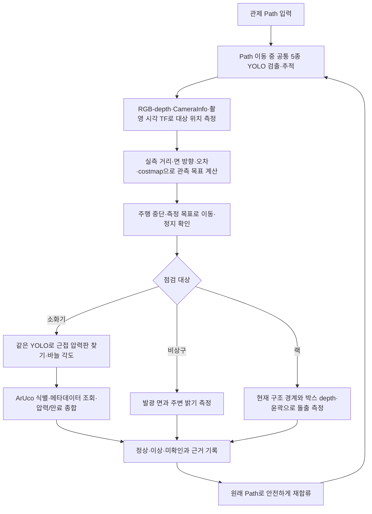

# Path 기반 설비 점검과 YOLO 학습 계획

수정일: 2026-10-13. 이번 범위는 계획과 방법 비교다. 추가 구현·학습·시험은 수행하지 않는다. 앞서 검토 범위를 넘어 추가했던 실행 코드와 시험 변경은 되돌렸으며, 원래 작업 파일은 유지한다.

## 1. 현재 데이터 상태와 권장안

사용자가 확인한 데이터 상태:

| 대상 | 상태 | 객체 검출의 목적 |
| --- | --- | --- |
| 소화기 | 라벨링 완료 | 순찰 중 발견·접근 대상 선택 |
| 압력판 | 라벨링 완료 | 압력계의 판독면을 찾아 바늘 검사 |
| 비상구표지 | 라벨링 완료 | 점등 검사 대상과 표지 영역 찾기 |
| 박스 | 라벨링 중 | 랙 적재물 찾기·소속 연결 |
| 랙 | 라벨링 중 | 순찰 중 발견·구조/측면 검사 대상 선택 |

여기서는 압력판을 기존 시나리오의 압력계 판독면으로 정리한다. 실제 라벨이 계기 전체 테두리인지 판독면만인지 통합 시 확인해 bbox 범위를 일관되게 맞춘다.

**권장: 5종 데이터셋을 공통 클래스 체계로 통합해 객체 위치 검출용 YOLO 모델 하나를 학습한다. 압력·점등·돌출·유통기한 판정은 각각의 측정 로직으로 분리한다.**

하나의 모델이 반드시 필요한 것은 아니다. 하지만 같은 카메라에서 Path 이동 중 모든 설비를 발견해야 하는 현재 목적에는 공통 모델 하나가 배포·추론·추적 연결을 단순하게 만든다. 이 판단은 설계 권고이며, 아직 학습하거나 성능 우위를 실험으로 입증한 결과는 아니다.

## 2. 방법 비교와 선택

| 방법 | 장점 | 부담·한계 | 판단 |
| --- | --- | --- | --- |
| 5종 객체를 단일 detection 모델로 학습 | 전체 영상에서 한 모델로 설비/부품 후보를 얻음. 로딩·배포·클래스 관리가 단순 | 작은 압력판과 큰 랙의 크기 차이, 클래스별 장수·촬영 조건 차이를 관리해야 함 | 첫 운영 후보로 권장 |
| 소방 3종과 랙/박스 2종을 두 모델로 분리 | 그룹별 해상도·학습 자료·모델 크기를 따로 최적화 가능 | 이동 중 두 그룹을 발견하려면 두 모델의 추론 스케줄과 결과 결합이 필요. GPU 메모리·관리 증가 가능 | 단일 모델에서 특정 그룹의 부족이 확인될 때 대안 |
| 객체마다 모델 5개 | 각 객체에 별도 조정 가능 | 이동 중 탐색 비용·배포·결과 동기화가 복잡해짐 | 현재 목적의 기본안으로 권하지 않음 |
| 5종 모두 segmentation 모델 하나 | bbox 외 실제 윤곽 마스크를 얻음 | 현재 자료가 bbox라면 실제 폴리곤 라벨을 추가해야 함. bbox를 사각형 마스크로 바꾸는 것만으로 실제 윤곽 정답이 되지는 않음 | 윤곽 라벨이 충분한 경우 별도 검토 |

**첫 선택은 단일 5종 detection 모델이다.** 작은 압력판에는 같은 모델을 원본 영상의 소화기 crop에 다시 적용한다. 여러 번 추론할 수 있지만 모델 가중치는 하나다. 추가 근접 모델이나 랙/박스 분할 모델은 실제 부족이 확인된 뒤 필요한 기능에만 도입한다.

YOLO의 detection bbox와 segmentation mask는 다른 출력이다. 객체를 찾는 bbox만으로 바늘 각도나 실제 박스 윤곽을 얻었다고 해석하지 않는다. [Ultralytics detection 자료 형식](https://docs.ultralytics.com/datasets/detect), [segmentation 설명](https://docs.ultralytics.com/tasks/segment)

## 3. 데이터셋 통합 계획

### 3.1 공통 클래스와 라벨 의미를 먼저 확정한다

초안 클래스는 아래와 같다. 숫자 ID는 운영 인터페이스용으로 통일하며 현재 모델의 ID 순서에 의존하지 않는다.

| 통합 ID | 클래스 이름 초안 | 라벨 범위 |
| ---: | --- | --- |
| 0 | fire_extinguisher | 소화기 전체 |
| 1 | pressure_gauge | 압력판/압력계 판독면: 데이터 검토 후 범위 통일 |
| 2 | exit_sign | 비상구표지 전체 |
| 3 | rack | 한 개의 랙 인스턴스 |
| 4 | box | 한 개의 박스 인스턴스 |

현재 프로젝트의 best.pt는 압력 상태·비상구 점등 상태를 포함한 6클래스다. 사용자 보유 데이터셋의 현재 라벨 파일과 이 가중치의 클래스는 별도로 확인해야 한다.

- 각 데이터셋의 ID 0이 같은 물체를 뜻한다고 가정하지 않는다. 원본 names와 라벨 ID를 통합 ID에 맞춰 재매핑하는 계획을 세운다.
- 압력판 자료가 이미 객체 라벨이면 그대로 매핑한다. Normal/Abnormal_left/Abnormal_right로 나뉘었다면 위치 검출용 pressure_gauge로 합치되 원래 압력 정답은 별도 상태 메타데이터에 보존한다.
- 비상구도 객체 라벨이면 그대로 매핑한다. on/off 라벨이라면 exit_sign으로 합치고 점등 정답을 별도 평가 자료로 보존한다.
- 소화기 bbox와 그 안의 압력판 bbox는 서로 다른 객체 범위로 함께 라벨링한다. 박스는 박스마다 라벨링하고, 여러 박스를 한 bbox로 묶지 않는다.

Ultralytics detection 자료는 공통 names 정의와 0부터 시작하는 클래스 ID, 이미지별 정규화 bbox 라벨을 사용한다. 서로 다른 데이터셋은 공통 ID와 라벨 규칙을 맞춘 뒤 묶어야 한다. [공식 데이터셋 형식](https://docs.ultralytics.com/datasets/detect)

### 3.2 폴더 병합보다 라벨 완전성이 중요하다

- 같은 사진을 여러 데이터셋에서 사용했다면 중복 이미지를 확인하고 객체 라벨을 합친다. 예를 들어 같은 사진의 소화기와 압력판 라벨 중 한쪽만 남기지 않는다.
- 한 사진에 보이는 학습 대상은 가능한 판독 범위에서 모두 라벨링한다. 라벨링하지 않은 압력판이나 박스를 학습에 계속 넣으면 검출 학습에 불리한 배경으로 취급될 수 있다.
- 파일명이 같고 내용이 다른 사진은 덮어쓰지 않는다. 원본 출처와 촬영 회차를 보존한다.
- 박스/랙 사진이 다른 세 객체보다 매우 많거나 적으면 이미지 수 외 객체 수·크기·조건별 분포를 함께 확인한다. 부족한 조건의 실촬영과 학습 샘플링으로 균형을 보완한다.
- 별도 crop 사진만으로 충분하다고 판단하지 않는다. 이동 중 전체 장면과 가까이 접근한 장면을 함께 포함한다.

### 3.3 공간을 분리해 평가한다

증강 전에 원본을 공간·설비 개체·촬영 회차로 그룹화한다. 동일 원본, 연속 영상의 매우 비슷한 프레임, 그 증강본이 학습과 시험에 동시에 들어가지 않도록 분리한다.

최종 시험에는 학습에 쓰지 않은 공간을 남긴다. 제공 자료가 한 공간뿐이면 '새 공간에서도 검출됨'이라는 합격 근거가 아직 없다고 기록한다. 거리·각도·조명·가림·작은 물체 조건별로 평가 자료를 준비한다. [Ultralytics 학습 자료 준비 지침](https://docs.ultralytics.com/guides/model-training-tips)

## 4. 학습과 선택의 실행 계획 — 아직 실행하지 않음

1. 완료된 세 데이터셋과 라벨링 중인 두 데이터셋의 클래스·bbox 범위·중복·누락·촬영 조건을 확인하는 목록을 작성한다.
2. 랙/박스 라벨링이 완료되면 공통 5클래스 데이터 정의와 학습/검증/시험 그룹을 확정한다. 라벨 상태가 완성되지 않은 사진은 정식 학습 자료에 섞지 않는다.
3. 현재 프로젝트와 호환되는 사전학습 YOLO의 작은 모델부터 통합 학습 후보를 구성한다. 현재 6클래스 best.pt의 이름만 바꾸어 5클래스 모델로 사용하지 않는다.
4. 전체 장면과 근접 crop의 크기 분포를 반영해 입력 해상도·증강·샘플링을 계획한다. 해상도가 높으면 작은 객체에 도움이 될 수 있지만 처리량과 메모리 비용도 증가하므로 실제 GPU의 시간 예산과 함께 선택한다. [Ultralytics 학습 설정](https://docs.ultralytics.com/modes/train)
5. 랙/박스를 추가할 때 기존 세 종류 자료도 함께 학습한다. '세 종류만 학습한 다음 랙/박스 사진만으로 이어서 학습'하는 방식은 기본안으로 삼지 않는다.
6. 클래스별 precision/recall, 작은 압력판의 검출률, 다른 공간의 오검출/미검출, 실제 원본 해상도별 성능과 GPU 지연을 비교한다. 전체 평균이 높아도 압력판이나 비상구의 성능이 낮으면 채택하지 않는다.
7. 단일 모델이 목표를 만족하면 모델을 하나로 유지한다. 부족하면 데이터/촬영 조건/crop/해상도를 먼저 개선하고, 그래도 특정 그룹의 부족이 지속될 때 소방·랙 그룹 모델 분리를 비교한다.

학습 횟수·장수·해상도·모델 크기의 확정값은 현재 자료의 분포와 실행 PC 정보 없이 임의로 정하지 않는다. 성능 비교와 변경 작업은 이후 별도 실행 단계다.

## 5. 수정한 운영 시나리오

### 접근은 '보기 좋은 위치'가 아닌 측정 조건으로 결정한다

- 대상 마스크/검증된 전경의 정렬 depth와 CameraInfo로 3차원 위치를 얻는다. bbox 중앙 한 픽셀이나 사진상 크기만으로 실제 거리를 단정하지 않는다.
- depth의 단위·유효 범위·RGB와의 촬영 시각 차이·유효 픽셀 비율·카메라 보정·TF를 검증한다. 정류 영상에는 그 영상에 맞는 P를 사용한다. 정렬되지 않은 영상에 RGB bbox를 그대로 대입하지 않는다.
- 현재 관측한 대상 면의 법선과 위치, 위치 오차, 카메라 부착 위치, 로봇 안전 여유로 후보를 계산하고 costmap으로 접근 가능성을 확인한다.
- 도착 후 실제 거리·면 각도·원본 압력판 픽셀 크기·선명도·노출·정지 여부를 다시 확인한다. 허용 기준은 센서와 실촬영 보정으로 정하며 시험용 숫자를 운영 기본값으로 사용하지 않는다.
- 수치 근거가 없거나 접근할 수 없으면 재관측 또는 미확인이다. 사전 등록 설비 좌표로 실제 검출·측정을 대신하지 않는다.

### 상태는 객체 클래스와 분리한다

- 압력판: 중심·바늘 끝·계기별 정상 구간을 측정한다. 단순한 pressure_gauge 검출은 압력이 정상이라는 의미가 아니다.
- ArUco: YOLO 클래스에 추가하지 않고 마커 디코더로 사전+ID를 읽는다. 기한은 마커에 적힌 것으로 추정하지 않고 조회 정보로 확인한다.
- 비상구: 표지 검출 후 발광 면·주변 밝기·노출을 분석한다. 점등과 소등이 영상상 구분되지 않으면 미확인이다.
- 랙: rack 검출은 랙을 찾았다는 뜻이다. box bbox만으로 실제 경계 초과나 거리 측정을 완료했다고 하지 않는다.

## 6. 기존 랙 판단 확인과 폐기 계획

현재 코드를 확인한 결과 랙 발견은 흰색 수직 파이프 두 개의 색상·길이·간격에 의존하고, manager는 고정 화면 ROI를 사용한다. 돌출은 정상 사진 한 장과 현재 사진의 경계 바깥 BGR 차이를 비교한다. 박스인지 사람인지 구별하는 객체 검출은 없다.

따라서 '랙은 기준 사진으로 찾는가'에 대한 답은 **발견은 흰 파이프 규칙, 정상/이상 판정은 기준 사진 한 장의 비교**다. 두 부분을 모두 새 공간에 대한 일반 검출·측정 기준으로 채택하지 않는다.

후속 구현에서 폐기할 대상:

- 흰색 HSV·고정 파이프 폭/간격·고정 화면 ROI를 랙 발견 기준으로 사용하는 로직.
- 정상 사진 색상 차이를 랙/박스 돌출의 최종 근거로 사용하는 로직.
- 고정 픽셀 margin/면적으로 실제 돌출 여부를 대신하는 로직.
- 관측 영역이 부족한데 변화가 없다는 이유만으로 정상 처리하는 로직.

대체 계획:

1. 통합 YOLO로 랙과 박스를 찾고, 랙 인스턴스와 박스 소속을 추적한다.
2. 현재 관측한 구조 키포인트/윤곽과 depth에서 허용 적재 공간의 경계 평면을 측정한다. 가려진 면을 고정 폭으로 만들어내지 않는다.
3. 필요한 측면/면을 관측하는 경로를 측정된 구조와 costmap으로 계획한다. 현재 박스가 경계를 가리면 다른 위치에서 랙 구조부터 관측한다.
4. 바깥 방향 경계 평면과 박스 윤곽 점의 거리[m]를 비교한다. 측정 오차를 고려해도 바깥이면 이상, 필요한 영역의 경계 안임이 확인되면 정상, 경계 오차와 겹치거나 미관측 면이 있으면 미확인이다.
5. 랙 bbox만으로 실제 적재 한계와 박스 윤곽을 충분히 얻지 못하면 구조 키포인트·박스 마스크를 추가한다. 라벨링 중인 랙/박스 자료에 이 정보도 별도로 보존하면 유용하지만, detection 학습의 최소 라벨과 추가 측정용 라벨은 구분한다.

이번에는 폐기를 계획에만 반영한다. 원래 랙 실행 코드는 복원했으며 추가 수정하지 않는다.

## 7. 관제·DB 없는 검증 계획 — 코드 작성·실행은 후속 단계

- 가상 Path 공급자: 실제 관제와 같은 frame/poses/작업·경로 ID를 전달.
- 가상 주행기: 이동 명령·도착·실패·취소를 반환하며 경로 중단/재개를 기록.
- 가상 메타데이터 저장소: 사전+마커 ID별 설비·기한 응답, 미등록·조회 실패·잘못된 응답을 제공.
- 합성/기록 RGB-depth·CameraInfo·TF 입력: 단위·시간차·보정·좌표 변환·관측 품질 조건 확인.
- 측정 판정 시험: 압력 경계/회전, 표지 주변 조도/포화, 랙 경계/가림/오차/필요 면 누락 확인.
- 같은 측정 구조의 회전·이동 시험과 실제 다른 공간 사진 시험은 별개로 수행. 전자는 수학적 판정의 좌표 독립성, 후자는 검출 모델의 공간 일반화 근거다.

가상 검증으로 관제·DB 의존성을 먼저 분리하고, 준비된 실제 어댑터로 바꾼다. 테스트 통과가 새 공간의 검출 정확도나 AMR 주행 완료를 의미하지는 않는다.

## 8. 최종 권고

**5종 객체의 통합 YOLO 하나를 첫 모델로 계획하고, 소화기 근접 영상에도 같은 모델을 재사용한다. 압력·밝기·돌출·만료는 객체 검출과 별도로 판정한다.**

모델 분리는 반드시 필요한 조건이 아니다. 통합 모델의 특정 그룹 성능이나 처리 시간 문제가 확인될 때 선택한다. 현재 라벨링 작업에는 공통 클래스 의미, 한 장의 모든 대상 라벨, 공간별 분할과 촬영 조건 보존을 우선 반영한다.
