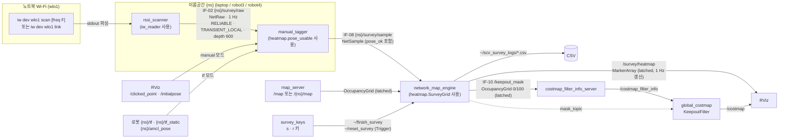

# scv_survey 코드 동작 설명 (파일별)

2026-10-12 · `feature/survey` 기준 (`fcfa487`)

README 의 「파일별 동작」은 사용법 위주다. 이 문서는 **코드가 실제로 어떤 순서로, 무엇을 판단해서 움직이는지**를 함수 단위로 적는다.

---

## 0. 한눈에 보는 전체 플로우

### 0-1. 노드·토픽 흐름



### 0-2. 샘플 하나의 일생 (scan + tf 모드 기준)

```text
[rssi_scanner · 1 Hz 타이머]
 ① tracker.next_freqs()  → 채널 모르면 전체 대역(≈5 s), 알면 그 채널만(≈0.06 s)
 ② run_iw_scan()         → iw 실행 전후 CLOCK_BOOTTIME 기록, stdout → ScanBss 목록
 ③ fresh_bss()           → 커널 캐시에 남은 옛 AP 제거 (last seen ≥ 스캔 시작)
 ④ 한 채널 스캔인데 대상이 없으면 같은 채널 최대 scan_retries(2) 번 재스캔
 ⑤ 스캔 자체가 실패 → NetRaw 안 보냄 (권한 오류면 fatal, 이후 측정 중단)
 ⑥ tracker.update()      → 대상 고정/채널 고정/연속 미검출 카운트
 ⑦ NetRaw 발행: detected, rssi_dbm, stamp = 지금 − (iw 끝난 시각 − 실제로 들은 시각)
            │
            ▼  {ns}/survey/raw
[manual_tagger · tf 모드]
 ⑧ pending 큐에 넣음 → 20 Hz flush_pending()
 ⑨ 측정 시각의 TF(map→base_link)가 버퍼에 올 때까지 최대 tf_wait(0.5 s) 대기
 ⑩ lookup_pose(): 측정 시각 TF(없으면 최신 TF) → x, y, yaw, age, lag
 ⑪ pose_usable(): TF 없음 / |lag|>0.5 / |age|>0.5 / AMCL 공분산 xx+yy>0.25 → pose_ok=False
 ⑫ NetSample 발행 (pose_ok 가 False 여도 보냄 — 버리는 건 엔진의 몫)
            │
            ▼  {ns}/survey/sample
[network_map_engine]
 ⑬ SurveyGrid.add(): (robot_id, seq) 중복이면 버림 → pose_ok False 면 버림 → 보관
 ⑭ 지도 밖이면 경고(표시 안 함), CSV 한 줄 기록, dirty=True
 ⑮ 1 Hz 타이머: dirty 면 grid.cells() 로 칸 통계 재계산 → MarkerArray 재발행
 ⑯ (s 키) finish_survey: 미검출·음영 칸 → /keepout_mask 100 → KeepoutFilter LETHAL
 ⑰ (r 키) reset_survey: 샘플·히트맵·마스크 모두 비움 (CSV 는 유지)
```

### 0-3. 파일 의존 관계

```text
iw_reader.py ──────────▶ rssi_scanner.py ──(RAW_QOS)──▶ manual_tagger.py ──(SAMPLE_QOS)──▶ network_map_engine.py
heatmap.py ─ pose_usable ─────────────────────────────▶ manual_tagger.py
heatmap.py ─ SurveyGrid·색·마스크 ───────────────────────────────────────────────────────▶ network_map_engine.py
survey_keys.py ── (서비스 이름만 공유) ─────────────────────────────────────────────────▶ network_map_engine.py
launch/laptop_test.launch.py ── 위 노드 + map_server + (costmap) + rviz 를 띄움
```

`iw_reader.py`, `heatmap.py` 는 ROS 를 import 하지 않는 순수 파이썬이라 pytest 로 바로 검증한다.
노드 파일은 이 둘을 불러 쓰는 얇은 ROS 껍데기다.

---

## 1. `scv_survey/iw_reader.py` — iw 출력 해석 (ROS 무관)

`iw` 명령을 실행하고 그 텍스트 출력을 구조체로 바꾸며, “어느 채널을 스캔할지·어느 AP 를 대상으로 볼지”를 결정한다.

### 1-1. 데이터 구조

| 이름 | 필드 | 의미 |
| --- | --- | --- |
| `LinkReading` | `detected, rssi_dbm, ssid` | link 방식 결과 1건 |
| `ScanBss` | `bssid, ssid, freq_mhz, signal_dbm, seen_boottime, age_ms, associated` | scan 출력의 BSS 블록 1개 |
| `ScanResult` | `ok, error, bss, start_boottime, end_boottime, full` + `duration_s` | iw scan 1회 실행 결과 |
| `TrackResult` | `target, candidates, events` | 트래커가 고른 대상 + 로그용 후보·이벤트 |

시각은 모두 **`CLOCK_BOOTTIME`** (`_boottime()`). iw 가 출력하는 `last seen: …s [boottime]` 과 같은 시계라 직접 비교할 수 있다.

### 1-2. link 방식

- `read_iw_link(iface, target_ssid)` → `iw dev <iface> link` 실행(2 s 타임아웃).
  실행 실패·비정상 종료는 예외 대신 `LinkReading(False, None, None)` (= 미검출).
- `parse_iw_link(text, target_ssid)`
  1. `Not connected` 가 있으면 미검출.
  2. `SSID:` · `signal: N dBm` 줄을 정규식으로 찾음. SSID 는 `decode_iw_ssid` 로 복원.
  3. signal 이 없거나, `target_ssid` 가 주어졌는데 붙어 있는 SSID 와 다르면 미검출(`ssid` 는 채워 줌 → 로그에 “지금 SSID” 표시).
  4. `target_ssid == ''` 면 붙어 있는 AP 아무거나 검출로 본다.

### 1-3. scan 방식

**`decode_iw_ssid(text)`** — iw 는 비ASCII 바이트를 `\xNN` 으로 출력한다(`csh\xec\x9d\x98 iPhone`).
`\xNN` 은 바이트로, 나머지 글자는 UTF-8 바이트로 이어 붙인 뒤 한 번에 UTF-8 디코딩 → `csh의 iPhone`. 깨진 바이트는 `errors='replace'`.

**`parse_iw_scan(text)`**
1. `^BSS xx:xx:…(on wlo1) …` 헤더 위치들을 모두 찾고, 헤더 사이 텍스트를 블록으로 자른다.
2. 블록에서 **탭 하나로 시작하는 줄만** 매칭한다 (`^\tSSID:`, `^\tsignal:`, `^\tfreq:`, `^\tlast seen:`).
   다른 IE 안에 들여쓰기된 SSID 와 헷갈리지 않기 위해서다.
3. `signal` 이나 `freq` 가 없는 블록은 버린다. SSID 가 없으면 `''`(숨은 SSID).
4. `last seen` 은 두 형식이 섞여 나온다: `1900.020s [boottime]` → `seen_boottime`, `20 ms ago` → `age_ms`.
5. 헤더 뒤에 `-- associated` 가 있으면 `associated=True` (노트북이 붙은 AP, 예: turtle08).

**`fresh_bss(bss, start_boottime, duration_s, slack_s=0.05)`** — 이번 스캔에서 실제로 들은 BSS 만 남긴다.
iw scan 결과에는 **커널 캐시(최대 약 30 초)** 에 남은 AP 도 섞여 나오기 때문에, 이걸 거르지 않으면 이미 꺼진 핫스팟이 “검출”로 잡힌다.
- `seen_boottime` 이 있으면: `seen_boottime ≥ start − 0.05` 이면 새것.
- 없으면 `age_ms ≤ (duration + 0.05) × 1000` 이면 새것.
- 둘 다 없으면 버림.

**`match_ssid(bss, ssid='', pattern='')`** — `ssid` 를 주면 완전 일치, 아니면 `pattern` 부분 일치(대소문자 무시). 결과는 **신호 센 순**으로 정렬.

**`run_iw_scan(iface, freqs=None, timeout=10)`**
- 명령: `iw dev <iface> scan` (+ `freq F1 F2…` 를 주면 그 채널만).
- 실행 직전·직후 boottime 을 `start_boottime`·`end_boottime` 으로 기록.
- 타임아웃/OSError/비정상 종료 → `ok=False`, `error` 에 stderr 마지막 줄. `full = not freqs`.

**`is_permission_error(error)`** — `Operation not permitted` 또는 `(-1)` 이면 권한 문제(iw 에 `cap_net_admin` 없음).

### 1-4. `HotspotTracker` — 대상·채널 결정 상태기계

상태: `ssid`(대상, 비면 아직 미정), `manual`(직접 입력 여부), `freq`(고정 채널), `misses`(연속 미검출 수), `last_full`(마지막 전체 스캔 시각).

**`next_freqs(now)`** — 이번 스캔 대역:

| 조건 | 반환 | 의미 |
| --- | --- | --- |
| `freq is None` | `None` | 채널 모름 → 전체 대역 (iwlwifi ≈ 5 s) |
| `misses ≥ rescan_after_miss` 이고 `now − last_full ≥ full_scan_interval` | `None` | 채널이 바뀌었을 수 있음 → 전체 대역 재탐색 |
| 그 외 | `[freq]` | 그 채널만 (5 GHz ≈ 0.06 s, 2.4 GHz ≈ 0.15 s) |

**`update(fresh, full, now)`**
1. 전체 스캔이었으면 `last_full = now`.
2. `pattern` 으로 후보(candidates) 목록을 만든다(로그용).
3. **자동 선택**: `ssid` 가 비어 있으면 후보 중 가장 센 것의 SSID 로 **고정**하고 이벤트를 남긴다. 후보가 없으면 그대로 미검출 반환. 한 번 고정되면 이후 더 센 iPhone 이 나타나도 바꾸지 않는다.
4. 고정된 `ssid` 로 완전 일치 검색.
   - 없음 → `misses += 1`. 정확히 `rescan_after_miss`(3) 번째에 `last_full = −∞` 로 만들어 **다음 스캔을 즉시 전체 대역**으로 하고 경고 이벤트.
   - 있음 → 가장 센 BSS 가 대상. 채널을 처음 알게 됐으면 “채널 고정”, 바뀌었으면 “채널 바뀜”, 오래 못 듣다가 다시 들었으면 “다시 검출” 이벤트. `freq` 갱신, `misses = 0`.

---

## 2. `scv_survey/heatmap.py` — 칸 계산·색·위치 판정·회피 마스크 (ROS 무관)

### 2-1. 상수

| 상수 | 값 | 쓰임 |
| --- | --- | --- |
| `STRONG_DBM` / `WEAK_DBM` | −35 / −75 | 색 그라데이션 양 끝 |
| `MISS_COLOR` | (0.4, 0.4, 0.4) | 미검출 칸 회색 |
| `SHADOW_DBM` | −72 | 음영 기준 (BR-T04) |
| `NORMAL`·`SHADOW`·`MISS` | 문자열 | 칸 상태 |
| `KEEPOUT` | 100 | 마스크 값 → KeepoutFilter 가 LETHAL 로 |

### 2-2. 함수

- **`rssi_to_color(rssi, strong, weak)`** — `t = (rssi − weak)/(strong − weak)` 를 0~1 로 자르고, HSV 색상 `(1 − t) × 240°` 로 변환.
  t=0(−75 이하) 파랑 → 하늘(−65) → 초록(−55) → 노랑(−45) → t=1(−35 이상) 빨강.
- **`cell_index(x, y, ox, oy, cell)`** — `(floor((x−ox)/cell), floor((y−oy)/cell))`. 칸 경계는 **지도 원점 기준**.
- **`cell_center(i, j, …)`** — `(ox + (i+0.5)·cell, oy + (j+0.5)·cell)`.
- **`CellStats`** — 칸 하나의 통계. `rssi`(검출된 값만), `n_missed`, 파생값 `n_detected`, `n_total`, `median`(검출값 중앙값, 없으면 None), `miss_ratio = n_missed / n_total`.
- **`pose_usable(age_s, cov_xy, max_age=0.5, max_cov=0.25, lag_s=None)`** — 위치를 지도에 써도 되는지. 검사 순서:
  1. `age_s is None` → `TF 없음`
  2. `|lag_s| > max_age` → 통신 지연 또는 노트북·로봇 시계 차 (측정 시각의 TF 를 찾았어도 시계가 어긋나면 엉뚱한 과거 위치일 수 있으므로 따로 본다)
  3. `|age_s| > max_age` → 측정 시각과 붙인 TF 시각 차가 큼
  4. `cov_xy > max_cov` → AMCL 이 위치를 확신 못 함 (`cov_xy` 가 None 이면 검사 생략)
  `max_age ≤ 0` 이면 2·3 을 끈다.
- **`cell_color(stats, miss_ratio_thresh=0.5, …)`** — 검출 0개이거나 `miss_ratio ≥ 0.5` 면 회색, 아니면 중앙값 색.
- **`cell_status(stats, shadow_dbm, miss_ratio_thresh)`** — 회색 조건과 같으면 `MISS`, 중앙값 `< −72` 면 `SHADOW`, 그 외 `NORMAL`.
- **`keepout_cells(cells, …, min_samples=2)`** — 샘플 수가 `min_samples` 미만인 칸은 한 번 튄 값일 수 있어 제외하고, `NORMAL` 이 아닌 칸만 `{(i,j): 상태}` 로 반환.
- **`keepout_mask(cells, cell_size, origin, resolution, width, height, margin=0)`** — `OccupancyGrid.data` 리스트(아래 행부터 행 우선)를 만든다.
  1. 전부 0 으로 시작.
  2. 회피 칸마다 칸 사각형 `[x0,x1]×[y0,y1]` 를 `margin` 만큼 넓힌 범위의 픽셀 행·열을 계산(지도 밖은 잘라냄).
  3. 각 픽셀 **중심**과 칸 사각형 사이 거리 `(dx, dy)` 를 구해 `dx² + dy² ≤ margin²` 이면 100 → margin 을 주면 모서리가 둥글게 넓어진다. margin 0 이면 정확히 칸 안의 픽셀만.
  - 전제: 마스크는 `/map` 과 원점·해상도·크기가 같고 지도에 회전이 없다.
  - KeepoutFilter 는 inflation 뒤에 적용돼 회피 칸 주변이 부풀지 않는다 → margin 0 이면 로봇 중심은 못 들어가도 몸체(반경 0.19 m)는 칸 가장자리에 걸칠 수 있다.

### 2-3. `SurveyGrid`

**샘플 원본을 보관하고 칸은 요청할 때마다 다시 계산**한다. `/map` 이 나중에 오거나 바뀌면 원점이 달라지기 때문.

| 메서드 | 동작 |
| --- | --- |
| `set_map(ox, oy, w_m, h_m)` | 원점·범위(bounds) 설정 |
| `clear()` | 샘플·중복 기록 비움 (지도 정보는 유지) |
| `in_bounds(x, y)` | bounds 없으면 항상 True, 있으면 `xmin ≤ x < xmax` 등 |
| `add(s)` | `(robot_id, seq)` 를 **먼저** seen 에 넣고(중복이면 False) → `pose_ok` False 면 False → 보관하고 True. 즉 pose_ok False 샘플도 seq 는 소모된 것으로 기록 |
| `samples` | 보관 샘플 복사본 (지도 밖 포함) |
| `cells()` | 지도 안 샘플만 칸별 `CellStats` 로 집계 (검출→`rssi`, 미검출→`n_missed`) |
| `center(idx)` | 칸 중심 좌표 |

---

## 3. `scv_survey/rssi_scanner.py` — 노드: RSSI 측정 → NetRaw (IF-02)

### 3-1. 파라미터

| 이름 | 기본 | 설명 |
| --- | --- | --- |
| `iface` | `wlo1` | RPi 에선 `wlan0` |
| `method` | `scan` | `scan` / `link` (그 외 값이면 ValueError) |
| `target_ssid` | `''` | 비우면 `ssid_pattern` 으로 자동 선택. **실행 중 변경 가능** |
| `ssid_pattern` | `iPhone` | 자동 선택 기준 |
| `robot_id` | `laptop` | NetRaw 에 실림 |
| `rate_hz` | 1.0 | 측정 주기 |
| `rescan_after_miss` | 3 | 트래커로 전달 |
| `full_scan_interval` | 10.0 | 트래커로 전달 |
| `scan_retries` | 2 | 한 채널 스캔 재시도 횟수 |
| `log_samples` | True | 측정마다 한 줄 로그 |
| `status_period` | 10.0 | 요약 로그 주기 (0 이면 끔) |

### 3-2. 발행 QoS — `RAW_QOS`

`RELIABLE + TRANSIENT_LOCAL + KEEP_LAST 600`. 수신 노드가 늦게 붙어도 최근 600개(1 Hz 면 10 분)를 받을 수 있다.
그 대신 **늦게 붙은 구독자에게 옛 샘플이 한꺼번에 밀려온다** — `manual_tagger` 가 이를 걸러낸다(§4).

### 3-3. 시작 (`main`, `__init__`)

1. `iw` 가 PATH 에 없으면 fatal 로그 후 종료.
2. 파라미터 읽기 → `HotspotTracker` 생성 → 퍼블리셔·파라미터 콜백·타이머(1/rate, status_period) 등록.
3. 시작 로그: 대상(직접 입력 / 자동), 주기, robot_id.

### 3-4. 측정 루프 `on_timer`

1. `fatal` 이면 아무것도 안 함 (권한 오류 이후 영구 정지).
2. `pending_ssid` 가 있으면(파라미터로 `target_ssid` 를 바꾼 경우) 트래커를 **새로 만들어** 채널도 다시 찾게 한다. 파라미터 콜백 자체는 값만 저장하고, 실제 교체는 다음 타이머에서 → 스캔 도중 상태가 꼬이지 않는다.
3. `method` 에 따라 `measure_link()` / `measure_scan()`.

**`measure_link()`** — `read_iw_link` 결과를 그대로 발행(stamp = 지금). 실행 실패도 미검출로 발행된다.

**`measure_scan()`**
1. `freqs = tracker.next_freqs(monotonic())`.
2. `scan_once()` = `run_iw_scan` + (성공 시) `fresh_bss`.
3. **재스캔**: 한 채널 스캔(`freqs` 있음)인데 대상이 안 보이면 같은 채널을 `scan_retries` 번까지 다시. 한 채널 스캔은 AP 가 있어도 4번에 1번꼴로 probe 응답을 놓치기 때문(10/11 실측). 전체 스캔은 재시도 안 함.
4. **스캔 실패** (`res.ok == False`):
   - 권한 오류 → `setcap` 안내 fatal 로그, `fatal = True`.
   - 그 외(장치 바쁨 등) → 경고만 하고 **NetRaw 를 보내지 않는다**. 미검출로 보내면 멀쩡한 칸이 회색이 되기 때문.
5. `tracker.update()` → 이벤트 로그(“미검출” 이 들어간 것은 warn, 나머지 info). 전체 스캔에서 후보가 있고 (대상 없음 또는 이벤트 발생) 이면 주변 후보 상위 6개 로그.
6. 대상 없음 → `detected=False` 발행, 미검출 로그.
7. 대상 있음 → `rssi = round(signal)`.
   **측정 시각 보정**: `age = end_boottime − seen_boottime` (없으면 `age_ms/1000`), `stamp = now − age`.
   전체 스캔은 5 초 가까이 걸려 “iw 가 끝난 시각”과 “실제로 그 AP 를 들은 시각”이 수 초 차이 나므로, TF 로 위치를 붙일 때 이 보정이 중요하다.

**`publish(stamp, detected, rssi)`** — `NetRaw{stamp, robot_id, detected, rssi_dbm (미검출이면 0)}` 발행 후 `seq += 1`.
(`seq` 는 NetRaw 에 실리지 않고 로그 번호로만 쓰인다. NetSample 의 `seq` 는 manual_tagger 가 따로 매긴다.)

### 3-5. 로그

- `log_sample` — 창(window)에 검출/미검출/RSSI/스캔 시간 누적, `log_samples` 면 한 줄 출력(검출 info, 미검출 warn — rclpy 는 호출 위치마다 로그 수준이 고정이라 두 호출로 나눔).
- `on_status` (10 s) — `[상태] 대상 · 채널 · 최근 측정 n (검출/미검출/실패) · 중앙값(최소, 최대) · 스캔 평균 ms · 재스캔 수 · 누적 발행` 출력 후 창 초기화.
- `_chan(freq)` — MHz → `chN` 표기 (2.4 GHz: `(f−2407)/5`, 5 GHz: `(f−5000)/5`).

---

## 4. `scv_survey/manual_tagger.py` — 노드(시험용): NetRaw + 위치 → NetSample (IF-02 → IF-08)

실제 구성의 `survey_buffer`(로봇 PC) 자리를 대신하는 시험용 노드. `pose_source` 로 위치 출처를 고른다.

공통:
- 구독 `survey/raw` (`RAW_QOS`), 발행 `survey/sample` (`SAMPLE_QOS` = RELIABLE, depth 50, VOLATILE).
- **`publish(raw, ok)`** — `NetSample{seq(자체 증가), stamp=raw.stamp, robot_id, run_id, x, y, yaw=self.pose, pose_ok=ok, resent=False, detected, rssi_dbm}`.
  pose_ok 가 False 여도 **항상 발행**한다. 버리는 판단은 엔진이 한다(로그·CSV 일관성).
- `yaw_from_quat(q)` — 쿼터니언 → yaw.

### 4-1. manual 모드 (노트북만 들고)

파라미터: `samples_per_point`(5), `init_x`·`init_y`·`init_yaw`(0 = SLAM 시작점), `measure_on_start`(True).

동작:
1. 시작 시 `set_point(init…)` → “초기위치에서 5개 측정 시작”.
2. RViz **Publish Point**(`/clicked_point`) → `set_point(x, y, 0)`, **2D Pose Estimate**(`/initialpose`) → `set_point(x, y, yaw)`.
3. `set_point` 는 `pose` 갱신, `remaining = 5`, `set_time = 지금`, `collected = []`.
4. NetRaw 가 오면 `manual_pose_ok(raw)`:
   - `remaining > 0` **그리고** `raw.stamp ≥ set_time` 일 때만 측정 중으로 본다.
     → 위치를 주기 전에 잰 샘플, 특히 TRANSIENT_LOCAL 로 한꺼번에 밀려온 옛 샘플은 그 자리 값이 아니므로 False.
   - 측정 중이면 `remaining −= 1`, 값 기록. 0 이 되면 “측정 끝: 중앙값, 검출 n/5 — 다음 위치를 클릭하세요” 로그.
   - 그 외(옮기는 중) 샘플은 pose_ok=False 로 발행된다.

### 4-2. tf 모드 (노트북을 TurtleBot4 에 올리고)

파라미터: `map_frame`(map), `base_frame`(base_link), `max_pose_age`(0.5), `max_pose_cov`(0.25), `tf_wait`(0.5).
launch 가 `/tf`, `/tf_static` → `{ns}/tf`, `{ns}/tf_static` 으로 리맵한다. `amcl_pose` 는 상대 이름이라 `{ns}/amcl_pose` 를 구독.

1. **`on_amcl`** — `cov_xy = covariance[0] + covariance[7]` (xx + yy) 를 최신값으로 저장.
2. **`on_raw`** — NetRaw 를 `pending` 큐 뒤에 넣고 즉시 `flush_pending()`.
3. **`flush_pending`** (20 Hz 타이머 + on_raw 직후) — 큐 앞에서부터:
   - 측정 시각(`raw.stamp`)의 TF 를 `can_transform` 으로 확인.
   - 아직 없고 기다린 시간 `< tf_wait` 이면 **멈추고 다음 틱에 다시** (TF 는 Wi-Fi 지연만큼 늦게 온다). 앞 샘플이 막히면 뒤도 기다리므로 순서가 유지된다.
   - TF 가 왔거나 tf_wait 이 지났으면 꺼내서 `publish(raw, tf_pose_ok(raw, now))`.
4. **`lookup_pose(stamp, now)`**
   - 최신 TF(`Time()`)를 먼저 조회 — 없으면 None(= TF 없음).
   - 측정 시각 TF 조회(tf2 가 보간), 실패하면 최신 TF 로 대신.
   - `age = 측정 시각 − 붙인 TF 시각`, `lag = 지금 − 최신 TF 시각` 반환.
5. **`tf_pose_ok`** — `pose_usable(age, cov_xy, max_pose_age, max_pose_cov, lag)`.
   OK 면 사용 카운트·위치·RSSI·TF 지연 로그(2 s 스로틀), 아니면 “위치 제외: 이유” 경고(2 s 스로틀).
   위치를 못 찾았으면 `self.pose` 는 직전 값 그대로 실리지만 pose_ok=False 라 엔진이 버린다.

---

## 5. `scv_survey/network_map_engine.py` — 노드: NetSample → 히트맵·CSV·회피 마스크

### 5-1. 파라미터

| 이름 | 기본 | 설명 |
| --- | --- | --- |
| `sample_topics` | `['/laptop/survey/sample']` | 여러 로봇 토픽을 동시에 구독 가능 |
| `map_topic` | `/map` | 로봇 시험은 `/{ns}/map` |
| `cell_size` | 0.5 | 칸 크기 [m] |
| `miss_ratio_thresh` | 0.5 | 이 비율 이상 미검출이면 회색/MISS |
| `alpha` | 0.7 | 칸 투명도 |
| `min_samples_full_alpha` | 2 | 샘플이 이보다 적은 칸은 alpha × 0.5 (흐리게) |
| `csv_path` | `''` | 비우면 CSV 안 씀 (launch 는 기본 경로를 채워 줌) |
| `show_points`, `max_points` | True, 2000 | 측정 위치 점 표시 |
| `rssi_strong`, `rssi_weak` | −35, −75 | 색 범위 |
| `mask_topic` | `/keepout_mask` | IF-10 |
| `shadow_dbm` | −72 | 음영 기준 |
| `mask_margin` | 0.0 | 회피 칸 확장 폭 |
| `min_samples_for_mask` | 2 | 이보다 적은 칸은 회피 대상에서 제외 |

### 5-2. 상태

`grid`(SurveyGrid), `dirty`(마커 다시 그릴지), `map_info`, `survey_done`(finish 이후 True), `keepout`(finish 때 계산한 회피 칸), `csv`.

### 5-3. 콜백

- **시작** — CSV 가 없거나 빈 파일이면 헤더(`stamp, robot_id, seq, run_id, x, y, detected, rssi_dbm`)를 쓰고 바로 flush (샘플 오기 전에 죽어도 헤더는 남게). 이미 있으면 **이어 쓰기(append)**.
- **`on_map`** (LATCHED 구독) — 지도 원점·크기로 `grid.set_map`, `map_info` 저장, `dirty`. 그리고 **즉시 `publish_mask()`** — 이때 `survey_done` 이 False 라 빈 마스크(전부 0)가 나간다.
  KeepoutFilter 는 마지막으로 받은 마스크를 계속 쓰므로, 노드를 새로 띄웠을 때 지난 측정의 회피 칸을 지우는 역할이다.
- **`on_sample`**
  1. `Sample` 로 변환해 `grid.add` — 중복·pose_ok False 면 여기서 끝(CSV 에도 안 남음).
  2. 지도 밖이면 경고(5 s 스로틀). 샘플은 보관되지만 칸 계산·점 표시에서 빠진다.
  3. `dirty = True`, CSV 한 줄 기록 + flush (지도 밖 샘플도 기록됨, 미검출이면 rssi 칸은 빈칸).
- **`on_timer`** (1 Hz) — `dirty` 일 때만 `build_markers()` 를 `/survey/heatmap` 에 발행. 샘플이 초당 여러 개 와도 그리기는 1 Hz 로 묶인다.

### 5-4. 서비스

- **`~/finish_survey`** (Trigger)
  1. 지도를 못 받았으면 실패.
  2. `keepout = keepout_cells(grid.cells(), shadow_dbm, miss_thresh, min_samples_for_mask)`.
  3. `survey_done = True`, `publish_mask()` → 회피 픽셀 수 반환, `dirty = True`(자홍 테두리 그리기).
  4. 응답: `측정 끝: 회피 칸 N 개 (미검출 a, 음영 b), 마스크 P px` + 칸 목록 로그.
  - 회피 칸은 **이 시점의 스냅샷**이다. finish 뒤에 샘플이 더 들어와도 히트맵은 바뀌지만 마스크는 다시 `s` 를 눌러야 갱신된다.
- **`~/reset_survey`** (Trigger) — `grid.clear()`, `survey_done = False`, `keepout = {}`, 지도가 있으면 빈 마스크 발행, `dirty`. **CSV 파일은 지우지 않는다**(일지 근거 보존).

### 5-5. `publish_mask()`

`survey_done` 이면 `keepout`, 아니면 빈 dict 로 `keepout_mask(...)` 를 만들어 `/map` 과 같은 `info`(원점·해상도·크기), `frame_id='map'` 의 `OccupancyGrid` 로 LATCHED 발행.

### 5-6. 마커 구성 `build_markers()`

순서대로 MarkerArray 에 넣는다:

| ns / id | 타입 | 내용 |
| --- | --- | --- |
| (첫 원소) | `DELETEALL` | 이전 마커 전부 삭제 → 줄어든 칸·리셋이 잔상 없이 반영 |
| `cells` / 0 | `TRIANGLE_LIST` | 칸마다 사각형(삼각형 2개, 칸 크기의 95 %), 꼭짓점 색 = `cell_color`, alpha 는 샘플 수에 따라 0.7 / 0.35. 칸이 있을 때만 index 1 에 삽입 |
| `labels` / k | `TEXT_VIEW_FACING` | 칸 중심에 중앙값 정수(dBm), 검출 없으면 `X`. 글자 크기 = 칸 × 0.3, 검정 |
| `keepout` / 0 | `LINE_LIST` | finish 이후에만, 회피 칸 테두리 자홍(굵기 0.04) |
| `points` / 0 | `POINTS` | 최근 `max_points` 개 측정 위치. 검출은 검정, 미검출은 회색 점(0.05 m). 점이 없으면 `DELETE` |
| `legend` / 0~2 | `TRIANGLE_LIST` + `TEXT` ×2 | 지도 왼쪽 아래 밖(y = ymin − 0.3)에 20칸짜리 파랑→빨강 막대(폭 2 m)와 양 끝 dBm 글자. 지도를 받기 전엔 없음 |

구현 메모:
- `CUBE_LIST` 는 RViz 조명 때문에 색이 절반쯤 어두워져 조명을 안 받는 `TRIANGLE_LIST` 를 쓴다.
- `flat_marker()` 는 `marker.color` 를 흰색·알파 1 로 둔다. RViz 는 꼭짓점 색에 이 색을 곱하므로 기본값(알파 0)이면 칸이 사라진다.
- 마커 발행이 LATCHED 라 RViz 를 나중에 켜도 마지막 히트맵이 보인다.

---

## 6. `scv_survey/survey_keys.py` — 노드(시험용): 키 입력 → 서비스 호출

```text
  s → {engine}/finish_survey    r → {engine}/reset_survey    q → 종료    그 외 → 도움말
```

1. `stdin` 이 터미널이 아니면 안내 문구 출력 후 종료 → launch 에 넣지 않고 **별도 터미널**에서 `ros2 run scv_survey survey_keys`.
2. 파라미터 `engine`(기본 `/network_map_engine`) 로 Trigger 클라이언트 2개 생성.
3. 터미널을 `cbreak` 모드로 바꿔 Enter 없이 한 글자씩 읽는다. `select` 로 0.1 s 대기 → 키 처리 → `spin_once(0)`.
4. `call(key)`: 서비스 2 s 안에 안 보이면 에러, 있으면 비동기 호출 후 최대 5 s 대기. 성공 메시지는 info, 실패는 warn.
5. 종료 시 터미널 설정을 원래대로 되돌린다(`finally`).

---

## 7. `launch/laptop_test.launch.py` — 노트북 시험 구성

`OpaqueFunction(_nodes)` 로 인자 값을 실제 문자열로 받아 노드 구성을 분기한다.

### 7-1. 모드별 차이

| 항목 | `pose_source:=manual` (기본) | `pose_source:=tf` |
| --- | --- | --- |
| 이름공간 `ns` | `robot_ns` 또는 `laptop` | `robot_ns` 또는 `robot4` |
| tagger 파라미터 | `init_x`, `init_y`, `samples_per_point` | `base_frame`, `max_pose_age` |
| tagger 리맵 | 없음 | `/tf→tf`, `/tf_static→tf_static` (= `/{ns}/tf…`) |
| 지도 | 노트북에서 `map_server` + `lifecycle_manager_map` 이 `maps/test_map.yaml` 발행 → `/map` | 로봇의 `localization.launch.py` 가 `/{ns}/map` 발행 (노트북은 안 띄움) |
| 코스트맵 | `keepout_costmap:=true` 면 노트북에 Nav2 전역 코스트맵 띄움 | 띄우지 않음 (로봇 Nav2 와 섞이지 않게) |
| RViz 리맵 | 없음 | `/tf, /tf_static, /map, /initialpose, /scan, /robot_description` → `/{ns}/…` |
| CSV 기본 | `~/scv_survey_logs/laptop_manual.csv` | `~/scv_survey_logs/robot4_tf.csv` |

### 7-2. 항상 띄우는 노드

1. `LogInfo` — 측정 방식·iface·대상·주기·토픽·CSV 경로 한 줄.
2. `rssi_scanner` (ns 안) — `robot_id = ns`. SSID 는 `ParameterValue(value_type=str)` 로 넘겨 숫자만으로 된 SSID 도 문자열로 유지.
3. `manual_tagger` (ns 안).
4. `network_map_engine` (이름공간 없음) — `sample_topics=['/{ns}/survey/sample']`, `map_topic`, 색·마스크 설정.
5. `rviz2` (`rviz:=true`) — `rviz/survey.rviz`.

### 7-3. `_keepout_costmap(mask_topic)` — manual 에서 회피 마스크 확인용

로봇 Nav2 설정을 줄여 노트북에서 KeepoutFilter 동작만 본다.

| 노드 | 역할 |
| --- | --- |
| `static_transform_publisher` | `map → base_link` 를 원점 고정 TF 로 (코스트맵이 로봇 TF 를 기다리므로) |
| `costmap_filter_info_server` | `type 0`(keepout), `mask_topic` 을 `/costmap_filter_info` 로 알림 |
| `nav2_costmap_2d` (`global_costmap`) | `static_layer`(/map) + `inflation_layer`(0.45 m, scaling 4.0 — turtlebot4 nav2.yaml 과 같게) + `keepout_filter`. 로봇 반경 0.19, unknown 추적, 항상 전체 코스트맵 발행 → `/costmap` |
| `lifecycle_manager_keepout` | 위 둘을 autostart. 단독 코스트맵 노드는 bond 를 안 만들어 `bond_timeout: 0` |

### 7-4. 주요 인자 (기본값)

`pose_source=manual`, `robot_ns=''`, `map=<share>/maps/test_map.yaml`, `iface=wlo1`, `method=scan`, `ssid=''`, `ssid_pattern=iPhone`, `rate_hz=1.0`, `rescan_after_miss=3`, `scan_retries=2`, `full_scan_interval=10.0`, `log_samples=true`, `status_period=10.0`, `init_x=0`, `init_y=0`, `samples_per_point=5`, `base_frame=base_link`, `max_pose_age=0.5`, `cell_size=0.5`, `rssi_strong=-35`, `rssi_weak=-75`, `csv_path=''`, `mask_topic=/keepout_mask`, `shadow_dbm=-72`, `mask_margin=0.0`, `keepout_costmap=true`, `rviz=true`.

---

## 8. `rviz/survey.rviz` — RViz 화면 구성

| 표시 | 토픽 | 기본 |
| --- | --- | --- |
| Grid | — | 끔 |
| Map | `/map` (Transient Local) | 켬 |
| Map | `/costmap` | 켬 |
| Map | `/keepout_mask` | 끔 (필요할 때 켜서 마스크 픽셀 확인) |
| MarkerArray | `/survey/heatmap` | 켬 |
| RobotModel | `/robot_description` | 켬 (tf 모드에서 로봇 표시) |
| Axes | — | 켬 |
| LaserScan | `/scan` | 켬 |

도구: Interact, MoveCamera, **PublishPoint → `/clicked_point`**, **SetInitialPose → `/initialpose`** (manual 모드 위치 지정). 뷰는 TopDownOrtho(위에서 내려다봄).
tf 모드에서는 launch 가 이 토픽들을 `/{ns}/…` 로 리맵한다.

---

## 9. `maps/test_map.yaml`, `maps/test_map.pgm` — 시험 지도

- `test_map.pgm`: P5(바이너리 그레이), **94 × 230 px**.
- `test_map.yaml`: `resolution 0.05`, `origin [-3.107, -4.823, 0]`, `mode trinary`, `occupied_thresh 0.65`, `free_thresh 0.196`.
- 실제 크기 4.70 m × 11.50 m → 0.5 m 칸 기준 가로 약 9.4칸 × 세로 23칸. 칸 번호는 이 원점에서 시작한다(`(0,0)` 이 지도 왼쪽 아래 칸).
- manual 모드에서만 노트북 `map_server` 가 사용.
- yaml 의 `origin` 은 지도 **왼쪽 아래 픽셀**의 map 좌표다. map 좌표 (0, 0) = SLAM 시작점은 그 모서리에서 오른쪽 3.107 m, 위 4.823 m 지점이고, manual 기본 초기위치(`init_x=init_y=0`)가 바로 여기다.

---

## 10. 패키지 설정 파일

| 파일 | 내용 |
| --- | --- |
| `setup.py` | `ament_python`. `launch/*.launch.py`, `rviz/*.rviz`, `maps/*.yaml|*.pgm` 를 share 로 설치. 실행 파일 4개: `rssi_scanner`, `manual_tagger`, `network_map_engine`, `survey_keys` |
| `setup.cfg` | 스크립트를 `lib/scv_survey` 에 설치 (`ros2 run` 이 찾는 위치) |
| `package.xml` | 의존: `rclpy, scv_msgs, geometry_msgs, nav_msgs, std_msgs, std_srvs, visualization_msgs, tf2_ros` / 실행: `iw, launch_ros, nav2_map_server, nav2_lifecycle_manager, nav2_costmap_2d, rviz2` / 시험: `python3-pytest` |
| `resource/scv_survey` | ament 인덱스 마커 (빈 파일) |
| `scv_survey/__init__.py` | 빈 파일 (파이썬 패키지 표시) |
| `README.md` | 사용법·실행 명령·시험 결과(10/10, 10/11, 10/12)·알려진 한계 |
| `.pytest_cache/` | pytest 가 만든 캐시 (코드 아님) |

사용 메시지(`scv_msgs`):

```text
NetRaw    (IF-02): stamp, robot_id, detected, rssi_dbm
NetSample (IF-08): seq, stamp, robot_id, run_id, x, y, yaw, pose_ok, resent, detected, rssi_dbm
```

---

## 11. 테스트 (`test/`)

ROS 없이 `/usr/bin/python3 -m pytest test/` 로 돈다.

### `test_iw_reader.py` (18개)

- **link 파싱**: 대상에 붙음 → 검출 / 다른 SSID → 미검출 / Not connected / signal 줄 없음 / SSID 에 공백 / 한글 SSID·아무 AP.
- **scan 파싱**: 10/11 노트북의 실제 `iw scan` 출력을 줄인 `SCAN` 픽스처(스캔 시작 boottime 1900.0 s, 0.06 s) 사용.
  필드 추출, signal 없는 블록 제거, `decode_iw_ssid`(한글·`’`), `fresh_bss`(boottime 기준 / `ms ago` 기준 — 20 초 전 캐시 AP 제거), `match_ssid` 완전·부분 일치, 권한 오류 판별.
- **트래커**: 직접 입력 SSID 는 채널 고정 / 더 센 다른 iPhone 무시 / 자동 선택은 처음 가장 센 것으로 고정 유지 / 후보 없으면 미검출 / 꺼졌다 켜졌을 때 재탐색 → 다시 검출.

### `test_heatmap.py` (24개, parametrize 포함 더 많음)

- 색 그라데이션 기준점(−35 빨강, −45 노랑, −55 초록, −65 하늘, −75 파랑)과 단조성, 범위 파라미터.
- `test_map` 원점 기준 칸 번호·중심 왕복.
- 중앙값·미검출 비율, 회색 규칙.
- `SurveyGrid`: 중복·pose_ok 필터, 미검출은 통계 밖, 지도 원점·범위, 시작점 5개, `samples` 는 채택분만, `clear`.
- `pose_usable`: age·cov·lag 조합, `max_age 0` 이면 검사 끔.
- teleop 경로를 따라 칸이 채워지는지.
- 회피: `cell_status`, `keepout_cells`(음영·미검출만, 샘플 2개 미만 제외), `keepout_mask`(빈 경우, margin 둥근 모서리, 기본은 칸 그대로, 지도 가장자리 자르기, 칸 격자와 픽셀 일치).

---

## 12. 동작상 알아 둘 점 (코드에서 읽히는 것)

1. **스캔 실패는 “미검출”이 아니라 “측정 없음”** 이다. NetRaw 가 안 나가므로 그 순간 위치에 샘플이 비는 것이 정상.
2. **NetRaw 의 TRANSIENT_LOCAL depth 600** 때문에 tagger 를 나중에 띄우면 옛 샘플이 몰려온다. manual 은 `stamp ≥ set_time` 으로, tf 는 옛 시각의 TF 가 없어 최신 TF 로 대체 → age 초과 → pose_ok False 로 걸러진다.
3. **pose_ok False 샘플도 NetSample 로 발행**되며, 엔진은 seq 만 기록하고 버린다. CSV 에는 남지 않는다.
4. **지도 밖 샘플은 CSV 에는 남고** 히트맵·점·마스크에서는 빠진다.
5. **회피 마스크는 finish 시점 스냅샷**. 이후 샘플은 히트맵에만 반영, 마스크는 `s` 를 다시 눌러야 갱신.
6. **reset 은 CSV 를 비우지 않는다**. 같은 CSV 에 여러 측정이 이어 쓰이므로 `run_id`·시각으로 구분해야 한다(현재 launch 는 `run_id` 를 바꾸지 않아 항상 1).
7. `grid.cells()` 는 매번 전체 샘플을 다시 집계한다(1 Hz). 샘플 수만 개 수준에서는 문제없다.
8. tf 모드의 `flush_pending` 은 큐 앞 샘플이 TF 를 기다리면 뒤 샘플도 기다린다(최대 `tf_wait`) → 발행 순서 = 측정 순서.
